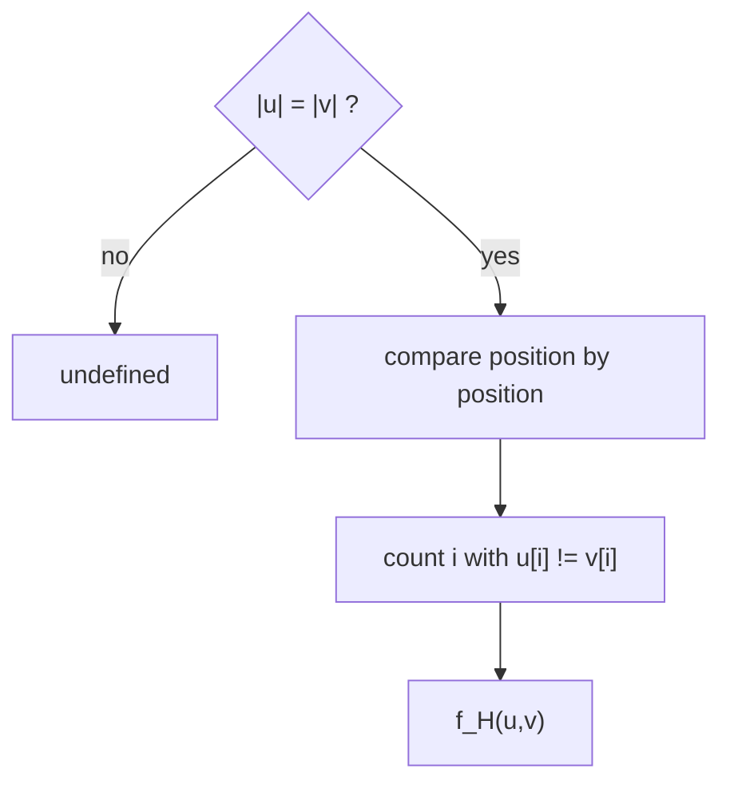

# Hamming Distance

## Definition

The Hamming distance (Hammingdistanz) `f_H(u,v)` — also written `d_H` — of two strings `u`, `v`
of **equal** length `n` counts the positions at which they differ (fsa_part1, p. 2):

```
f_H(u, v) = | { i | 1 <= i <= n , u[i] != v[i] } |
```

It is **only defined if `|u| = |v|`** (fsa_part1, p. 2). `u[i]` is the `i`-th character of `u`
(1-based).

## Why it matters

It is the cheapest sensible distance for sequences that are known to be positionally aligned —
no insertions or deletions are modelled. In the [[cost-function]] framework it is exactly the
**Hamming cost model**: replacements cost 0/1, indels cost `∞`, so no indel can ever be part of
an optimal alignment and `edist_δ` collapses to `f_H` (fsa_part1, p. 5).

## Construction / Mechanism



## Pseudocode

```text
ALGORITHM HammingDistance(u[1..n], v[1..n])
  d <- 0
  for i = 1 to n:
    if u[i] != v[i]:
      d <- d + 1
  return d
```

## Complexity

| Operation | Time | Space |
|---|---:|---:|
| `f_H(u,v)`, `|u| = |v| = n` | `O(n)` | `O(1)` |
| `edist_δ` under the Hamming cost model | `O(mn)` DP, but only the diagonal is finite | `O(mn)` |

## Worked example

`u = ACGTA`, `v = ACCTG`.

| `i` | 1 | 2 | 3 | 4 | 5 |
|---|---|---|---|---|---|
| `u[i]` | A | C | G | T | A |
| `v[i]` | A | C | C | T | G |
| differs? | – | – | ✓ | – | ✓ |

`f_H(u,v) = 2`.

> [!note] Inference
> The same pair has unit [[cost-function|edit distance]] 2 as well here, because no indel can beat
> two replacements on equal-length strings. In general the two measures diverge as soon as a
> single indel shifts a long common block: `u = ACGT`, `v = CGTA` has `f_H = 4` but unit edit
> distance 2.

## Pitfalls & exam traps

> [!warning]
> - Hamming distance is **undefined** for strings of different lengths — do not pad silently.
> - `f_H >= edist_δ` under unit cost whenever both are defined; never the other way round.
> - In the Hamming cost model `δ(α → ε) = ∞`, which violates the finiteness that the general
>   [[edit-graph]] shortest-path argument assumes for every edge; the DP still runs, but only the
>   main diagonal carries finite values.

## Related

- [[cost-function]] — the Hamming cost model is the special `δ` that forbids indels.
- [[edit-operation]] — Hamming distance only uses replacements, never indels.
- [[alignment]] — a Hamming comparison is the alignment with `h = m = n` and no gap columns.

- [[fsa_part1]] ? source page for this part of the module.

## Sources

- fsa_part1, pp. 2, 5 (`raw/foundations_sequence_analysis_part1.pdf`)
