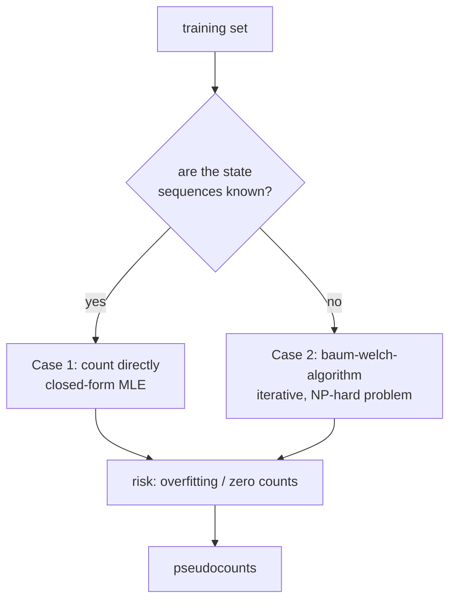

# HMM Parameter Training

## Definition

The problem of **constructing an HMM** has two parts (gik_1_2, p. 21):

1. **Determine the topology**: the number of states and their connections.
2. **Determine the parameters**: the transition probabilities `a_{k,q}` and the emission
   probabilities `e_k(b)`.

- **In**: a training set.
- **Goal**: set the parameters in such a way that the probability that the given training
  sequences are generated by the HMM is maximised.

This is [[maximum-likelihood-estimation|MLE]] applied to an HMM.

## Why it matters

An HMM is only as good as its parameters. The topology encodes the biological hypothesis (for
example `+`/`−` states for [[cpg-island|CpG islands]]), but every downstream answer —
[[viterbi-algorithm|decoding]], [[forward-algorithm|evaluation]],
[[posterior-decoding|posterior probabilities]] — is computed *from* `A` and `e`. Training is
therefore the step that turns a structural guess into a usable model, and it is also where the
two practical failure modes of the whole unit appear: overfitting on small training sets
(countered by [[pseudocounts]]) and the absence of a closed form when state sequences are
unknown (countered by [[baum-welch-algorithm|Baum–Welch]]).



## Case 1 — symbol and state sequences known (gik_1_2, p. 21)

Given `x₁, …, x_n` and `π¹, …, πⁿ`, choose parameters that best explain the data:

```
P(x₁,…,x_n, π¹,…,πⁿ | M = (Σ, Q, A, e))  ≥  P(x₁,…,x_n, π¹,…,πⁿ | M = (Σ, Q, A', e'))
                                                                     for all A', e'
```

The parameters are set by counting:

```
            A_{k,q}                              E_k(b)
ā_{k,q} = ─────────────            ē_k(b) = ─────────────────
          Σ(q') A_{k,q'}                     Σ(c ∈ Σ) E_k(c)
```

where `A_{k,q}` = number of times `k → q` occurs in the training sequences, and `E_k(b)` =
number of times state `k` produces symbol `b`.

## The overfitting problem

> [!warning]
> **Overfitting** (gik_1_2, p. 21):
> - if the transition `k → q` is never seen, then `ā_{k,q} = 0`;
> - if state `k` is never seen, then `ē_k(b)` is **undefined** (division by zero).
>
> A single zero transition probability makes every path using it impossible, no matter how
> strong the rest of the evidence. Solution: introduce [[pseudocounts]] `r_{k,q}` and `r_k(b)`.

## Case 2 — state sequences unknown

More realistic. Choose `(A, e)` maximising

```
P(x₁,…,x_n | M = (Σ, Q, A, e))  ≥  P(x₁,…,x_n | M' = (Σ, Q, A', e'))
```

This problem is **NP-hard** (gik_1_2, p. 22), so we settle for a heuristic that converges to a
local optimum: the [[baum-welch-algorithm|Baum–Welch algorithm]].

## Log-likelihood of a model

Training sequences are assumed **independent**, so
`P(x₁,…,x_n) = P(x₁) · … · P(x_n)`. The log-likelihood of the model `M` with respect to
sequences `x₁ … x_n` is (gik_1_2, p. 22):

```
σ(x₁,…,x_n) = log P(x₁,…,x_n | (A,e)) = Σ(j = 1 to n) log P(x_j | (A,e))
```

Each `P(x_j | (A,e))` can be evaluated by the [[forward-algorithm|Forward]] or
[[backward-algorithm|Backward]] algorithm. **The goal is to choose `(A, e)` that maximises the
log-likelihood.**

## Pitfalls & exam traps

> [!warning]
> - The topology (how many states, which connections) is **not** learned — it is a modelling
>   decision made before training.
> - Case 1 is plain counting and has a closed form; case 2 is NP-hard. Knowing which case a
>   question is in determines the entire answer.
> - Taking logs is what turns the product over independent sequences into a sum — the same trick
>   as in [[log-space-computation]].

## Related

- [[baum-welch-algorithm]] — the algorithm for case 2.
- [[pseudocounts]] — the fix for zero counts.
- [[maximum-likelihood-estimation]] — the principle being applied.
- [[hidden-markov-model]] — the model being trained.
- [[hmm-three-problems]] — training is the "learning" problem.

## Sources

- gik_1_2, pp. 21–22 (unit 2, "Training the parameters").
