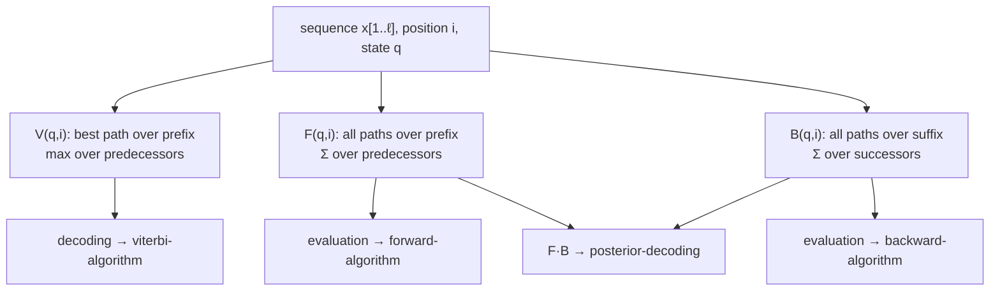

# The Three HMM Tables (V, F, B)

A side-by-side comparison of the three dynamic programming tables of unit 2. The lecture states
all three together on one page precisely because they are so easy to confuse
(gik_1_2, p. 19).

## Why it matters

Exam questions rarely ask "what is Forward?" in isolation; they ask which table answers a given
question, or hand over a recurrence and ask which algorithm it belongs to. Confusing `max` with
`Σ`, or a prefix table with a suffix table, changes the answer silently — the dimensions and the
`e_q(x[i])` factors all look alike. This page exists to make the three distinguishable at a
glance.

## The definitions

| Table | Definition | In words |
|---|---|---|
| `V(q, i)` | — | probability of the **most probable path** generating the symbol sequence `x[1..i]`, where the HMM is in state `q` |
| `F_x(q, i)` | `P(x[1..i], π_i = q)` | probability that the symbol sequence `x[1..i]` **is generated** and the HMM is in state `q` |
| `B_x(q, i)` | `P(x[i+1..ℓ], π_i = q)` | probability that the HMM **is in state `q`** and then the symbol sequence `x[i+1..ℓ]` is generated |

The distinction in one line: **`V` maximises, `F` and `B` sum. `V` and `F` look backwards over a
prefix; `B` looks forwards over a suffix.**



## Recurrences side by side

```text
V(q,i)   = e_q(x[i]) * max{ V(k,i-1)   * a_{k,q} | k in Q }
F_x(q,i) = e_q(x[i]) * SUM{ F_x(k,i-1) * a_{k,q} | k in Q }
B_x(q,i) =             SUM{ a_{q,k} * e_k(x[i+1]) * B_x(k,i+1) | k in Q }
```

Note where the emission factor sits: outside the sum for `V` and `F` (emission of `x[i]` in the
current state `q`), but *inside* the sum for `B` (emission of `x[i+1]` in the next state `k`).

## Initialisation and termination

| Table | Init | Termination |
|---|---|---|
| `V` | `V(q,0) = 1` if `q = 0`, else `0` | `P(x, π*) = max{ V(k,ℓ) a_{k,0} }` |
| `F` | `F_x(q,0) = 1` if `q = 0`, else `0` | `P(x\|M) = Σ{ F_x(k,ℓ) a_{k,0} }` |
| `B` | `B_x(q,ℓ) = a_{q,0}` | `P(x\|M) = Σ{ a_{0,k} e_k(x[1]) B_x(q,1) }` |

## Complexity

All three: `O(|Q|² · ℓ)` time and `O(|Q| · ℓ)` space.

## Pitfalls & exam traps

> [!warning]
> - `F` and `B` must agree on `P(x | M)`. If they do not, the bug is almost always the shifted
>   emission index in `B`.
> - All three are **joint**, not conditional, probabilities. Converting to a conditional requires
>   dividing by `P(x)` — that is the step [[posterior-decoding]] performs.

## Related

- [[viterbi-algorithm]], [[forward-algorithm]], [[backward-algorithm]] — the algorithms.
- [[posterior-decoding]] — the product `F·B / P(x)`.
- [[hidden-markov-model]] — the underlying model.
- [[hmm-three-problems]] — which problem each table answers.

## Sources

- gik_1_2, p. 19 (unit 2, "Three Tables").
