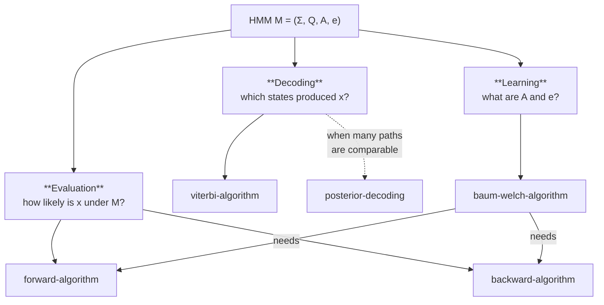

# The Three HMM Problems

## Definition

Let `M` be an HMM and `x` a sequence. The lecture frames all of unit 2's algorithmic content as
three problems (gik_1_2, p. 16):

| Problem | Task | Algorithm | Output |
|---|---|---|---|
| **Decoding** | determine the most probable sequence of states in `M` generating `x` | [[viterbi-algorithm\|Viterbi]] | a path `π*` |
| **Evaluation** | determine the probability that `M` generates `x`, i.e. `P(x \| M)` | [[forward-algorithm\|Forward]] or [[backward-algorithm\|Backward]] | a number |
| **Learning** | given some set of sequences of symbols, train the parameters of `M` | [[baum-welch-algorithm\|Baum–Welch]] | parameters `(A, e)` |

## Why it matters

The dependency structure is the point: **learning is built on evaluation**. Baum–Welch calls
Forward and Backward inside every iteration. So the order of study is evaluation → decoding →
learning, and an exam question on Baum–Welch is implicitly a question on Forward/Backward too.

## Which to use when

| Situation | Use |
|---|---|
| Want the single best state assignment, paths well separated | [[viterbi-algorithm]] |
| Many paths have comparable probability, `P(x,π) ≈ P(x,π*)` | [[posterior-decoding]] |
| Want a per-position probability of a property (e.g. "is this in an island?") | [[posterior-decoding]] |
| Want to compare two models on the same data | evaluation via [[forward-algorithm]] |
| State sequences known in training data | direct counting — [[hmm-parameter-training]] |
| State sequences unknown in training data | [[baum-welch-algorithm]] |

## Complexity

| Problem | Time |
|---|---|
| Decoding (Viterbi) | `O(\|Q\|² · ℓ)` |
| Evaluation (Forward/Backward) | `O(\|Q\|² · ℓ)` |
| Learning (Baum–Welch) | `O(\|Q\|² · ℓ · n)` per iteration, over `n` sequences |

## Pitfalls & exam traps

> [!warning]
> Decoding and evaluation sound similar but answer different questions: decoding asks *which*
> path, evaluation asks *how likely overall*, summing over all paths. The algorithms differ by
> exactly one operator (`max` vs `Σ`) — see [[hmm-tables-comparison]].

## Related

- [[hidden-markov-model]] — the model definition.
- [[hmm-tables-comparison]] — the three DP tables.
- [[hmm-parameter-training]] — the learning problem in detail.

## Sources

- gik_1_2, p. 16 (unit 2, "Problems").
