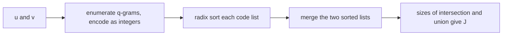

# Jaccard Index

## Definition

For two sets `U` and `V`, the **Jaccard index** (Jaccard-Index) is (fsa_part2, p. 10):

```
J(U, V) = |U ∩ V| / |U ∪ V|
```

Properties:

- `0 <= J(U, V) <= 1`
- `U ∩ V = ∅  =>  J(U, V) = 0`
- `U = V      =>  J(U, V) = 1`

It is a **similarity**, not a distance: much in common → large `J` → small distance.

## Why it matters

Applied to [[q-gram]] sets it gives an alignment-free sequence similarity that is computable in
`O(m+n)` — faster than [[q-gram-distance]], which carries an `O(r^q)` term (fsa_part2, p. 10). It
is the quantity that [[minhash-sketch]] estimates from constant-size sketches and from which
[[mash-distance]] derives a mutation rate.

## Construction / Mechanism — Jaccard on q-gram sets

Let `G_q(u)` and `G_q(v)` be the **sets** of all q-grams of `u` and `v`. Then (fsa_part2, p. 10):

```
J(u, v) = J( G_q(u), G_q(v) )
```

Common q-grams are found in linear time by a three-pass code-sort-merge pipeline
(fsa_part2, p. 10):



Each stage is `O(m+n)`: encoding uses the constant-time rolling update of [[q-gram]]; radix sort is
linear because the keys are bounded integers in `[0, r^q - 1]`; the merge increments a counter
whenever the two current values are equal ("wenn Werte gleich dann ++", fsa_part2, p. 10).

## Pseudocode

```text
ALGORITHM JaccardQgram(u[1..m], v[1..n], q, r)
  Cu <- QgramCodes(u, q, r)                   // O(m), constant-time rolling update
  Cv <- QgramCodes(v, q, r)                   // O(n)
  radix-sort Cu; remove duplicates            // O(m), keys in [0, r^q - 1]
  radix-sort Cv; remove duplicates            // O(n)
  a <- 1;  b <- 1;  inter <- 0;  union <- 0
  while a <= |Cu| or b <= |Cv|:
    if a > |Cu|:                 union <- union + 1;  b <- b + 1
    else if b > |Cv|:            union <- union + 1;  a <- a + 1
    else if Cu[a] = Cv[b]:       inter <- inter + 1
                                 union <- union + 1
                                 a <- a + 1;  b <- b + 1
    else if Cu[a] < Cv[b]:       union <- union + 1;  a <- a + 1
    else:                        union <- union + 1;  b <- b + 1
  return inter / union
```

## Complexity

| Operation | Time | Space |
|---|---:|---:|
| Enumerate + encode q-grams of `u` and `v` | `O(m+n)` | `O(m+n)` |
| Radix sort both code lists | `O(m+n)` | `O(m+n)` |
| Merge to find common elements | `O(m+n)` | `O(1)` extra |
| **Total** | `O(m+n)` | `O(m+n)` |
| Compare: `qgdist` | `O(m+n+r^q)` | `O(m+n+r^q)` |

The q-gram set Jaccard index is **faster than the q-gram distance** because no array over all of
`A^q` is ever allocated (fsa_part2, p. 10).

## Worked example

`A = {a, c}` (`r = 2`), `q = 2`, `u = a a c a`, `v = a c a c`.

- `G_2(u) = {aa, ac, ca}` → codes `{0, 1, 2}`
- `G_2(v) = {ac, ca, cc}` → codes `{1, 2, 3}`

Merge of the sorted code lists `[0,1,2]` and `[1,2,3]`:

| step | `Cu[a]` | `Cv[b]` | action | inter | union |
|---|---:|---:|---|---:|---:|
| 1 | 0 | 1 | `Cu < Cv`, advance `a` | 0 | 1 |
| 2 | 1 | 1 | equal, `++`, advance both | 1 | 2 |
| 3 | 2 | 2 | equal, `++`, advance both | 2 | 3 |
| 4 | — | 3 | `Cu` exhausted, advance `b` | 2 | 4 |

`J(u, v) = 2 / 4 = 0.5`.

## Pitfalls & exam traps

> [!warning]
> - `G_q(u)` is a **set** — duplicate q-gram occurrences are collapsed. This is the key difference
>   to the profile `P_{u,q}`, which counts multiplicities. Mash explicitly "ignores duplicates of
>   q-grams" (fsa_part2, p. 14).
> - `J = 1` means identical q-gram sets, which does **not** imply identical sequences (same
>   weakness as `qgdist`'s failed zero property).
> - `J` is a similarity; distances derived from it (see [[mash-distance]]) must invert it.
> - Radix sort is linear only because the keys are bounded by `r^q`; a comparison sort would make
>   the pipeline `O(n log n)`.
> - The union must be counted during the merge, not computed as `|Cu| + |Cv|` — that double-counts
>   the intersection.

## Related

- [[q-gram]] — supplies `G_q(u)` and the integer codes that make radix sort applicable.
- [[q-gram-distance]] — the profile-based alternative, slower by the `O(r^q)` term.
- [[minhash-sketch]] — estimates `J` from bottom-`s` sketches in `O(s)` instead of `O(m+n)`.
- [[mash-distance]] — turns `J_est` into a mutation rate via the Poisson model.
- [[average-nucleotide-identity]] — the alignment-based gold standard `J`-derived distances are
  validated against.
- [[fragment-assembly]] — overlap detection in long reads is a stated application.
- [[fsa_part2]] — source page for this unit.

## Sources

- fsa_part2, pp. 10, 12 (raw file `raw/foundations_seqzence_analysis_part2.pdf`)
