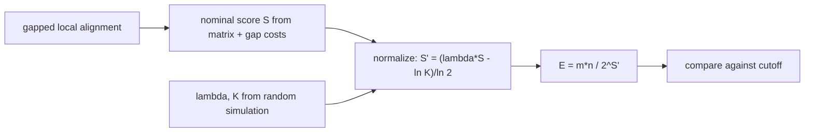

# Karlin-Altschul Statistics

## Definition

**Karlin–Altschul statistics** report the statistical significance of a gapped local alignment as
an **E-value** (fsa_part2, p. 26). The E-value is the number of local alignments with at least the
same score that one expects when comparing a **random** query sequence of typical amino-acid
composition against a **random** database sequence.

Three steps (fsa_part2, p. 26):

1. **Nominal score `S`** — the raw score of the local alignment, computed from a scoring matrix and
   gap costs.
2. **Normalized score (bit score) `S'`**:

```
S' = (λ·S - ln K) / ln 2
```

3. **E-value**:

```
E = Q / 2^{S'} = (m · n) / 2^{S'}
```

Symbols: `S` — nominal (raw) score; `S'` — normalized score; `λ`, `K` — statistical parameters of
the scoring system, **pre-computed by random simulation**; `m`, `n` — the lengths of the two
compared sequences, whose product `Q = m·n` is the size of the search space.

## Why it matters

Raw scores are not comparable across scoring matrices, gap models or database sizes: a score of 50
means something different for BLOSUM62 than for a DNA match/mismatch scheme. Normalising by `λ` and
`K` puts every alignment on one scale (bits), and multiplying by the search space `m·n` converts
that into an expected count of chance hits. This is the final stage (stage 5) of [[blast]], used to
determine the cutoff parameter (fsa_part2, p. 26).

## Construction / Mechanism



The normalisation is an exponential-to-bit conversion: dividing by `ln 2` expresses the score in
bits, so each extra bit of `S'` halves the expected number of chance alignments.

## Pseudocode

```text
ALGORITHM EValue(A, sigma, gapcosts, lambda, K, m, n)
  S  <- score of alignment A under sigma and gapcosts     // nominal score
  S' <- (lambda * S - ln K) / ln 2                        // normalized (bit) score
  E  <- (m * n) / 2^(S')
  return E
```

## Complexity

| Operation | Time | Space |
|---|---:|---:|
| Nominal score `S` of an alignment of length `L` | `O(L)` | `O(1)` |
| Normalized score `S'` and `E` from `S` | `O(1)` | `O(1)` |
| Estimation of `λ`, `K` | offline, by random simulation | — |

(fsa_part2, p. 26)

## Worked example

Take `λ = 0.267`, `K = 0.041` (typical BLOSUM62-style values), `S = 100`, `m = 1000`, `n = 10^6`.

1. `λ·S = 26.7`
2. `ln K = ln 0.041 = -3.194`, so `λ·S - ln K = 29.894`
3. `S' = 29.894 / ln 2 = 29.894 / 0.6931 = 43.13` bits
4. `2^{S'} = 2^{43.13} ≈ 9.6 · 10^{12}`
5. `E = (10^3 · 10^6) / 9.6·10^{12} = 10^9 / 9.6·10^{12} ≈ 1.0 · 10^{-4}`

Expect about `0.0001` alignments this good by chance — highly significant.

Effect of the search space, same `S'`:

| `m` | `n` | `Q = m·n` | `E` |
|---:|---:|---:|---:|
| 1000 | 10^6 | 10^9 | `1.0·10^{-4}` |
| 1000 | 10^9 | 10^12 | `1.0·10^{-1}` |
| 1000 | 10^10 | 10^13 | `1.0` |

Each 10× growth of the database multiplies `E` by 10 — the same alignment becomes less significant
in a bigger database.

> [!note] Inference
> The numeric values of `λ` and `K` above are illustrative; the page states only that they are
> pre-computed by random simulation and gives no concrete numbers.

## Pitfalls & exam traps

> [!warning]
> - `E` is an **expected count**, not a probability. It may exceed 1. Low `E` = significant.
> - `λ` and `K` depend on the **scoring system** (matrix and gap costs) and on the background
>   composition. Changing the matrix invalidates them.
> - `ln K` is **subtracted** in the numerator, and the division is by `ln 2` — not `log_2 K`, not
>   `log_2 S`.
> - `E` grows linearly with the search space `Q = m·n`: a hit that is significant against one
>   sequence may be noise against a whole database.
> - The E-value is computed for **gapped** local alignments at stage 5; MSPs at stage 3 are scored
>   by a separate significance threshold (fsa_part2, p. 25).
> - `S'` is in bits, so `2^{S'}` (not `e^{S'}`) appears in the denominator.

## Related

- [[blast]] — stage 5 of BLAST; this is where the E-value is produced and reported.
- [[alignment-significance]] — the general question of when a local alignment score is meaningful.
- [[score-function]] — supplies the nominal score `S`.
- [[gap-cost-model]] — the gap costs entering `S` (affine, in BLAST's gapped extension).
- [[position-specific-scoring-matrix]] — an alternative scoring system that would require its own
  `λ`, `K`.
- [[smith-waterman]] — the exact local-alignment method whose results BLAST approximates.
- [[fsa_part2]] — source page for this unit.

## Sources

- fsa_part2, p. 26 (raw file `raw/foundations_seqzence_analysis_part2.pdf`)
