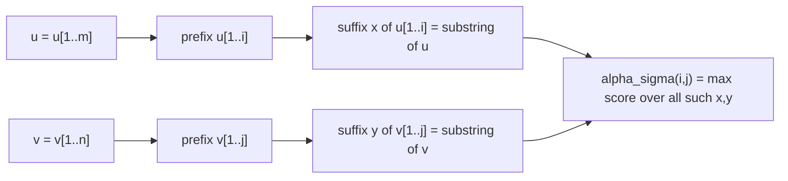

# Local Similarity

## Definition

Let `σ` be a [[score-function]]. The **local similarity** (lokale Ähnlichkeit) of `u` and `v` is
(fsa_part1, p. 14):

```
loc_σ(u, v) = max { score_σ(u', v') | u' is a substring of u , v' is a substring of v }
```

If `u'`, `v'` attain this maximum, any [[alignment]] `A` of `u'` and `v'` with
`score_σ(u',v') = σ(A)` is an **optimal local alignment** of `u` and `v`. The **local alignment
problem** is to compute `loc_σ(u,v)` and an optimal local alignment (fsa_part1, p. 14).

## Why it matters

Global comparison is often the wrong question (fsa_part1, p. 13):

- DNA sequences carry large **non-coding regions** and small **coding regions**; the signal lives
  in the small part.
- Protein sequences contain **domains** shared with related sequences; if only the domains are
  similar, a global comparison hides the relationship.
- Two large sequences being similar does **not** imply small `edist_δ(u,v)` — the script
  explicitly strikes that implication out (fsa_part1, p. 13).

So one looks for pairs of **similar substrings** of `u` and `v`.

> [!warning] Why it must be a score, not a distance
> It makes no sense to look for substring pairs with minimum *distance*: `ε` is a substring of any
> sequence and `edist_δ(ε, ε) = 0`, so the minimum is trivially 0 and attained everywhere
> (fsa_part1, p. 13). Maximising a score with negative contributions is the fix.

## Construction / Mechanism

**Key observation:** a substring is a **suffix of a prefix** (fsa_part1, p. 14).



This turns a quadruple quantification (start and end in each sequence) into a double one: fix the
two *ends* `(i,j)` and let the DP find the best starts. Define the `(m+1) × (n+1)` matrix
(fsa_part1, p. 15):

```
α_σ(i, j) = max { score_σ(x, y) | x is a suffix of u[1..i] and y is a suffix of v[1..j] }
```

Then

```
loc_σ(u, v) = max { α_σ(i, j) | 0 <= i <= m , 0 <= j <= n }
```

The recurrence (valid for `σ` satisfying `(3.3)`, see [[smith-waterman]]) adds a `0` to the
three-way maximum. The `0` **suppresses prefixes with negative score**, so similar substrings
appear as **positive islands** in a matrix dominated by zeros (fsa_part1, p. 15).

## Complexity

| Approach | Time | Space |
|---|---:|---:|
| Brute force over all substring pairs | `O(m³n³)` | `O(mn)` |
| One `score_σ(u',v')` (global, maximising) | `O(mn)` | `O(mn)` |
| `α_σ` matrix ([[smith-waterman]]) | `O(mn)` | `O(mn)` |

(fsa_part1, pp. 14, 16.) The brute force figure comes from `O(m²)` substrings of `u` times
`O(n²)` of `v` times `O(mn)` per global alignment.

## Worked example

`u = TTACGTT`, `v = GGACGGG`, with `σ`: match `+2`, mismatch `−1`, indel `−2`.

The shared substring is `ACG`. Local alignment:

```
A C G
A C G
```

`loc_σ(u,v) = 2 + 2 + 2 = 6`, attained at `u' = u[3..5]`, `v' = v[3..5]`.

The global score would be far worse: the flanking `TT…TT` vs `GG…GGG` contributes mismatches and
indels, dragging the total below 6 — this is the "positive island" effect in miniature.

## Pitfalls & exam traps

> [!warning]
> - `loc_σ` is a **max of maxima**: over substring pairs *and* over alignments of each pair.
> - `α_σ(i,j)` is a *best score ending at `(i,j)`*, not the local similarity of the two prefixes.
>   The script explicitly crosses out the claim `α_σ(i,j)` solves `loc_σ(u[1..i], v[1..j])`
>   (fsa_part1, p. 15).
> - `loc_σ(u,v) >= 0` always, because `x = y = ε` is admissible and scores 0.
> - The `0` in the recurrence is what makes it *local*; delete it and you get a (semi-)global
>   maximising DP.

## Related

- [[score-function]] — supplies `σ` and the condition (3.3).
- [[smith-waterman]] — the `O(mn)` algorithm computing `α_σ` and the traceback.
- [[edit-graph]] — `α_σ` lives on the same node set; only the admissible start/end nodes change.
- [[alignment]] — the local alignment is an ordinary alignment of two substrings.
- [[overlap-alignment]] — another relaxation of the endpoint constraints.

- [[fsa_part1]] ? source page for this part of the module.

## Sources

- fsa_part1, pp. 13–16, 24 (`raw/foundations_sequence_analysis_part1.pdf`)
