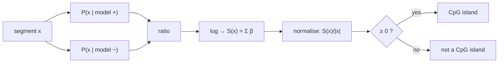

# Log-Odds Score

## Definition

Given a sequence `x = (x₁, …, x_ℓ)` and two competing [[markov-chain|Markov chains]], the
**log-odds score** is the logarithm of the ratio of the two model probabilities
(gik_1_2, p. 14):

```
            P(x | model +)        ℓ+1        a⁺_{x_(i−1), x_i}
S(x) = log ─────────────── = Σ   log ───────────────────────
            P(x | model −)       i=1        a⁻_{x_(i−1), x_i}
```

where, with `x₀ = b` and `x_(ℓ+1) = e`:

```
P(x | model +) = ∏(i = 1 to ℓ+1) a⁺_{x_(i−1), x_i}
P(x | model −) = ∏(i = 1 to ℓ+1) a⁻_{x_(i−1), x_i}
```

Precomputing the per-transition contributions gives a simple sum:

```
β_{s,t} = log( a⁺_{s,t} / a⁻_{s,t} )

S(x) = Σ(i = 1 to ℓ+1) β_{x_(i−1), x_i}
```

A larger `β` means larger importance for that transition.

## Why it matters

This answers question 1 of [[cpg-island]]: decide whether a given segment comes from a CpG
island. **The higher the log-odds score `S(x)`, the higher the probability that `x` is a CpG
island** (gik_1_2, p. 14).

Because segments differ in length, normalise before comparing:

```
S(x) / |x| ≥ 0   ⇒  more likely a CpG island
```



## Pseudocode

```text
ALGORITHM LogOddsScore(x[1..ℓ], A_plus, A_minus)
  In:  sequence x, transition matrices A⁺ and A⁻ (with begin state b, end state e)
  Out: normalised log-odds score

  // precompute the score table once for all queries
  for each state s, t:
    β[s][t] <- log( A_plus[s][t] / A_minus[s][t] )

  S    <- 0
  prev <- b
  for i = 1 to ℓ:
    S    <- S + β[prev][x[i]]
    prev <- x[i]
  S <- S + β[prev][e]

  return S / ℓ
```

## Worked example

Suppose `β_{C,G} = +1.4` (CpG far more likely in islands) and `β_{A,A} = −0.3`. For a segment
whose transitions are `C→G, G→C, C→G`, with `β_{G,C} = +0.9`:

```
S(x) = 1.4 + 0.9 + 1.4 = 3.7      S(x)/|x| = 3.7 / 4 ≈ 0.93 ≥ 0  ⇒  CpG island
```

## Complexity

| Step | Cost |
|---|---|
| Precomputing `β` | `O(\|S\|²)`, once |
| Scoring a segment of length `ℓ` | `O(ℓ)` |

## Pitfalls & exam traps

> [!warning]
> - **Normalise by length.** An unnormalised `S(x)` grows with `ℓ`, so long non-island segments
>   can outscore short island segments.
> - The log turns the product into a sum — this is both a speed and a
>   [[log-space-computation|numerical-stability]] win, not just cosmetic.
> - If any `a⁻_{s,t} = 0` the ratio diverges; see [[pseudocounts]].
> - The score compares **two models against each other**; it is not a probability. It contains
>   no prior, unlike [[prior-posterior-probability|a full Bayesian posterior]].

## Related

- [[markov-chain]] — the two chains `A⁺` and `A⁻` being compared.
- [[cpg-island]] — the classification problem this solves.
- [[prior-posterior-probability]] — the prior-weighted alternative.
- [[hidden-markov-model]] — needed when the island boundaries are unknown.
- [[log-space-computation]] — the general technique.

## Sources

- gik_1_2, p. 14 (unit 2).
