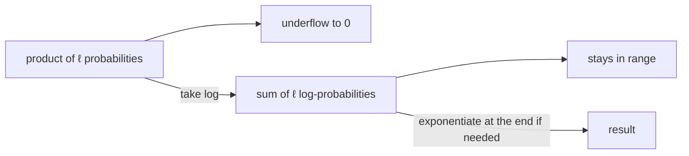

# Log-Space Computation

## Definition

Replacing products of many probabilities by sums of their logarithms, to avoid numerical
underflow. The identity that makes it work, from exercise 1.3 (gik_1_2, p. 25):

```
x = e^(log x)              log(a · b) = log a + log b

a · b = e^(log(a·b)) = e^(log a + log b)
```

## Why it matters

Every sequence model in this module multiplies `O(ℓ)` probabilities together. With `ℓ` in the
thousands, the result underflows to 0 in floating point and all information is lost. The lecture
notes it directly for Viterbi: **normally use log instead of multiplying, and sum up**
(gik_1_2, p. 17).



## Worked example — exercise 1.3 (gik_1_2, p. 25)

Start from the HMM joint probability ([[hidden-markov-model]]):

```
P(x, π) = a_{0,π₁} · ∏(i = 1 to ℓ) e_{π_i}(x[i]) · a_{π_i, π_(i+1)}
```

Rewrite it through the exponential of its logarithm:

```
P(x, π) = e^( log( a_{0,π₁} · ∏(i=1..ℓ) e_{π_i}(x[i]) · a_{π_i,π_(i+1)} ) )

        = e^( log(a_{0,π₁}) + Σ(i=1..ℓ) log( e_{π_i}(x[i]) · a_{π_i,π_(i+1)} ) )

        = e^( log(a) + Σ(i=1..ℓ) [ log(e) + log(a) ] )
```

So the product collapses into a single sum of logarithms inside one exponential.

### Viterbi in log space

Because `log` is strictly increasing, it commutes with `max`, so the
[[viterbi-algorithm|Viterbi]] recurrence transfers directly:

```text
log V(q,i) = log(e_q(x[i])) + max{ log V(k,i-1) + log a_{k,q} | k in Q }

// at the end:
return e^P      // exponentiate only if the actual probability is needed
```

Every multiplication has become an addition, and the `max` is unaffected.

## Pitfalls & exam traps

> [!warning]
> - `log` commutes with `max` but **not with `+`**. [[viterbi-algorithm|Viterbi]] transfers to
>   log space trivially; [[forward-algorithm|Forward]] and [[backward-algorithm|Backward]] do
>   not, because they sum. Those need the log-sum-exp trick:
>   `log(Σ e^{l_i}) = l_max + log(Σ e^{l_i − l_max})`.
> - `log 0 = −∞`. Any zero probability propagates as `−∞` — another reason for
>   [[pseudocounts]].
> - Do not exponentiate intermediate values "to check them"; that reintroduces the underflow
>   you just removed.

## Related — the sigmoid connection

Exercise 2.1 ([[sheet-02]]) applies the same algebra in reverse: a posterior probability of the
form `P(ext | x)` is rewritten as

```
P(ext | x) = exp( −log( 1 + exp( ŷ − p̂ ) ) )
```

with `ŷ = log P(int) + Σ log f_x^int` and `p̂ = log P(ext) + Σ log f_x^ext`. That is exactly a
[[sigmoid-function|sigmoid]] in the log-likelihood difference — so the S-curve of unit 1 page 1
and the log-space manipulations of unit 2 are the same mathematics.

## Related

- [[viterbi-algorithm]] — the main consumer of this technique.
- [[log-odds-score]] — another product-to-sum conversion.
- [[sigmoid-function]] — reappears via exercise 2.1.
- [[pseudocounts]] — prevents `log 0`.
- [[sheet-01]], [[sheet-02]] — the exercises deriving all of this.

## Sources

- gik_1_2, p. 17 (unit 2, Viterbi note); exercise 1.3, p. 25; exercise 2.1, p. 26.
