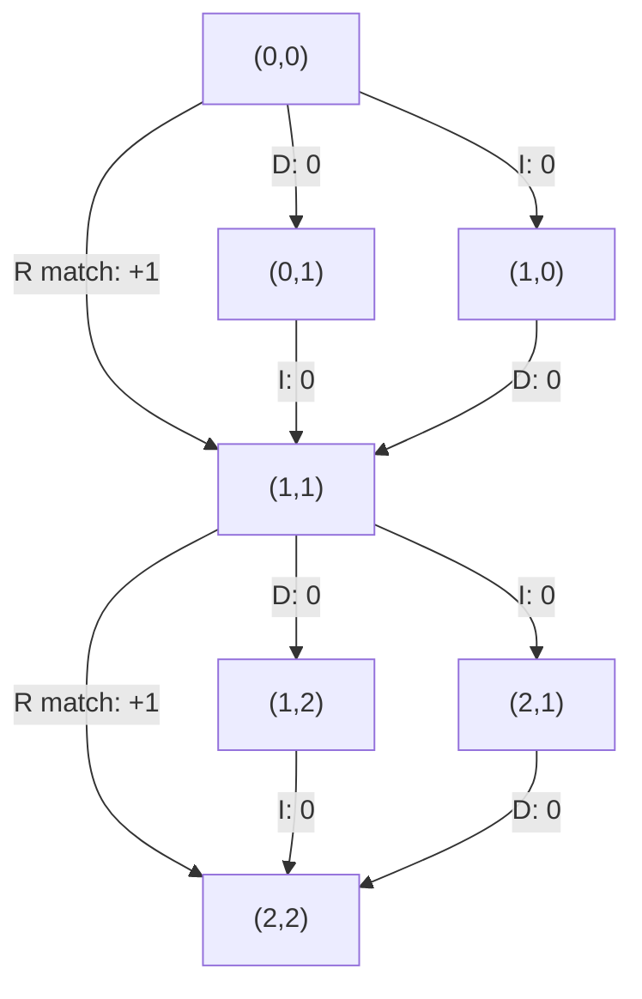

# Longest Common Subsequence

## Definition

Let `u` with `|u| = m` and `v` with `|v| = n`. A **common subsequence** (gemeinsame Subsequenz) of
`u` and `v` is a sequence of index pairs `(i_1, j_1), ..., (i_r, j_r)` with

1. `1 <= i_1 < ... < i_r <= m`
2. `1 <= j_1 < ... < j_r <= n`
3. `u[i_h] = v[j_h]` for all `1 <= h <= r`

(fsa_part2, p. 1). The **longest common subsequence** (LCS) is a common subsequence of maximal
`r`. Both index lists must be *strictly* increasing, so the matched characters keep their relative
order in both sequences, but they need not be contiguous.

Symbols: `u`, `v` — the two sequences; `m`, `n` — their lengths; `r` — the number of matched pairs;
`i_h`, `j_h` — the position of the `h`-th match in `u` and in `v`.

## Why it matters

LCS is the match-maximising counterpart of [[unit-edit-distance]]: instead of minimising edit
operations it maximises the number of equal character pairs. It is the simplest instance of the
edit-graph/path formalism that also underlies [[edit-distance-dp]] and [[alignment]]
(fsa_part2, p. 1).

## Construction / Mechanism — the LCS graph

The **LCS graph** (LCS-Graph) is the lattice (fsa_part2, p. 1):

- **Nodes** `(i, j)` with `0 <= i <= m`, `0 <= j <= n`; node `(i, j)` stands for the prefix pair
  `u[1..i]`, `v[1..j]`.
- **Edges**: `I` (insertion, vertical), `D` (deletion, horizontal), `R` (replacement, diagonal).
  The diagonal edge exists **only** where `u[i] = v[j]` — it is a pure *match* edge.
- **Edge weights**: `I` and `D` carry weight `0`, a match edge carries `+1`.

The length of the LCS is the weight of the **maximising path** (maximierender Pfad) from `(0,0)`
to `(m,n)` (fsa_part2, p. 1).



> [!warning]
> This is **not** the general edit graph: a diagonal edge is present only on equality. There is no
> mismatch edge, so a mismatch must be paid for by one `I` plus one `D`.

## Pseudocode

`LCS_δ(i, j)` is the length of the LCS of `u[1..i]` and `v[1..j]`. The matrix has size
`(m+1) x (n+1)` (fsa_part2, p. 1).

```text
LCS_δ(i, j) =
    0                                      , if i = 0 or j = 0
    LCS_δ(i-1, j-1) + 1                    , if u[i] = v[j]
    max{ LCS_δ(i-1, j), LCS_δ(i, j-1) }    , otherwise
```

```text
ALGORITHM LCS(u[1..m], v[1..n])
  for i = 0 to m:  LCS[i][0] <- 0
  for j = 0 to n:  LCS[0][j] <- 0
  for i = 1 to m:
    for j = 1 to n:
      if u[i] = v[j]:
        LCS[i][j] <- LCS[i-1][j-1] + 1
      else:
        LCS[i][j] <- max( LCS[i-1][j], LCS[i][j-1] )
  return LCS[m][n]
```

## Complexity

| Operation | Time | Space |
|---|---:|---:|
| Fill the `(m+1) x (n+1)` LCS matrix | `O(m·n)` | `O(m·n)` (fsa_part2, p. 1) |
| Length only (two rows suffice) | `O(m·n)` | `O(min{m, n})` |

> [!note] Inference
> The two-row space variant is not stated on p. 1; it follows directly because the recurrence reads
> only row `i-1` and row `i`.

## Worked example

`u = a c b`, `v = a b c b` (`m = 3`, `n = 4`). Rows are `i = 0..3`, columns `j = 0..4`.

| `LCS_δ` | j=0 | j=1 (a) | j=2 (b) | j=3 (c) | j=4 (b) |
|---|---:|---:|---:|---:|---:|
| **i=0** | 0 | 0 | 0 | 0 | 0 |
| **i=1 (a)** | 0 | 1 | 1 | 1 | 1 |
| **i=2 (c)** | 0 | 1 | 1 | 2 | 2 |
| **i=3 (b)** | 0 | 1 | 2 | 2 | 3 |

`LCS_δ(3,4) = 3`; the maximising path uses the match edges `(1,1)`, `(2,3)`, `(3,4)`, i.e. the
common subsequence `a c b` with index pairs `(1,1), (2,3), (3,4)`.

## Part 3 addendum — the LCS length formula

Part 3 relates the LCS length directly to the edit distance (fsa_part3, p. 3):

```
lcslen(u, v) = ( m + n − edist_δ(u, v) ) / 2
```

with `m = |u|`, `n = |v|`. Either quantity determines the other, so one DP table suffices for both.

**Where it comes from.** In the LCS graph only `I`, `D` and *match* edges exist, so an optimal
"alignment" consists of `lcslen` matched pairs plus pure indels. The matched pairs consume
`2·lcslen` characters; the remaining `m + n − 2·lcslen` characters are each paid for by one indel
of cost 1. Hence `edist_δ(u,v) = m + n − 2·lcslen(u,v)`, which rearranges to the formula above.

> [!warning]
> The formula holds for the **indel-only** cost model (the LCS cost model: insertion and deletion
> cost 1, replacement **not available**, matches free). It is *not* valid for the general unit cost
> of [[unit-edit-distance]], where a replacement costs 1 rather than 2. Counterexample:
> `u = ab`, `v = cd` have `lcslen = 0`, but unit `edist_δ = 2` gives `(2+2−2)/2 = 1 ≠ 0`. With the
> indel-only distance `edist = 4` the formula is correct again: `(2+2−4)/2 = 0` ✓.

> [!note] Inference
> p. 3 writes `edist_δ` without naming the cost model. The derivation and the counterexample above
> identify it as the indel-only model; this is not stated in the source.

**Check against the worked example above.** `u = acb` (`m = 3`), `v = abcb` (`n = 4`),
`lcslen = 3`. The indel-only distance is 1 (insert the second `b`), so
`(3 + 4 − 1)/2 = 6/2 = 3` ✓.

Second check: `u = ACGT` (`m = 4`), `v = AGT` (`n = 3`), `lcslen = 3` (`AGT`), indel-only
distance 1 (delete `C`): `(4 + 3 − 1)/2 = 3` ✓.

## Pitfalls & exam traps

> [!warning]
> - Subsequence `!=` substring: the matched positions need not be contiguous. Contiguity is the
>   subject of [[maximal-matches-distance]].
> - The diagonal edge in the LCS graph is *conditional* on `u[i] = v[j]`; drawing a full diagonal
>   lattice turns LCS into ordinary alignment.
> - Index pairs must be strictly increasing in **both** coordinates — one character may be used
>   only once.
> - The boundary row and column are `0`, not `i·d`/`j·d` as in weighted alignment.

## Related

- [[edit-graph]] — the general lattice of which the LCS graph is the match-only special case.
- [[unit-edit-distance]] — minimises operations where LCS maximises matches; both are paths in the
  same lattice.
- [[edit-distance-dp]] — the same `O(mn)` DP schema with a cost-minimising recurrence.
- [[alignment]] — a path in the graph read as a two-row alignment.
- [[maximal-matches-distance]] — the contiguous-block alternative to subsequence matching.
- [[fsa_part2]] — source page for this unit.
- [[fsa_part3]] — source page for the LCS length formula.

## Sources

- fsa_part2, p. 1 (raw file `raw/foundations_seqzence_analysis_part2.pdf`)
- fsa_part3, p. 3 (`raw/foundations_sequence_analysis_part3.pdf`) — the `lcslen` formula
