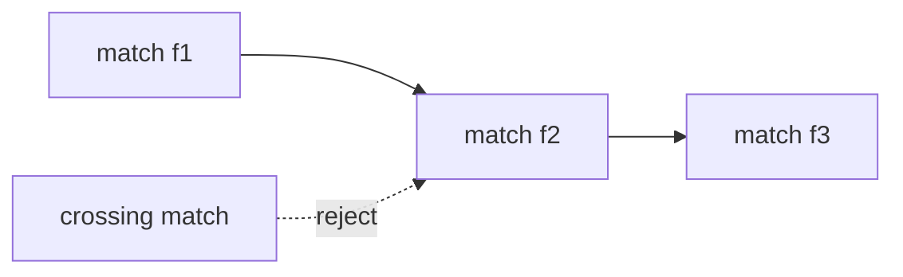

# Match Chaining

## Definition

Given weighted matches between two sequences, match chaining asks for a maximum-score chain of collinear non-overlapping matches. For matches `f` and `f'`, the notes use `f << f'` when `e(f).x < s(f').x` and `e(f).y < s(f').y` (gik_3_4, pp. 28-30).

## Why it matters

It is the combinatorial core of [[anchor-based-sequence-comparison]]: choose a consistent anchor chain before aligning the regions between anchors (gik_3_4, p. 26). Unit 5 names [[maximal-unique-match|MUMs]] as exact anchors that are first found, then chained, then separated gaps are aligned by dynamic programming (gik_5, p. 22).

## Construction / Mechanism



## Pseudocode

```text
ALGORITHM IsValidChain(f[1..k])
  for i = 1 to k - 1:
    if not (EndX(f[i]) < StartX(f[i+1]) and EndY(f[i]) < StartY(f[i+1])):
      return false
  return true
```

## Complexity

| Operation | Time | Space |
|---|---:|---:|
| Validate chain of `k` matches | `O(k)` | `O(1)` |
| Score chain | `O(k)` | `O(1)` |
| Optimise, simple DP | `O(b^2)` | `O(b)` |
| Optimise, dictionary sweep | `O(b log b)` | `O(b)` |

## Worked example

If `f=(u:1..3,v:2..4)` and `g=(u:5..7,v:8..10)`, then `f<<g` and the chain score is `weight(f)+weight(g)`. A match starting at `v=3` after `f` would overlap/cross in the second sequence (gik_3_4, pp. 28-30).

## Pitfalls & exam traps

> [!warning]
> - Use strict inequalities for non-overlap.
> - Sorting by one coordinate is not enough; test both coordinates.
> - Global chaining does not subtract gaps; [[sheet-04]] local chaining does.

## Related

- [[match-chaining-algorithm]] — algorithms for the optimisation.
- [[anchor-based-sequence-comparison]] — uses chains as anchors.
- [[sheet-04]] — gap-penalised local version.

## Sources

- gik_3_4, pp. 28-35
- gik_5, p. 22
