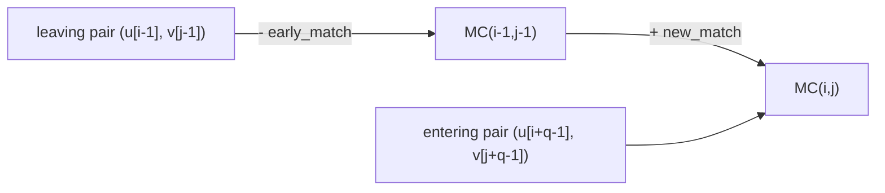

# Match Count

## Definition

The **match count** (Anzahl übereinstimmender Zeichen) of a q-word pair (q-Wort-Paar) is the number
of positions at which the two length-`q` words agree. For sequences `u` (`|u| = m`) and `v`
(`|v| = n`) (fsa_part2, p. 8):

```
MC(i, j) = mc( u[i+1 .. i+q], v[j+1 .. j+q] )
```

where `mc(x, y) = |{ l | 1 <= l <= q, x[l] = y[l] }|` for `x, y ∈ A^q`.

Symbols: `q` — window length; `i`, `j` — the offsets preceding the compared windows in `u` and `v`;
`A` — alphabet.

## Why it matters

Exact q-gram equality (as in [[q-gram-distance]]) is all-or-nothing. `MC(i,j)` is the *graded*
version: it measures partial agreement of two aligned windows, which is what a scoring-based seed
test such as the [[blast|BLAST]] blast-hit condition needs. The point of the page is that the whole
`(m x n)` table can be filled in `O(mn)` rather than the naive `O(m·n·q)` (fsa_part2, p. 8).

## Construction / Mechanism — the diagonal recurrence

Each cell `(i, j)` lies on diagonal `d = j - i`. Moving one step along a diagonal shifts **both**
windows right by one: the leftmost character pair leaves the window and a new rightmost pair
enters. So the match count changes by at most `-1 + 1` (fsa_part2, p. 8):

```
MC(i, j) = MC(i-1, j-1) - early_match + new_match
early_match = 1 if u[i-1] = v[j-1], else 0        // pair leaving the window
new_match   = 1 if u[i+q-1] = v[j+q-1], else 0    // pair entering the window
```

The first row and the first column are computed directly (each in `O(q)`); every other cell is
`O(1)` (fsa_part2, p. 8).



> [!question]
> The definition on p. 8 indexes the windows as `u[i+1 .. i+q]`, but the recurrence's leaving and
> entering pairs (`u[i-1]` and `u[i+q-1]`) are the ones consistent with windows
> `u[i .. i+q-1]`. The handwritten page is off by one between the two formulations; both are
> transcribed as written. Fix a single convention before using it in an exam answer — the
> *mechanism* (drop the left pair, add the right pair) is unambiguous.

## Pseudocode

```text
ALGORITHM MatchCountTable(u[1..m], v[1..n], q)
  // windows u[i..i+q-1], v[j..j+q-1]; i in 1..m-q+1, j in 1..n-q+1
  for j = 1 to n - q + 1:                      // first row, directly
    MC[1][j] <- 0
    for l = 0 to q-1:
      if u[1+l] = v[j+l]:  MC[1][j] <- MC[1][j] + 1
  for i = 2 to m - q + 1:                      // first column, directly
    MC[i][1] <- 0
    for l = 0 to q-1:
      if u[i+l] = v[1+l]:  MC[i][1] <- MC[i][1] + 1
  for i = 2 to m - q + 1:                      // remaining cells, O(1) each
    for j = 2 to n - q + 1:
      early <- 1 if u[i-1] = v[j-1] else 0
      new   <- 1 if u[i+q-1] = v[j+q-1] else 0
      MC[i][j] <- MC[i-1][j-1] - early + new
  return MC
```

## Complexity

| Operation | Time | Space |
|---|---:|---:|
| Naive: evaluate every cell independently | `O(m·n·q)` | `O(m·n)` |
| First row + first column directly | `O((m+n)·q)` | — |
| Each remaining cell incrementally | `O(1)` | — |
| **Total (diagonal recurrence)** | `O(m·n)` | `O(m·n)` (or `O(min{m,n})` per diagonal) |

(fsa_part2, p. 8)

## Worked example

Trivial pair from the page: `u[1..3] = a a a`, `v[1..3] = b a a` gives `mc = 2` (positions 2 and 3
agree) (fsa_part2, p. 8).

Full diagonal trace with `q = 3`, `u = a a a c`, `v = b a a a` (`m = n = 4`, windows at
`i, j ∈ {1, 2}`):

| `MC` | j=1 (`baa`) | j=2 (`aaa`) |
|---|---:|---:|
| **i=1** (`aaa`) | 2 | 3 |
| **i=2** (`aac`) | 1 | 2 |

Cell `(2,2)` by the recurrence from `(1,1) = 2`: leaving pair `(u[1], v[1]) = (a, b)` →
`early = 0`; entering pair `(u[4], v[4]) = (c, a)` → `new = 0`; so `MC(2,2) = 2 - 0 + 0 = 2`.
Direct check: `aac` vs `aaa` agrees in positions 1 and 2 → 2. ✓

## Pitfalls & exam traps

> [!warning]
> - The recurrence runs along **diagonals** (`i-1, j-1`), not along rows. Initialising only the
>   first row is not enough; the first column is needed too, or diagonals entering from the left
>   edge are undefined.
> - `early_match` is **subtracted** and `new_match` **added** — swapping them is the classic error.
> - The two characters compared in `early_match` are the ones at the *same* offset in both windows;
>   it is a character-pair test, not a q-gram test.
> - Match count is a similarity (higher = better), unlike `qgdist` which is a distance.
> - Window start indices only run to `m-q+1` / `n-q+1`; the last `q-1` positions start no window.

## Related

- [[q-gram]] — the length-`q` windows being compared.
- [[q-gram-distance]] — exact-equality counting of q-grams, as opposed to graded agreement.
- [[blast]] — blast hits generalise `MC` from identity counting to a scoring function `score_σ`.
- [[score-function]] — the weighted generalisation of counting matches.
- [[edit-distance-dp]] — same `O(mn)` matrix shape, different recurrence direction set.
- [[fsa_part2]] — source page for this unit.

## Sources

- fsa_part2, p. 8 (raw file `raw/foundations_seqzence_analysis_part2.pdf`)
