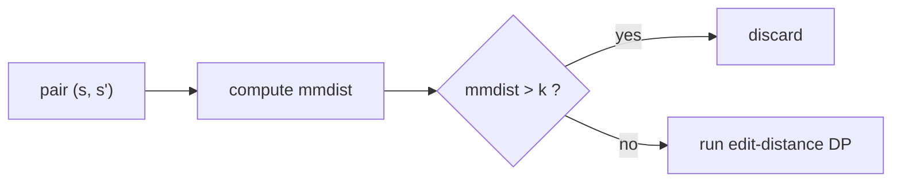

# Maximal Matches Distance

## Definition

A **partition** (Partition) `Ψ` of `v` with respect to `u` is a sequence
`(w_1, c_1, ..., w_r, c_r, w_{r+1})` of substrings `w_1, ..., w_{r+1}` **of `u`** and characters
`c_1, ..., c_r` such that `v = w_1 c_1 ... w_r c_r w_{r+1}` (fsa_part2, p. 2).

- `w_1, ..., w_{r+1}` are the **submatches** of `Ψ` — each is a substring of `u`;
- `c_1, ..., c_r` are the **marked characters** (markierte Zeichen);
- `|Ψ| = r`, the number of marked characters, is the **size** of the partition.

The **maximal matches distance** (maximal-matches-Distanz) is
`mmdist(v, u) = |Ψ|` for a **minimal** partition `Ψ` of `v` with respect to `u`
(fsa_part2, p. 2). Informally: the minimum number of characters that must be removed from `v` so
that the remaining pieces are all substrings of `u` (fsa_part2, p. 2).

Symbols: `u`, `v` — sequences, `|u| = m`, `|v| = n`; `A` — the alphabet; `r` — number of marked
characters; `δ` — the unit cost function.

## Why it matters

`mmdist` is computable in linear time from a [[suffix-tree]] and is a **lower bound** on the unit
edit distance, so it is a cheap *filter* that discards sequence pairs before the `O(mn)` DP of
[[edit-distance-dp]] is ever started (fsa_part2, pp. 3–4). Unlike [[longest-common-subsequence]] it
works with contiguous common substrings (gemeinsame Teilstrings).

## Construction / Mechanism — the two canonical partitions

Two greedy partitions are singled out (fsa_part2, p. 2):

- **Left-to-right partition** `Ψ_lr(v, u)`: for all `h` with `1 <= h <= r`, `w_h c_h` is **not** a
  substring of `u` — i.e. every submatch is extended as far right as possible before a character is
  marked.
- **Right-to-left partition** `Ψ_rl(v, u)`: for all `h`, `c_h w_{h+1}` is **not** a substring of `u`.

Both are minimal:

```
|Ψ_lr(v, u)| = mmdist(v, u) = |Ψ_rl(v, u)|
```


## Pseudocode

Simple `Ψ_lr` construction: scan `v` left to right until a prefix `w c` is found such that `w` is a
substring of `u` but `w c` is not; mark `c` and restart after `c` (fsa_part2, p. 3).

```text
ALGORITHM MMDist(v[1..n], u[1..m])          // uses ST(u), the suffix tree of u
  r <- 0
  start <- 1
  i <- start
  while i <= n:
    if v[start..i] is a substring of u:      // matched by walking ST(u)
      i <- i + 1
    else:
      r <- r + 1                             // v[i] becomes a marked character c
      start <- i + 1                         // submatch was v[start..i-1]
      i <- start
      reset the ST(u) walk to the root
  return r                                   // = mmdist(v, u)
```

`Ψ_rl(v, u)` is produced by the same scan on the suffix tree `ST(u^{-1})` of the **reversed** `u`
(fsa_part2, p. 3).

## The mmm metric

`mmdist` is **not** a metric on `A*` because it is asymmetric: `mmdist(v, u) != mmdist(u, v)`
(fsa_part2, p. 3). A metric is obtained by symmetrising on a logarithmic scale:

```
mmm(u, v) = log_2( (mmdist(u, v) + 1) · (mmdist(v, u) + 1) )
```

`mmm` **is** a metric on `A*`, computable in `O(|A|·(m+n))` time and `O(max{m, n})` space
(fsa_part2, p. 3).

## Relation to unit edit distance

A partition induces an alignment (`Ψ -> A`): submatches `w` correspond to replacement/match edges
`R`, marked characters `c` correspond to insertions `I` (fsa_part2, p. 3).

Let `δ` be the unit cost function and `A` an alignment of `v` and `u`. Then there is an `r` with
`0 <= r <= δ(A)` and a partition `(w_1, c_1, ..., w_r, c_r, w_{r+1})` of `v` with respect to `u`
such that `w_1` is a prefix and `w_{r+1}` is a suffix of `u`. Hence (fsa_part2, p. 3):

```
mmdist(v, u) <= edist_δ(v, u)
```

### Use as a filter

Given a set `S` of sequences, find all pairs `(s, s') ∈ S × S` with `s != s'` and
`edist_δ(s, s') <= k`. First compute `mmdist(s, s')` in `O(|s| + |s'|)`; if `mmdist(s, s') > k`,
discard the pair immediately — the expensive DP is never run (fsa_part2, p. 4). Correctness is the
bound above: `mmdist > k` implies `edist_δ > k`.



## Complexity

| Operation | Time | Space |
|---|---:|---:|
| `Ψ_lr(v, u)` / `mmdist(v, u)` via `ST(u)` | `O(\|A\|·(m+n))` | `O(m)` |
| `Ψ_rl(v, u)` via `ST(u^{-1})` | `O(\|A\|·(m+n))` | `O(m)` |
| `mmm(u, v)` | `O(\|A\|·(m+n))` | `O(max{m, n})` |
| Filter one pair before DP | `O(\|s\| + \|s'\|)` | — |

(fsa_part2, pp. 3–4)

## Worked example

`u = a b c b a`, `v = c b a b c b` (fsa_part2, p. 2 illustration).

Left-to-right scan of `v` against substrings of `u`:

| step | candidate prefix | substring of `u`? | action |
|---|---|---|---|
| 1 | `c` | yes | extend |
| 2 | `c b` | yes | extend |
| 3 | `c b a` | yes | extend |
| 4 | `c b a b` | no | mark `b`; `w_1 = c b a`, `c_1 = b` |
| 5 | `c` | yes | extend |
| 6 | `c b` | yes | extend; end of `v`, `w_2 = c b` |

`Ψ_lr(v, u) = (c b a, b, c b)`, so `|Ψ_lr| = 1 = mmdist(v, u)`. Any alignment of `v` and `u` must
therefore cost at least 1 under `δ`.

## Part 3 addendum — all four partitions of one pair

Part 3 revisits `Ψ_lr` and `Ψ_rl` with a larger example and computes **all four** partitions
of the pair, in both directions (fsa_part3, p. 4):

```
u = a g t g c a c a c a t c        (m = 12)
v = a t c a c a c t t a g c        (n = 12)
```

| partition | submatches are substrings of | as transcribed | `r = \|Ψ\|` |
|---|---|---|---:|
| `Ψ_lr(u, v)` | `v` | `ag, t, gc, a, caca, t, c` | 3 |
| `Ψ_rl(u, v)` | `v` | `a, g, t, g, caca, c, atc` | 3 |
| `Ψ_lr(v, u)` | `u` | `atc, a, cac, t, t, ag(g)c` | 3 |
| `Ψ_rl(v, u)` | `u` | `a, t, cacac, t, ta, gc` | 3 |

Read with the alternation `(w_1, c_1, w_2, c_2, w_3, c_3, w_4)`, e.g.

```
Ψ_lr(u, v) :  w_1 = ag   c_1 = t   w_2 = gc   c_2 = a   w_3 = caca   c_3 = t   w_4 = c
              ag · t · gc · a · caca · t · c  =  agtgcacacatc  =  u      ✓
```

Every list concatenates back to its own sequence, which is the check to run in the exam.

Hence `mmdist(u, v) = mmdist(v, u) = 3` and
`mmm(u, v) = log_2( (3+1)·(3+1) ) = log_2 16 = 4`.

The bound holds: `edist_δ(u, v) = 5 >= 3 = mmdist(u, v)` — here the filter is a genuine, strict
lower bound, not tight.

**Left-maximality spot-check** (`w_h c_h` must *not* be a substring of the reference):

| `Ψ_lr(u, v)` step | `w_h c_h` | substring of `v`? |
|---|---|---|
| 1 | `agt` | no ✓ |
| 2 | `gca` | no ✓ |
| 3 | `cacat` | no ✓ |

**Right-maximality spot-check for `Ψ_rl(v, u)`** (`c_h w_{h+1}` must not be a substring of `u`):
`t·cacac = tcacac` ✗ not in `u` ✓, `t·t = tt` ✗ not in `u` ✓, `a·gc = agc` ✗ not in `u` ✓.

> [!question]
> Two of the transcribed lists have only **six** entries instead of the seven that
> `(w_1, c_1, ..., w_r, c_r, w_{r+1})` with `r = 3` requires, and both anomalies sit at the end:
> - `Ψ_lr(v, u)` ends `..., t, ag(g)c` with a bracketed `g`. Reading the final entry as the two
>   entries `c_3 = a`, `w_4 = gc` restores the alternation, concatenates to `v` exactly, and
>   satisfies left-maximality (`ta` is not a substring of `u`). The bracketed `g` appears to be a
>   struck-out character.
> - `Ψ_rl(v, u)` ends `..., t, ta, gc`; reading `ta` as the two entries `w_3 = t`, `c_3 = a` does
>   the same. A right-to-left greedy scan reproduces exactly
>   `(a, t, cacac, t, t, a, gc)`.
>
> Both repairs keep `r = 3`, consistent with the other two lists.

> [!note] Inference
> `Ψ_lr(u, v)` as transcribed uses `w_3 = caca`, but a strictly greedy left-to-right scan would
> extend to `w_3 = cacac` (which *is* a substring of `v`) and finish `(..., cacac, a, tc)`. The
> transcribed version still satisfies the lr-condition literally (`cacat` is not in `v`) and has
> the same size 3, so both are minimal partitions. The lr-condition characterises maximality
> locally; it does not force the globally greedy choice.

## Pitfalls & exam traps

> [!warning]
> - `mmdist(v, u)` counts **marked characters**, not submatches: a partition with `r+1` submatches
>   has size `r`.
> - Direction matters — `mmdist(v, u)` asks whether pieces of `v` occur in `u`, not the reverse.
>   This is exactly why `mmdist` is not a metric.
> - `Ψ_lr` and `Ψ_rl` differ as partitions but always have the **same size**.
> - The suffix tree is built over `u` (the reference), so the construction cost `O(m)` space is
>   paid once per reference, not per pair.
> - The bound is one-sided: `mmdist <= k` does **not** imply `edist_δ <= k`; surviving pairs must
>   still be verified by DP.

## Related

- [[suffix-tree]] — index over `u` (and `u^{-1}`) that makes the partition scan linear.
- [[unit-edit-distance]] — the quantity `mmdist` lower-bounds.
- [[edit-distance-dp]] — the expensive computation the filter avoids.
- [[q-gram-distance]] — the other lower-bound filter of this unit, with bound `qgdist/(2q)`.
- [[longest-common-subsequence]] — non-contiguous counterpart of the common-substring idea.
- [[alignment]] — the object a partition is converted into (`Ψ -> A`).
- [[fsa_part2]] — source page for this unit.
- [[fsa_part3]] — source page for the four-partition example.

## Sources

- fsa_part2, pp. 2–4 (raw file `raw/foundations_seqzence_analysis_part2.pdf`)
- fsa_part3, p. 4 (`raw/foundations_sequence_analysis_part3.pdf`) — `Ψ_lr` / `Ψ_rl` example
