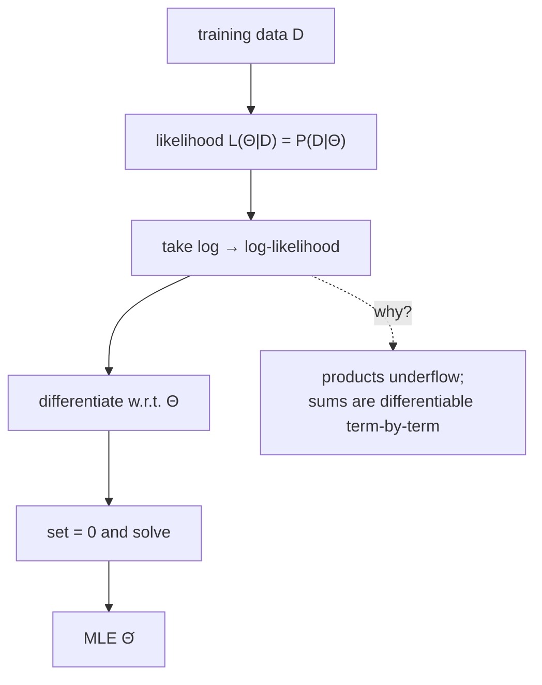

# Maximum Likelihood Estimation (MLE)

## Definition

**MLE determines the parameters `Θ` of a model from data, such that the probability that the
model generated the data is maximised** (gik_1_2, p. 3).

`P(D | Θ)` is the probability of observing outcome `D` given model `Θ` — the sequence of events
that could be generated by the model with parameters `Θ`. When `Θ` is unknown, we turn it into a
variable and maximise the **likelihood function**:

```
L(Θ | D) = P(D | Θ)
```

`L` is a function *of `Θ`* that returns `P(D | Θ)`. The data `D` used to fit it is the
**training data**.

> [!warning]
> `L(Θ | D) = P(D | Θ)` is an *equality of values, not of meaning*. `L` varies `Θ` with `D`
> fixed; `P` varies `D` with `Θ` fixed. This is the single most common confusion on this topic.

## Why it matters

Why use probabilities derived from observed frequencies? Because doing so maximises the total
probability of the training data when it is generated by the model (gik_1_2, p. 3). For DNA
sequences of total length `n`, the MLE of the symbol probability is simply the relative
frequency:

```
q_a = f_a / n        where f_a = how often a occurs
```

## Pseudocode

```text
ALGORITHM MLE(D, parameter space Θ-space)
  // conceptual: maximise the likelihood over all parameter settings
  best  <- undefined
  bestL <- -infinity
  for each Θ in Θ-space:
    L <- P(D | Θ)
    if L > bestL:
      bestL <- L
      best  <- Θ
  return best

// in practice, solve analytically:
//   take log, differentiate w.r.t. each parameter, set to 0, solve
```

## Worked example 1 — coin (gik_1_2, p. 4)

Let `p` be the probability of tossing a head. Toss `ℓ` times; let `k` be the number of heads.
There are `C(ℓ, k)` ways to choose which `k` of the `ℓ` positions are heads:

```
C(ℓ, k) = ℓ! / (k! (ℓ − k)!)
```

Each such sequence has probability `p^k (1 − p)^(ℓ − k)`, so:

```
g(p, ℓ, k) = P(toss k heads out of ℓ | p) = C(ℓ, k) · p^k · (1 − p)^(ℓ − k)
```

With `ℓ = 20`, `k = 7`: the MLE is `p = 7/20`. The likelihood curve `P(· | p)` peaks there.

## Worked example 2 — traffic delay (gik_1_2, p. 5)

Given times `t₁, …, t_n` of delays of a fairly reliable public transport system. Observations:
there are no negative delays, and the histogram looks like an exponential distribution, where
the number of consecutive events falls by a constant rate. A histogram taken to the continuous
limit is a **probability density function (PDF)**.

PDF of the exponential function, with `λ > 0`:

```
f(λ, x) = λ · e^(−λx)
```

- the curve starts at `(0, λ)`;
- `∫(−∞ to ∞) f(λ, x) dx = 1`;
- `P(point falls into [a, b]) = ∫(a to b) f(λ, x) dx`.

Now estimate `λ`:

```
L(λ | t₁,…,t_n) = P(t₁,…,t_n | λ) = ∏(i=1 to n) λ e^(−λ t_i)
                = λ^n · e^(−λ · Σ(i=1 to n) t_i)
                = λ^n · e^(−λ n t̄)              where t̄ = (1/n) Σ t_i is the mean
```

The two factors are extreme (one very large, one very small), so take the **log-likelihood** —
maximising the log-likelihood is equivalent to maximising the likelihood, because `log` is
strictly increasing:

```
ℓ(λ | t₁,…,t_n) = n ln λ − λ n t̄

d/dλ:   ℓ'(λ) = n/λ − n t̄ = 0
                                 ⇒  λ = 1 / t̄
```

The MLE of the rate is the reciprocal of the mean delay.



## Complexity

| Step | Cost |
|---|---|
| Closed-form MLE from counts (symbols, transitions) | `O(n)` over the data |
| Numerical maximisation when no closed form exists | iterative — see [[expectation-maximization]] |

## Pitfalls & exam traps

> [!warning]
> - Always maximise the **log**-likelihood in practice. Raw products underflow
>   ([[log-space-computation]]).
> - MLE with hidden/missing data has no closed form — that is exactly when you need
>   [[expectation-maximization]].
> - MLE overfits small training sets: an event never seen gets probability 0 and poisons every
>   later product. The fix is [[pseudocounts]].

## Related

- [[probabilistic-model]] — what `Θ` parameterises.
- [[prior-posterior-probability]] — MLE uses no prior; Bayes does.
- [[expectation-maximization]] — iterative MLE when some variables are hidden.
- [[pseudocounts]] — regularising MLE counts.
- [[sheet-01]] — exercise 1.1 compares two coin models using exactly the `g(p, ℓ, k)` above.

## Sources

- gik_1_2, pp. 3–5 (unit 1); exercise 1.1, p. 24.
