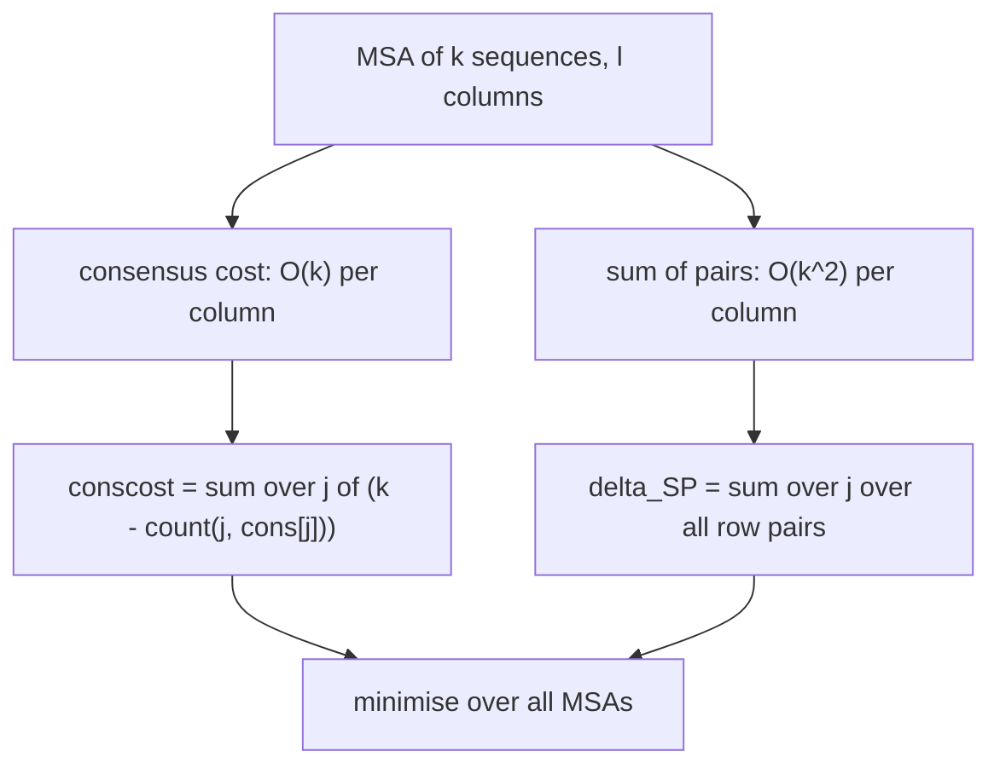

# Multiple Sequence Alignment

## Definition

A **multiple sequence alignment (MSA)** (multiples Sequenzalignment) of a set
`S = {s_1, …, s_k}` of `k ≥ 2` sequences with `n_i = |s_i|` is a tuple of `k` strings
`(s'_1, …, s'_k)` over `A' = A ∪ {−}` such that (fsa_part3, p. 15):

1. there is an `l ≥ 1` with `s'_i ∈ (A')^l` for all `1 ≤ i ≤ k` — **all rows have equal length**;
2. `delgap(s'_i) = s_i` for all `i` — **deleting gaps recovers the input**;
3. for every column `j`, `1 ≤ j ≤ l`, there is at least one `i` with `s'_i[j] ≠ −` — **no all-gap
   column**.

Here `−∉ A` is the **gap symbol**, and `delgap : (A')* → A*` is the homomorphism with
`delgap(a) = a` for `a ∈ A`, `delgap(−) = ε`, extended by
`delgap(w[1..n]) = delgap(w[1]) ⋯ delgap(w[n])` (fsa_part3, p. 15).

**Length bounds** (fsa_part3, p. 15):

```
max{ n_i | 1 <= i <= k }  <=  l  <=  Σ_{i=1}^{k} n_i
```

Symbols: `k` — number of sequences; `l` — alignment length (number of columns); `n_i` — length of
input `s_i`; `s'_i` — the gapped row for `s_i`.

## Why it matters

One compares `k ≥ 2` sequences, usually a set assumed to be **homologous**, with the goal of
**detecting homologous residues** (fsa_part3, p. 15). The MSA is the input from which a
[[position-specific-scoring-matrix]] is estimated (p. 1), from which conserved motifs are read off,
and from which the distances feeding a [[phylogenetic-tree]] are derived.

## Scoring — consensus costs

The **consensus** (Konsensus) of a column is a non-gap symbol occurring most often in it
(fsa_part3, p. 16). With

```
count(j, a) = | { i | 1 <= i <= k , s'_i[j] = a } |        a ∈ A
```

a string `cons` is **a** consensus of `(s'_1, …, s'_k)` iff for every column `j`

```
count(j, cons[j]) >= count(j, a)   for all a ∈ A
```

and

```
dist( cons, (s'_1, ..., s'_k) ) = Σ_{j=1}^{l} ( k − count(j, cons[j]) )
```

**Lemma** (fsa_part3, p. 16). If `cons_1` and `cons_2` are two different consensi of the same MSA,
then `dist(cons_1, ·) = dist(cons_2, ·)`.

Hence the quantity is well defined and written

```
conscost(s'_1, ..., s'_k) = dist( cons, (s'_1, ..., s'_k) )        — the smaller the better
```

**MSA problem with consensus costs** (fsa_part3, p. 16): find the MSA of `s_1, …, s_k` minimising
`conscost`.

> [!note] Inference
> The lemma is immediate: a consensus column symbol is by definition one attaining the *maximum*
> count, so `count(j, cons[j])` is the same number for every consensus, and the sum only depends on
> those numbers.

## Scoring — sum of pairs

Let `δ(α → β) ≥ 0` be a pairwise distance on `A'` with `δ(− → −) = 0` (fsa_part3, p. 17). The
**sum-of-pairs (SP)** score of a column is the sum over all `C(k,2)` unordered pairs of rows:

```
δ_SP( s'_1[j], ..., s'_k[j] ) = Σ_{i=1}^{k-1} Σ_{r=i+1}^{k} δ( s'_i[j] -> s'_r[j] )
```

and of the whole alignment:

```
δ_SP( s'_1, ..., s'_k ) = Σ_{j=1}^{l} δ_SP( s'_1[j], ..., s'_k[j] )
```

**MSA problem with SP scoring** (fsa_part3, p. 17): find an MSA with minimum SP score; the optimum
is written `δ_opt-SP(s_1, …, s_k)`.



## Compatibility and projection

Let `S' ⊆ S` and let `Al_S = (s'_1, …, s'_k)` be an MSA of `S`. The **projection** of `Al_S` with
respect to `S'` is the MSA `proj(Al_S, S')` obtained by (fsa_part3, p. 20):

1. deleting all rows of `Al_S` that do not correspond to a sequence in `S'`;
2. deleting all columns consisting only of gaps.

`Al_S` is **compatible** (kompatibel) with an MSA `Al_{S'}` of `S'` iff
`Al_{S'} = proj(Al_S, S')`.

Step 2 is exactly what repairs condition 3 of the MSA definition after rows are removed.

An **alignment tree** (Alignmentbaum) for `S` is a labelled undirected tree whose node set is `S`
and whose every edge `(s,t)` is labelled by an **optimal pairwise alignment** of `s` and `t`
(fsa_part3, p. 20). The heuristics [[star-alignment]] and [[progressive-alignment]] build an MSA
compatible with such a tree.

## Good cost functions

A cost function `δ : A' × A' → ℝ_{≥0}` is **good** (gut) if (fsa_part3, p. 22):

1. `δ(a, a) = 0` for all `a ∈ A'`;
2. `δ(a, c) ≤ δ(a, b) + δ(b, c)` for all `a, b, c ∈ A'` — the **triangle inequality**.

Goodness is the hypothesis of the [[star-alignment]] `(2 − 2/k)` approximation theorem: it is what
allows a pairwise cost to be bounded by a detour through the center sequence.

> [!warning]
> Goodness does **not** require symmetry or the zero property, so a good `δ` need not be a metric —
> but unit cost and every sensible substitution distance are good.

## Complexity

| Quantity | Cost |
|---|---:|
| Consensus column cost `k − count(j, cons[j])` | `O(k)` (fsa_part3, p. 19) |
| SP column cost | `O(k²)` (fsa_part3, p. 19) |
| Whole-alignment consensus cost | `O(k·l)` |
| Whole-alignment SP cost | `O(k²·l)` |
| Exact optimal MSA | `O(z·f(k)·2^k)`, see [[multidimensional-dp-msa]] |
| Alignment length `l` | `max n_i ≤ l ≤ Σ n_i` |

## Worked example

`S = {s_1, s_2, s_3}` with `s_1 = ACGT` (`n_1 = 4`), `s_2 = AGT` (`n_2 = 3`), `s_3 = ACT`
(`n_3 = 3`), so `k = 3`.

An MSA with `l = 4`:

| row | 1 | 2 | 3 | 4 |
|---|---|---|---|---|
| `s'_1` | A | C | G | T |
| `s'_2` | A | − | G | T |
| `s'_3` | A | C | − | T |

Validity: all rows have length 4 ✓; `delgap(s'_2) = AGT = s_2` ✓; no all-gap column ✓;
`max n_i = 4 ≤ l = 4 ≤ Σ n_i = 10` ✓.

### Consensus cost

| `j` | column | `count(j,A)` | `count(j,C)` | `count(j,G)` | `count(j,T)` | `cons[j]` | `k − count` |
|---:|---|---:|---:|---:|---:|---|---:|
| 1 | A,A,A | 3 | 0 | 0 | 0 | **A** | `3−3 = 0` |
| 2 | C,−,C | 0 | 2 | 0 | 0 | **C** | `3−2 = 1` |
| 3 | G,G,− | 0 | 0 | 2 | 0 | **G** | `3−2 = 1` |
| 4 | T,T,T | 0 | 0 | 0 | 3 | **T** | `3−3 = 0` |

`cons = ACGT` and `conscost = 0 + 1 + 1 + 0 = 2`.

### SP cost (unit `δ`: `0` on equal symbols, `1` otherwise, `δ(−,−) = 0`)

Three row pairs per column: `(1,2)`, `(1,3)`, `(2,3)`.

| `j` | `(s'_1,s'_2)` | `(s'_1,s'_3)` | `(s'_2,s'_3)` | column `δ_SP` |
|---:|---:|---:|---:|---:|
| 1 | `δ(A,A)=0` | `0` | `0` | 0 |
| 2 | `δ(C,−)=1` | `δ(C,C)=0` | `δ(−,C)=1` | 2 |
| 3 | `δ(G,G)=0` | `δ(G,−)=1` | `δ(G,−)=1` | 2 |
| 4 | `0` | `0` | `0` | 0 |

`δ_SP(s'_1, s'_2, s'_3) = 0 + 2 + 2 + 0 = 4`.

### Projection

`proj(Al_S, {s_1, s_3})`: delete row `s'_2`; no column becomes all-gap, so nothing else changes:

```
A C G T
A C - T
```

which is an optimal pairwise alignment of `ACGT` and `ACT` (cost 1). The MSA is therefore
**compatible** with it. Projecting onto `{s_2, s_3}` gives

```
A - G T
A C - T
```

of cost 2, while `edist_δ(AGT, ACT) = 1` — so the same MSA is **not** compatible with the optimal
pairwise alignment of `s_2` and `s_3`. One MSA cannot in general be compatible with all pairwise
optima; that is precisely why the exact problem is hard and [[star-alignment]] only approximates.

## Pitfalls & exam traps

> [!warning]
> - `count(j, a)` ranges over `a ∈ A` only — **gaps are not consensus candidates**, but they do
>   count towards `k` in `k − count(j, cons[j])`, which is why a gappy column is expensive.
> - The consensus may not be unique; the *cost* is unique (the lemma). Do not write "the" consensus
>   without justification.
> - SP counts **unordered** pairs: `C(k,2) = k(k−1)/2` per column, not `k²`. The `O(k²)` is the
>   asymptotic form.
> - `δ(− → −) = 0` is required explicitly; otherwise two aligned gaps would be charged.
> - Condition 3 (no all-gap column) is what keeps `l ≤ Σ n_i`; without it `l` is unbounded.
> - Projection requires **both** steps — forgetting to delete all-gap columns produces a tuple that
>   is not an MSA.
> - "Good" is `δ(a,a) = 0` **plus** the triangle inequality — it is not the metric axioms.

## Related

- [[multidimensional-dp-msa]] — the exact `k`-dimensional DP for both cost models.
- [[star-alignment]] — approximation built from pairwise alignments to a center, with the
  `(2 − 2/k)` bound that relies on goodness of `δ`.
- [[progressive-alignment]] — guide-tree heuristic, the practical method.
- [[alignment]] — the `k = 2` case.
- [[cost-function]] — the pairwise `δ` lifted to columns.
- [[position-specific-scoring-matrix]] — estimated from an MSA, sharing the `count(j,a)` function.
- [[phylogenetic-tree]] — built from the distances an MSA yields.
- [[fsa_part3]] — source page for this unit.

## Sources

- fsa_part3, pp. 15–17, 20, 22 (`raw/foundations_sequence_analysis_part3.pdf`)
