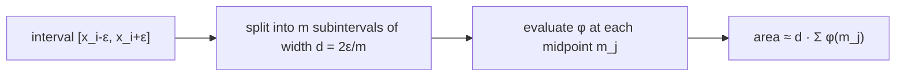

# Numerical Integration — Midpoint Method

## Definition

A numerical method to compute an integral by simple geometric means: approximate the area under
the curve by a sum of rectangles whose height is taken at the **midpoint** of each subinterval
(gik_1_2, p. 11).

## Why it matters

The [[expectation-maximization|EM]] E-step needs

```
P(x_i | r) = ∫(x_i − ε to x_i + ε) φ(μ_r, σ_r, x) dx
```

and the normal density `φ` has no elementary antiderivative, so the integral must be
approximated.

## Mechanism

Split `[x_i − ε, x_i + ε]` into `m` subintervals of size `d = 2ε / m`:

```
P(x_i | r) ≈ d · Σ(j = 0 to m−1) φ(μ_r, σ_r, m_j)

m_j = x_i − ε + j·d + d/2      // midpoint of subinterval j
```



## Worked example — the `m = 1` collapse

For `m = 1` there is a single subinterval of width `d = 2ε`, whose midpoint is `x_i` itself:

```
P(x_i | r) ≈ 2ε · φ(μ_r, σ_r, x_i)
```

Substituted into the responsibility quotient, the `2ε` cancels top and bottom:

```
                    φ(μ_r, σ_r, x_i) P(r)
P(r | x_i) = ────────────────────────────────────────────
             φ(μ_r, σ_r, x_i) P(r) + φ(μ_g, σ_g, x_i) P(g)
```

ε is no longer used, which speeds up the computation (gik_1_2, p. 11).

## Complexity

| Variant | Cost per point |
|---|---|
| `m` subintervals | `O(m)` density evaluations |
| `m = 1` shortcut | `O(1)` |

## Pitfalls & exam traps

> [!warning]
> The midpoint `m_j` includes the `+ d/2` term. Using the left edge `x_i − ε + j·d` instead is
> the rectangle (left Riemann) rule and is less accurate — a classic off-by-half error.

## Related

- [[expectation-maximization]] — the algorithm that needs this integral.
- [[mixture-model]] — where `φ` comes from.

## Sources

- gik_1_2, p. 11 (unit 1, "Implementation of EM-Alg").
