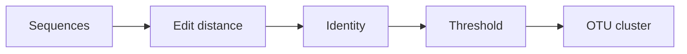

# Operational Taxonomic Unit

## Definition

An operational taxonomic unit (OTU) is a cluster of sequences treated as the same operational taxon when pairwise sequence identity reaches a threshold, e.g. 97% in the notes (gik_3_4, p. 25).

## Why it matters

The metagenomics block studies DNA from communities of uncultured organisms; OTUs group many similar sequences before downstream interpretation (gik_3_4, p. 25).

## Construction / Mechanism



The notes define `id(z,u)=100(1-edist(z,u)/ℓ)`, with `ℓ=(|z|+|u|)/2`. Therefore `id(z,u)≥θ` iff `edist(z,u)≤(1-θ/100)ℓ` (gik_3_4, p. 25).

## Pseudocode

```text
ALGORITHM SameOTU(z, u, theta)
  ell <- (length(z) + length(u)) / 2
  d_max <- (1 - theta / 100) * ell
  d <- ThresholdedOutputSensitiveEditDistance(z, u, d_max)
  if d <= d_max: return true
  return false
```

## Complexity

| Operation | Time | Space |
|---|---:|---:|
| Thresholded pair test | `O(|z|+|u|+d_max^2)` | `O(d_max)` |
| Naive all-pairs over `N` sequences | `O(N^2)` pair tests | depends on clustering storage |

## Worked example

For average length `ℓ=100` and `θ=97`, `d_max=3`. The algorithm only needs to decide whether the edit distance is at most 3; distance 4 already rejects the pair (gik_3_4, p. 25).

## Pitfalls & exam traps

> [!warning]
> - The normalising length is the average length in the notes.
> - Higher identity means a smaller allowed edit distance.
> - OTUs are operational clusters, not necessarily biological species.

## Related

- [[output-sensitive-edit-distance]] — efficient threshold test.
- [[unit-edit-distance]] — distance used in the identity formula.
- [[anchor-based-sequence-comparison]] — another similarity strategy for long sequences.

## Sources

- gik_3_4, p. 25
