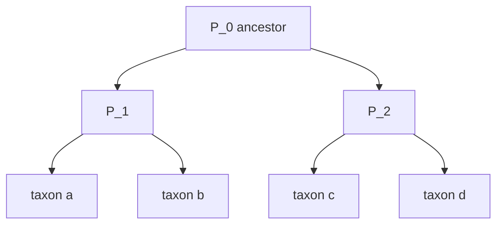
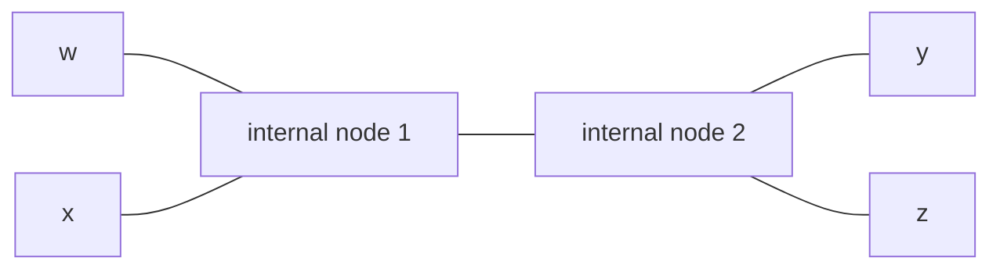
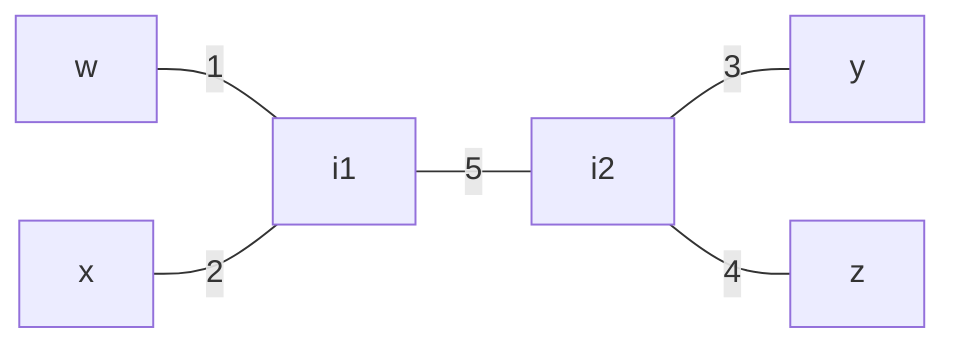

# Phylogenetic Tree

## Definition

**Phylogenetic analysis** (phylogenetische Analyse) takes a collection of species and determines
and describes the **evolutionary relationship** between them, modelled as a branching process: an
ancestor `P_0` branches into `P_1` and `P_2` (fsa_part3, p. 25).

Let `X` be a finite set of **taxa** (Taxa); a taxon `x ∈ X` is a group of individuals defined in
some way. A **phylogenetic tree** (phylogenetischer Baum) is a triple

```
T = (V, E, λ)
```

where `(V, E)` is a **connected graph without cycles** and `λ` is a **one-to-one labeling of the
leaves** by elements of `X` (fsa_part3, p. 25).

| Kind | Meaning |
|---|---|
| **rooted** | reflects the most basal ancestor of the tree in question |
| **unrooted** | does not imply a known ancestral root |
| **binary** | every internal node has degree 3, except the root `p` |



**Edge length** (Kantenlänge): a positive length is assigned to each edge; it describes the
putative order of the speciation events that gave rise to the considered taxa
(fsa_part3, p. 25).

Symbols: `X` — taxa, `n = |X|`; `T_X` — a phylogenetic tree over `X`;
`d : X × X → ℝ_{≥0}` — a distance (a metric); `w, x, y, z ∈ X` — four taxa.

## Why it matters

Trees are the output of the whole comparison pipeline: sequences → pairwise distances → tree. They
also feed back into alignment as the **guide tree** of [[progressive-alignment]]. Whether a given
distance matrix *can* come from a tree at all is the additivity question below.

## Methods

Three families (fsa_part3, p. 25), of which the lecture pursues the first:

1. **Distance methods** ★ — [[upgma]], [[neighbor-joining]]
2. Maximum parsimony
3. Maximum likelihood approaches

All start from `d : X × X → ℝ_{≥0}`, a metric.

## Additivity

Let `T_X` be a phylogenetic tree over `X` and `d : X × X → ℝ_{≥0}`. Then `d` is **additive with
respect to `T_X`** (additiv) if `d` was obtained by **adding up edge lengths on paths between the
leaves** of `T_X`. `d` is **additive** if there exists some phylogenetic tree `T_X` such that `d`
is additive with respect to it (fsa_part3, p. 26).

Additivity is the exact condition under which the distance matrix is a faithful, lossless encoding
of a tree with edge lengths.

## The four point condition

**Theorem** (fsa_part3, p. 26). `d` is additive **if and only if** for all `w, x, y, z ∈ X`:

```
d(w,x) + d(y,z)  <=  max{ d(w,y) + d(x,z) ,  d(w,z) + d(x,y) }
```

**The decision is made in `O(n⁴)`** — test the condition for every 4-element subset, of which there
are `C(n,4) ∈ Θ(n⁴)`, each in `O(1)`.

The geometric content: of the three ways to pair up four leaves, **two of the three sums are equal
and the third is no larger**. In a quartet tree the two larger sums both traverse the internal edge
twice; the smallest sum is the one pairing the true neighbours.



## Pseudocode

```text
ALGORITHM IsAdditive(d, X[1..n])                 # O(n^4)
  for each 4-subset {w, x, y, z} of X:
    for each of the 3 pairings of {w,x,y,z}:     # (wx|yz), (wy|xz), (wz|xy)
      s1 <- d(w,x) + d(y,z)
      s2 <- d(w,y) + d(x,z)
      s3 <- d(w,z) + d(x,y)
      if s1 > max(s2, s3):  return false
      if s2 > max(s1, s3):  return false
      if s3 > max(s1, s2):  return false
  return true
```

(The three tests collapse to one check: the **two largest of `s1, s2, s3` must be equal**.)

## Complexity

| Operation | Time | Space |
|---|---:|---:|
| Four point condition on one quartet | `O(1)` | `O(1)` |
| Additivity test over all quartets | `O(n⁴)` (fsa_part3, p. 26) | `O(n²)` for `d` |
| Ultrametry test | `O(n³)` — see [[ultrametric]] | `O(n²)` |
| Tree reconstruction, UPGMA | `O(n²)` | `O(n²)` |
| Tree reconstruction, Neighbor Joining | `O(n³)` | `O(n²)` |

## Worked example

> [!note] Inference
> p. 26 states the condition and sketches the euclidean counterexample without numbers. The
> arithmetic below is derived from the lecture's own definitions.

### An additive distance

Quartet tree with `w, x` on one side and `y, z` on the other; pendant edge lengths
`w:1`, `x:2`, `y:3`, `z:4` and internal edge `5`:



Path sums:

| pair | path | `d` |
|---|---|---:|
| `w,x` | `1 + 2` | 3 |
| `y,z` | `3 + 4` | 7 |
| `w,y` | `1 + 5 + 3` | 9 |
| `x,z` | `2 + 5 + 4` | 11 |
| `w,z` | `1 + 5 + 4` | 10 |
| `x,y` | `2 + 5 + 3` | 10 |

The three pairings:

| pairing | sum |
|---|---:|
| `(wx\|yz)` | `3 + 7 = ` **10** |
| `(wy\|xz)` | `9 + 11 = ` **20** |
| `(wz\|xy)` | `10 + 10 = ` **20** |

Two sums are equal (`20 = 20`) and the third is smaller (`10 ≤ 20`) ✓ — the condition holds, and
the smallest sum `(wx|yz)` correctly identifies `w,x` and `y,z` as the neighbouring pairs.

### The euclidean distance is not additive (fsa_part3, p. 26)

Four points at the corners of a square with side `c` and diagonal `D = c√2`; take `c = 1`, so
`D ≈ 1.414`. Label the corners so that `w` and `x` are **diagonally opposite**, and `y`, `z` are
the other diagonal pair:

| pair | relation | `d` |
|---|---|---:|
| `w,x` | diagonal | `1.414` |
| `y,z` | diagonal | `1.414` |
| `w,y` | side | `1` |
| `x,z` | side | `1` |
| `w,z` | side | `1` |
| `x,y` | side | `1` |

| pairing | sum |
|---|---:|
| `(wx\|yz)` | `1.414 + 1.414 = ` **2.828** |
| `(wy\|xz)` | `1 + 1 = ` **2** |
| `(wz\|xy)` | `1 + 1 = ` **2** |

`2.828 > max{2, 2} = 2` ✗ — the four point condition **fails**, so the euclidean distance on a
square is not additive: no tree with edge lengths reproduces it. In general `2D = 2c√2 > 2c`, so
the counterexample works for every square side `c`.

> [!warning]
> The condition must hold for **every** labelling of every quartet. Checking only one convenient
> labelling (as in the first square labelling, where sides pair with sides) passes vacuously.

## Pitfalls & exam traps

> [!warning]
> - `λ` labels **leaves only**; internal nodes are hypothetical ancestors and carry no taxon.
> - "Binary" means internal degree **3** (two children + one parent) in the unrooted reading; the
>   root is the exception.
> - The four point condition is an **inequality with a max**, not an equality of all three sums.
>   The usable form: *the two largest of the three sums are equal*.
> - It must hold for all `C(n,4)` quartets; one violating quartet refutes additivity.
> - Additive ≠ ultrametric. Additivity allows different root-to-leaf distances; [[ultrametric]] is
>   the strictly stronger molecular-clock condition.
> - `O(n⁴)` counts quartets; it is not the cost of building a tree.
> - Edge lengths are **positive**; a reconstruction yielding a negative edge signals that `d` is
>   not additive w.r.t. the proposed topology.

## Related

- [[ultrametric]] — the stronger molecular-clock condition, testable in `O(n³)`.
- [[upgma]] — distance method producing a **rooted** tree; correct under ultrametry.
- [[neighbor-joining]] — distance method producing an **unrooted** tree; correct under additivity.
- [[progressive-alignment]] — consumes such a tree as the guide tree.
- [[multiple-sequence-alignment]] — produces the sequences whose distances `d` measures.
- [[operational-taxonomic-unit]] — the practical stand-in for a taxon in metagenomics.
- [[mash-distance]] — one way of obtaining `d` without alignment.
- [[fsa_part3]] — source page for this unit.

## Sources

- fsa_part3, pp. 25–26 (`raw/foundations_sequence_analysis_part3.pdf`)
