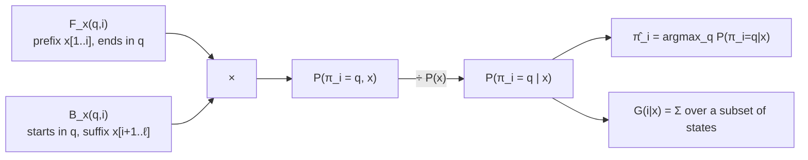

# Posterior Decoding

## Definition

**Forward and Backward algorithms are complementary**: Forward covers the prefix of `x` ending
in `q`, Backward starts in `q` and covers the suffix. The combination of both algorithms allows
us to restrict to paths which reach a specific state at position `i` when generating `x`
(gik_1_2, p. 20).

The **posterior probability** that symbol `x[i]` is generated in state `π_i = q`, given that the
sequence `x` is generated:

```
                  P(π_i = q, x)      F_x(q, i) · B_x(q, i)
P(π_i = q | x) = ─────────────── = ─────────────────────────
                      P(x)                   P(x)
```



## Why it matters

**If `P(x, π) ≈ P(x, π*)` — do not use Viterbi, use an alternative** (gik_1_2, p. 20). When many
paths have comparable probability, the single best path is not representative: it may be barely
more probable than thousands of competitors, and committing to it discards that uncertainty.

## The alternative state sequence

Define `π̂` by choosing, at every position, the most probable state for that position:

```
π̂_i = q   if   P(π_i = q | x) ≥ P(π_i = q' | x)   for all q' ∈ Q, for all i ∈ [1, ℓ]
```

## Pseudocode

```text
ALGORITHM PosteriorDecoding(M, x[1..ℓ])
  In:  HMM M and sequence x[1..ℓ]
  Out: state sequence π̂, and posterior probabilities

  F   <- Forward(M, x)            // full table
  B   <- Backward(M, x)           // full table
  Px  <- P(x | M)                 // from either table's termination step

  for i = 1 to ℓ:
    for each q in Q:
      post[q][i] <- F(q, i) * B(q, i) / Px
    π̂_i <- the q in Q maximising post[q][i]

  return π̂, post
```

## Posterior of a property

`P(π_i = q | x)` is also used **if we are interested in a property of a position derived from
the probabilities of a subset of states at that position** (gik_1_2, p. 20). For CpG island
detection:

```
G(i | x) = Σ(q ∈ Q⁺) P(π_i = q | x)       with  Q⁺ = { A+, C+, G+, T+ }
```

the posterior probability that position `i` is in a CpG island.

This is the cleanest answer to question 2 of [[cpg-island]]: instead of hard boundaries it gives
a per-position probability curve, with no window size anywhere.

## Complexity

| Step | Cost |
|---|---|
| Forward + Backward | `O(\|Q\|² · ℓ)` time |
| Combination | `O(\|Q\| · ℓ)` |
| Space | `O(\|Q\| · ℓ)` — both full tables are required |

## Pitfalls & exam traps

> [!warning]
> - **`π̂` need not be a valid path.** Choosing the best state independently at every position
>   can produce a state sequence containing a transition with `a_{s,t} = 0`. Viterbi never does
>   this. This is the fundamental trade-off between the two decoders.
> - The denominator is `P(x)`, the *same* value at every position — compute it once.
> - `F · B` is a joint probability; without dividing by `P(x)` it is not a posterior.

## Related

- [[forward-algorithm]], [[backward-algorithm]] — the two tables being combined.
- [[viterbi-algorithm]] — the global-path alternative.
- [[hmm-tables-comparison]] — how `V`, `F` and `B` differ.
- [[prior-posterior-probability]] — the general Bayesian notion specialised here.
- [[cpg-island]] — the application.

## Sources

- gik_1_2, p. 20 (unit 2, "Posterior Probabilities").
