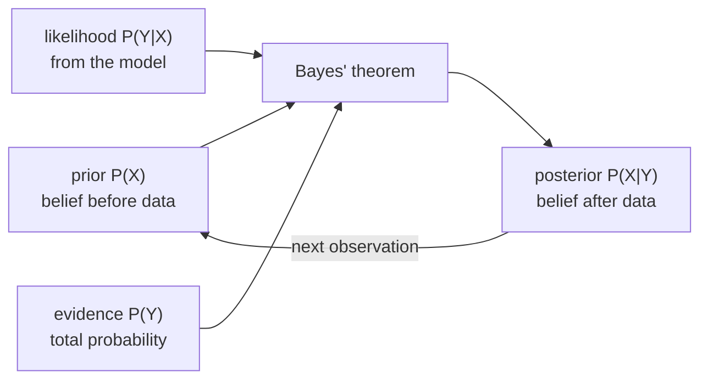

# Prior and Posterior Probability (Bayes' Theorem)

## Definition

**Bayes' theorem** (gik_1_2, p. 6):

```
             P(Y | X) · P(X)
P(X | Y) = ─────────────────────
                  P(Y)
```

| Term | Name |
|---|---|
| `P(X \| Y)` | **posterior** probability |
| `P(Y \| X)` | **likelihood** |
| `P(X)` | **prior** probability |
| `P(Y)` | evidence / normalising constant |

The denominator is expanded by the law of total probability:

```
P(Y) = P(Y | X) P(X) + P(Y | ¬X) P(¬X)
```

The **prior** is what you believed before seeing the data; the **posterior** is what you believe
after. Bayes' theorem is the rule for updating one into the other.

## Why it matters

MLE ([[maximum-likelihood-estimation]]) asks "which parameters make the data most likely?".
Bayes asks the better question for **model comparison**: "given the data, which model is most
likely?" — which requires a prior over models.



## Worked example — the casino dice (gik_1_2, p. 6)

A casino picks a die: with probability 0.99 a **fair** die, with probability 0.01 a **loaded**
die. We pick a die and roll `[6, 6, 6]`. Is it loaded?

Two models: `D_ld` (loaded, `P(6) = 1/2`) and `D_fr` (fair), with `D_fr = ¬D_ld`. Determine
which of the two models fits the observed data better by computing the **posterior**
`P(D_ld | [6,6,6])`. The **prior** is `P(D_ld) = 1/100`.

Likelihoods — note the loaded die is only loaded on the 6, with `P(6) = 1/2`, the other faces
sharing the rest:

```
P([6,6,6] | D_ld) = 1/2 · 1/2 · 1/2 = 1/8
P([6,6,6] | D_fr) = 1/6 · 1/6 · 1/6 = 1/6³ = 1/216
P(D_ld)           = 1/100
P([6,6,6])        = P([6,6,6] | D_ld) P(D_ld) + P([6,6,6] | D_fr) P(D_fr)
                  = (1/8)(0.01) + (1/216)(0.99)
                  = 0.00125 + 0.004583 = 0.005833

P(D_ld | [6,6,6]) = 0.00125 / 0.005833 ≈ 0.21
```

**≈ 0.21 — so it is still more likely that we picked the fair die**, despite three sixes in a
row. The strong prior (99:1) outweighs the evidence.

Follow-up question posed in the notes: *which `k` makes "loaded" more likely?* — i.e. solve

```
f(k) = P(D_ld | [6^k]) > 0.5
```

> [!note] Inference
> Solving it: `P(D_ld | 6^k) > 0.5` ⟺ `(1/2)^k · 0.01 > (1/6)^k · 0.99` ⟺ `3^k > 99`
> ⟺ `k ≥ 5`. Five consecutive sixes tip the balance.

## Pitfalls & exam traps

> [!warning]
> - A high likelihood does **not** mean a high posterior. The dice example exists precisely to
>   make that point: `P([6,6,6] | D_ld)` is 27× larger than `P([6,6,6] | D_fr)`, yet the loaded
>   model is still the less probable one.
> - Do not forget the second term in `P(Y)`. Dropping it is the most common arithmetic slip.
> - The prior must be a genuine probability distribution over the models: `P(D_ld) + P(D_fr) = 1`.

## Related

- [[probability-basics]] — the conditional-probability definitions Bayes is derived from.
- [[maximum-likelihood-estimation]] — the prior-free alternative.
- [[expectation-maximization]] — uses Bayes in its E-step to compute responsibilities.
- [[posterior-decoding]] — applies the same idea position-by-position in an HMM.
- [[log-odds-score]] — a ratio of two model likelihoods, with the prior dropped.

## Sources

- gik_1_2, p. 6 (unit 1, "Prior and Posterior Probability").
