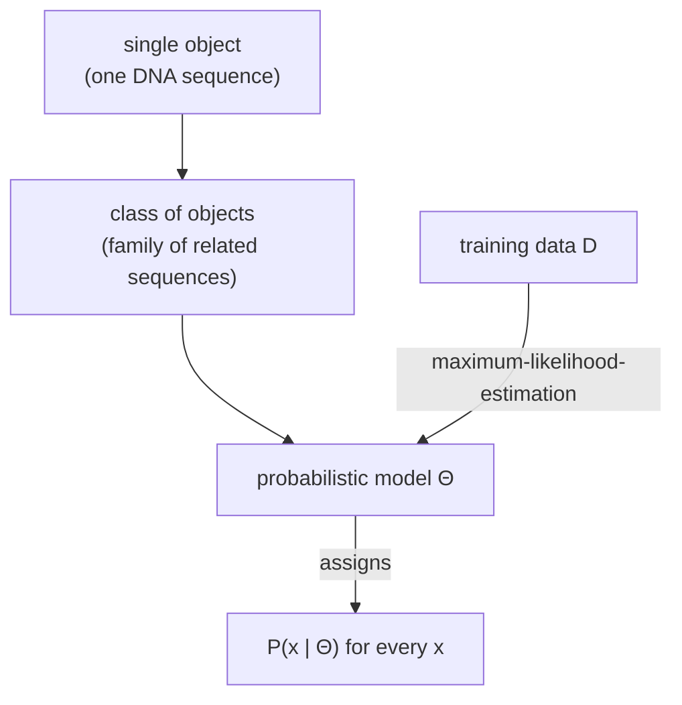

# Probabilistic Model

## Definition

A **model** is a system that simulates, represents or approximates an object under
consideration (gik_1_2, p. 2).

A **probabilistic model** is a model that produces different outcomes with different
probabilities. It simulates, represents or approximates a *whole class* of objects, assigning
each a probability (gik_1_2, p. 2).

Two defining properties (gik_1_2, p. 1):
- model parameters are derived by statistics;
- model descriptions are based on probabilities.

## Why it matters

This is the organising idea of the whole module. A single DNA sequence is an object; a
probabilistic model describes a *family* of related sequences and tells you how likely each one
is. Everything downstream — [[markov-chain]], [[hidden-markov-model]], [[mixture-model]] — is a
particular choice of probabilistic model, and every training method
([[maximum-likelihood-estimation]], [[expectation-maximization]], [[baum-welch-algorithm]]) is a
way of setting its parameters from data.

## Mechanism

The simplest sequence model treats positions as independent, with one probability `q_a` per
symbol `a ∈ Σ`. For a sequence `x` of length `n` (gik_1_2, p. 2):

```
P(x) = ∏(i = 1 to n) q_(x[i])
```

All parameters of a model are collectively called `Θ` (gik_1_2, p. 3). For DNA sequences,
`Θ = { q_a : a ∈ Σ }`.



## Worked example

Alphabet `Σ = {A, C, G, T}` with `q_A = q_C = q_G = q_T = 0.25`. Then for `x = ACGT`:

```
P(ACGT) = 0.25 · 0.25 · 0.25 · 0.25 = 0.00390625 = 4^(−4)
```

Every sequence of length 4 is equally likely under this model — which is precisely why it is too
weak to recognise [[cpg-island|CpG islands]], and why [[markov-chain|Markov chains]] are
introduced in unit 2.

## Pitfalls & exam traps

> [!warning]
> - The independence assumption `P(x) = ∏ q_(x[i])` is a *modelling choice*, not a fact. Unit 2
>   exists because it is wrong for real genomes: the frequency of `CG` dinucleotides is far lower
>   than `q_C · q_G` would predict. See [[cpg-island]].
> - Products of many probabilities underflow to zero in floating point. See
>   [[log-space-computation]].

## Related

- [[probability-basics]] — the rules a probabilistic model must obey.
- [[maximum-likelihood-estimation]] — how `Θ` is chosen from data.
- [[markov-chain]] — drops the independence assumption, conditioning on the predecessor.
- [[mixture-model]] — a model combining several component distributions.

## Sources

- gik_1_2, pp. 1–3 (unit 1).
