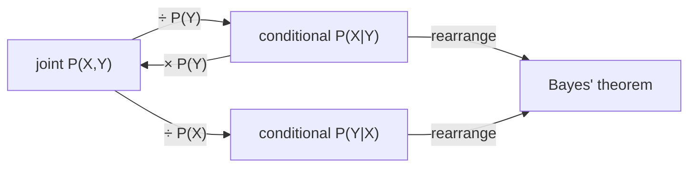

# Probability Basics

## Definition

An **event** (Ereignis) is a set of outcomes to which a probability is assigned. We assume a
**sample space** (Ergebnisraum) Ω; every event is a subset `A ⊆ Ω` (gik_1_2, p. 1).

A **probability** is a function `P` assigning a number to an event `A ⊆ Ω`, subject to three
axioms (gik_1_2, p. 1):

| # | Axiom | Meaning |
|---|---|---|
| 1 | `0 ≤ P(A) ≤ 1` for all `A ⊆ Ω` | probabilities are normalised |
| 2 | `P(Ω) = 1` | something always happens |
| 3 | `P(A ∪ B) = P(A) + P(B)` for all `A, B ⊆ Ω` with `A ∩ B = ∅` | additivity on disjoint events |

If `A` and `B` are **not** disjoint, inclusion–exclusion applies:

```
P(A ∪ B) = P(A) + P(B) − P(A ∩ B)
```

## Why it matters

Everything else in units 1–2 is built on this: [[maximum-likelihood-estimation]] maximises a
probability, [[prior-posterior-probability]] rearranges conditional probabilities, and
[[markov-chain]] and [[hidden-markov-model]] are nothing but structured products of conditional
probabilities.

## Conditional and joint probability

Events often come from different sample spaces, where the occurrence of one depends on the
other, or where they occur together (gik_1_2, p. 2).

**Conditional probability** (bedingte Wahrscheinlichkeit) — the probability of event `X` given
that event `Y` occurred:

```
P(X | Y) = P(X ∩ Y) / P(Y)
```

**Joint probability** (gemeinsame/kombinierte Wahrscheinlichkeit) — the probability of two
events occurring together:

```
P(X, Y) = P(X | Y) · P(Y)
```

Expanding both directions gives the symmetry that [[prior-posterior-probability|Bayes' theorem]]
exploits:

```
P(X, Y) = P(X | Y) P(Y) = P(X ∩ Y) = P(Y ∩ X) = P(Y | X) P(X)
```



## Worked example — dice (gik_1_2, p. 2)

Sample space for two dice `{D₁, D₂}`. The probability of rolling `i` with die `D₁` is the
conditional probability `P(i | D₁)`. The probability of picking die `Dⱼ` *and* rolling `i` is the
joint probability `P(i, Dⱼ) = P(i | Dⱼ) · P(Dⱼ)`.

With a fair die and a fair choice of die: `P(6, D₁) = (1/6) · (1/2) = 1/12`.

## Pitfalls & exam traps

> [!warning]
> - Axiom 3 holds **only** for disjoint events. Forgetting the `− P(A ∩ B)` correction term for
>   overlapping events is the classic mistake.
> - `P(X | Y)` and `P(Y | X)` are different numbers. Confusing them is exactly the error that
>   [[prior-posterior-probability|Bayes' theorem]] exists to correct.
> - `P(X | Y)` is undefined when `P(Y) = 0`.

## Related

- [[probabilistic-model]] — assigns probabilities to whole classes of objects using these rules.
- [[prior-posterior-probability]] — Bayes' theorem, derived directly from the definitions above.
- [[maximum-likelihood-estimation]] — picks model parameters that maximise a probability.

## Sources

- gik_1_2, pp. 1–2 (unit 1).
