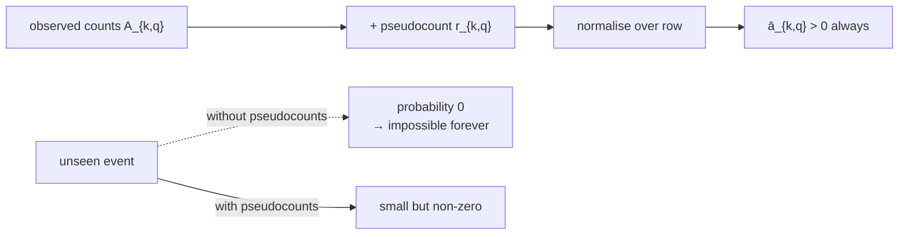

# Pseudocounts

## Definition

Pseudocounts `r_{k,q}` and `r_k(b)` are artificial counts added to the observed counts before
normalising, so that no probability is ever exactly zero or undefined (gik_1_2, p. 21).

```
            A_{k,q} + r_{k,q}                         E_k(b) + r_k(b)
ā_{k,q} = ───────────────────────      ē_k(b) = ──────────────────────────
          Σ(q') (A_{k,q'} + r_{k,q'})            Σ(c ∈ Σ) (E_k(c) + r_k(c))
```

## Why it matters

Training by counting ([[hmm-parameter-training]]) overfits a finite training set:

- if transition `k → q` is never seen, `ā_{k,q} = 0`;
- if state `k` is never seen, `ē_k(b)` is **undefined** (0/0).

A zero transition probability is not "unlikely" — it is "impossible". Any sequence requiring
that transition gets probability exactly 0, regardless of how well the rest of the sequence
fits. Pseudocounts replace "never observed" with "not yet observed".



## Worked example

State `k` with alphabet `Σ = {A, C, G, T}`, observed emission counts `E_k = (5, 0, 3, 2)`,
total 10.

Without pseudocounts: `ē_k(C) = 0/10 = 0`. Any sequence with `C` emitted in state `k` has
probability 0.

With uniform pseudocount `r_k(b) = 1` for every `b`:

```
ē_k(A) = (5+1)/(10+4) = 6/14 ≈ 0.43
ē_k(C) = (0+1)/(10+4) = 1/14 ≈ 0.07
ē_k(G) = (3+1)/(10+4) = 4/14 ≈ 0.29
ē_k(T) = (2+1)/(10+4) = 3/14 ≈ 0.21
```

Still sums to 1, and nothing is impossible.

## Pitfalls & exam traps

> [!warning]
> - The pseudocounts must be added to the **denominator** too, otherwise the row no longer sums
>   to 1.
> - Large pseudocounts relative to the data wash out the signal; small ones barely regularise.
>   The size encodes how strong your prior belief is.
> - Pseudocounts matter in both training cases — they are an input to the
>   [[baum-welch-algorithm|Baum–Welch algorithm]], not just to counting.

> [!note] Outside source
> Adding 1 to every count is known as Laplace smoothing, and pseudocounts correspond to a
> Dirichlet prior in a Bayesian treatment. Neither name appears in the lecture notes.

## Related

- [[hmm-parameter-training]] — where the overfitting problem arises.
- [[baum-welch-algorithm]] — takes pseudocounts as explicit input.
- [[maximum-likelihood-estimation]] — the unregularised estimator being corrected.
- [[markov-chain]] — zero transition counts cause the same problem there.

## Sources

- gik_1_2, p. 21 (unit 2); p. 23 (Baum–Welch input).
