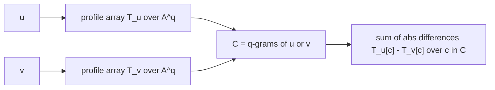

# q-gram Distance

## Definition

The **q-gram distance** (q-Gramm-Distanz) of `u` and `v` is the number of differences between their
[[q-gram|q-gram profiles]] (fsa_part2, p. 5):

```
qgdist(u, v) = Σ_{w ∈ A^q} | P_{u,q}(w) - P_{v,q}(w) |
```

where `P_{u,q}(w)` is the number of positions in `u` at which the q-gram `w` occurs, `A` is the
alphabet with `r = |A|`, `m = |u|`, `n = |v|`.

## Why it matters

`qgdist` compares two sequences **without aligning them**: position is irrelevant, only
multiplicities matter. It is computable in essentially linear time and lower-bounds the unit edit
distance, making it a filter in the same role as [[maximal-matches-distance]]
(fsa_part2, pp. 5, 7).

## Not a metric

Of the metric axioms (fsa_part2, p. 5):

| Axiom | Holds? |
|---|---|
| Symmetry `qgdist(u,v) = qgdist(v,u)` | yes |
| Triangle inequality | yes |
| Zero property (`qgdist(u,v) = 0 => u = v`) | **no** |

Hence `qgdist` is **not** a metric: two different sequences can have identical q-gram profiles.

> [!note] Inference
> The page states only that the zero property fails. The standard witness is a pair of distinct
> sequences sharing a profile, e.g. for `q = 2` the strings `u = a b a b a` and a rearrangement with
> the same multiset of 2-grams; the lecture does not give an explicit example.

## Construction / Mechanism



Restricting the final sum to `C` (the q-grams actually occurring) rather than all of `A^q` is what
keeps step 3 proportional to `m + n`; the `r^q` term is paid only for allocating/initialising the
two arrays (fsa_part2, p. 7).

## Pseudocode

```text
ALGORITHM QgramDistance(u[1..m], v[1..n], q, r)
  for c = 0 to r^q - 1:                       // O(r^q)
    T_u[c] <- 0
    T_v[c] <- 0
  C <- empty list
  for i = 1 to m - q + 1:                     // O(m), codes rolled in O(1) each
    c <- code(u[i .. i+q-1])
    if T_u[c] = 0 and T_v[c] = 0:  append c to C
    T_u[c] <- T_u[c] + 1
  for j = 1 to n - q + 1:                     // O(n)
    c <- code(v[j .. j+q-1])
    if T_u[c] = 0 and T_v[c] = 0:  append c to C
    T_v[c] <- T_v[c] + 1
  d <- 0
  for each c in C:                            // O(m + n)
    d <- d + | T_u[c] - T_v[c] |
  return d
```

Steps as given on p. 7: (1) accumulate the profiles of `u` and `v` into arrays `T_u`, `T_v` with
`T_u[w] = P_{u,q}(w)`, `T_v[w] = P_{v,q}(w)`; (2) compute `C = { w | w is a q-gram of u or v }`;
(3) `qgdist(u,v) = Σ_{c ∈ C} |T_u[c] - T_v[c]|`.

## Complexity

| Operation | Time | Space |
|---|---:|---:|
| Profile accumulation into `T_u`, `T_v` | `O(m + n + r^q)` | `O(r^q)` |
| Occurring-code set `C` | `O(m + n)` | `O(m + n)` |
| Summation over `C` | `O(m + n)` | `O(1)` |
| **Total** | `O(m + n + r^q)` | `O(m + n + r^q)` |

If `r^q ∈ O(m + n)`, the method is **optimal** (fsa_part2, p. 7).

## Filter for edit distance

```
qgdist(u, v) / (2 · q)  <=  edist_δ(u, v)
```

(fsa_part2, p. 7). So with threshold `k`, a pair with `qgdist(u,v) > 2qk` can be discarded without
running the DP, exactly as with `mmdist` (fsa_part2, pp. 4, 7).

> [!note] Inference
> The factor `2q` is intuitive: one edit operation touches at most `q` q-gram occurrences in each of
> the two profiles, so it changes the `L1` sum by at most `2q`.

## Worked example

`A = {a, c}` (`r = 2`), `q = 2`, `u = a a c a`, `v = a c a c`.

| q-gram | `aa` | `ac` | `ca` | `cc` |
|---|---:|---:|---:|---:|
| `P_{u,2}` | 1 | 1 | 1 | 0 |
| `P_{v,2}` | 0 | 2 | 1 | 0 |
| `\|difference\|` | 1 | 1 | 0 | 0 |

`qgdist(u, v) = 2`. The filter bound gives `edist_δ(u, v) >= 2 / (2·2) = 0.5`, i.e. `>= 1` after
rounding up — consistent with `u != v`. With a threshold `k = 0` the pair would already be
discarded.

## Part 3 addendum — qgdist vs. edist, all three orderings

Part 3 returns to the comparison of `qgdist` with `edist_δ` and settles it with three examples
(fsa_part3, p. 5): **neither quantity dominates the other, and `q` decides which way the
inequality goes.** The same pair of sequences is used for the first two, with only `q` changed:

```
u = R Y R R Y R Y R R          (m = 9)
v = R R R Y R Y R Y R R        (n = 10)
```

Their unit edit distance is `edist_δ(u, v) = 2`, realised by one replacement and one insertion:

```
u:  R  Y  R  -  R  Y  R  Y  R  R
v:  R  R  R  Y  R  Y  R  Y  R  R
op: M  R  M  I  M  M  M  M  M  M
```

### Case 1 — `qgdist > edist`, with `q = 3`

| 3-gram | `#` in `u` | `#` in `v` | abs. difference |
|---|---:|---:|---:|
| `RRR` | 0 | 1 | 1 |
| `RRY` | 1 | 1 | 0 |
| `RYR` | 3 | 3 | 0 |
| `YRR` | 2 | 1 | 1 |
| `YRY` | 1 | 2 | 1 |
| **total** | **7** | **8** | **3** |

`qgdist_3(u, v) = 3 > 2 = edist_δ(u, v)` (fsa_part3, p. 5).

### Case 2 — `qgdist < edist`, with `q = 2`

| 2-gram | `#` in `u` | `#` in `v` | abs. difference |
|---|---:|---:|---:|
| `RR` | 2 | 3 | 1 |
| `RY` | 3 | 3 | 0 |
| `YR` | 3 | 3 | 0 |
| **total** | **8** | **9** | **1** |

`qgdist_2(u, v) = 1 < 2 = edist_δ(u, v)` (fsa_part3, p. 5).

### Case 3 — `qgdist = edist`

`u = v = ACCC`, `q = 3`. Both profiles are `{ACC: 1, CCC: 1}`, so `qgdist_3 = 0 = edist_δ`
(fsa_part3, p. 5). Equality is forced whenever the sequences are identical, and that is the only
case the lecture gives.

> [!warning]
> Cases 1 and 2 are the exam point: `qgdist` is **not** a bound on `edist_δ` in either direction.
> The only valid one-sided statement is the scaled bound of the *Filter for edit distance* section
> above, `qgdist(u, v) / (2q) <= edist_δ(u, v)`. Check it here: `q = 3` gives `3/6 = 0.5 <= 2` ✓
> and `q = 2` gives `1/4 = 0.25 <= 2` ✓. Both hold comfortably — the division by `2q` is exactly
> what makes case 1 harmless.

> [!note] Inference
> Why the direction flips with `q`: a single edit touches at most `q` q-grams on each side, so a
> larger `q` inflates `qgdist` (case 1), while a smaller `q` over a tiny alphabet (`|A| = 2` here)
> makes profiles collide and *deflates* it (case 2). The lecture states the examples but not this
> explanation.

## Pitfalls & exam traps

> [!warning]
> - Not a metric — only the **zero property** fails; symmetry and the triangle inequality do hold.
>   Do not claim the triangle inequality fails.
> - Distance `0` does not mean equal sequences, so `qgdist` can never *prove* similarity, only
>   *refute* it. All filter survivors need verification.
> - The bound is `qgdist/(2q) <= edist_δ`, not `qgdist <= edist_δ`. Forgetting the `2q` makes the
>   filter unsound in the wrong direction.
> - The `r^q` space term is the practical limit; for proteins (`r = 20`) even `q = 5` means
>   `3.2·10^6` cells. This is the motivation for [[minhash-sketch]].
> - `qgdist` ignores the order of q-grams entirely — this is exactly the difference to FASTA's
>   diagonal model (fsa_part2, p. 18).

## Related

- [[q-gram]] — the profile and the integer coding this distance is built on.
- [[maximal-matches-distance]] — the other lower-bound filter, with bound `mmdist <= edist_δ`.
- [[unit-edit-distance]] — the quantity being filtered for.
- [[edit-distance-dp]] — the expensive verification step after filtering.
- [[jaccard-index]] — set-based alternative, `O(m+n)` with no `r^q` term.
- [[minhash-sketch]] — sketching that removes the `O(r^q)` space requirement.
- [[fasta-database-search]] — contrasts with `qgdist` by requiring q-gram matches on a common diagonal.
- [[fsa_part2]] — source page for this unit.
- [[fsa_part3]] — source page for the three qgdist-vs-edist examples.

## Sources

- fsa_part2, pp. 5, 7 (raw file `raw/foundations_seqzence_analysis_part2.pdf`)
- fsa_part3, p. 5 (`raw/foundations_sequence_analysis_part3.pdf`) — `qgdist` vs. `edist` examples
