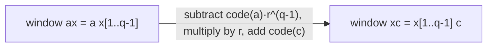

# q-gram

## Definition

For `q > 0`, a **q-gram** (q-Gramm) of a sequence `s` is a substring of `s` of length `q`
(fsa_part2, p. 5). A sequence of length `m` has `m - q + 1` q-gram occurrences (one per start
position).

The **q-gram profile** (q-Gramm-Profil) of `u` is the function

```
P_{u,q} : A^q -> N
```

where `P_{u,q}(w)` is the number of different positions in `u` at which `w` occurs
(fsa_part2, p. 5).

Symbols: `A` — alphabet, `r = |A|`; `A^q` — the set of all `r^q` words of length `q`;
`m = |u|`, `n = |v|`.

## Why it matters

q-grams are the unit of **alignment-free** comparison: many shared q-grams means small distance,
*independently of where* they occur (fsa_part2, p. 5). They are also the seeding unit of
[[fasta-database-search]] and [[blast]], the sampling unit of [[minhash-sketch]], and the index
unit of [[q-gram-suffix-array-construction]]. The fixed length `q` is what makes constant-time
integer coding possible.

One chooses `q << n`; e.g. `8 <= q <= 11` for an entire bacterial genome (fsa_part2, p. 5).

## Construction / Mechanism — integer coding

Let `A = {a_1, ..., a_r}` be an ordered alphabet with `a_1 < ... < a_r`. The **character code** is

```
code(a_l) = l - 1
```

and the **q-gram code** of `w ∈ A^q` is (fsa_part2, p. 6):

```
code(w) = Σ_{i=1}^{q} code(w[i]) · r^{q-i}
          └ char code ┘  └ weight ┘
```

with value range `code(w) ∈ {0, ..., r^q - 1}`. Since `|A^q| = r^q` and the interval
`[0, r^q - 1]` holds exactly `r^q` integers, the mapping is **bijective** — it is a radix-`r`
number with the q-gram as its digit string, so there are **no collisions** (fsa_part2, p. 6).

### Constant-time rolling-window update

Sliding the window one position right drops the leading character `a` (weight `r^{q-1}`) and
appends `c` (weight `r^0`) (fsa_part2, p. 6):

```
code(xc) = ( code(ax) - code(a) · r^{q-1} ) · r + code(c)
```

where `ax` is the previous q-gram (leading char `a`, remainder `x` of length `q-1`) and `xc` is the
next one. This is `O(1)` per position, so all q-gram codes of a sequence are obtained in `O(m)`
after the first code is computed in `O(q)`.



## Pseudocode

```text
ALGORITHM QgramCodes(s[1..m], q, r)
  c <- 0
  for i = 1 to q:
    c <- c * r + code(s[i])                  // initial code, O(q)
  C[1] <- c
  p <- r^(q-1)                               // precomputed once
  for i = 2 to m - q + 1:
    c <- ( c - code(s[i-1]) * p ) * r + code(s[i+q-1])
    C[i] <- c
  return C[1 .. m-q+1]
```

```text
ALGORITHM QgramProfile(s[1..m], q, r)
  for c = 0 to r^q - 1:  T[c] <- 0
  C <- QgramCodes(s, q, r)
  for i = 1 to m - q + 1:  T[C[i]] <- T[C[i]] + 1
  return T                                    // T[code(w)] = P_{s,q}(w)
```

## Complexity

| Operation | Time | Space |
|---|---:|---:|
| First q-gram code | `O(q)` | `O(1)` |
| Each subsequent code (rolling update) | `O(1)` | `O(1)` |
| All codes of `s`, `\|s\| = m` | `O(m)` | `O(m)` (or `O(1)` streamed) |
| Full profile array `T` over `A^q` | `O(m + r^q)` | `O(r^q)` |

(fsa_part2, pp. 6–7)

## Worked example

`A = {a, c}`, so `r = 2`, `code(a) = 0`, `code(c) = 1`; `q = 2`, `u = a a c a` (fsa_part2, p. 5).

Profile:

| q-gram `w` | `aa` | `ac` | `ca` | `cc` |
|---|---:|---:|---:|---:|
| `code(w)` | 0 | 1 | 2 | 3 |
| `P_{u,2}(w)` | 1 | 1 | 1 | 0 |

The lexicographically ordered profile list is `[1, 1, 1, 0]`, indexed by `code(w)` over
`0 .. r^q - 1 = 0 .. 3`.

Rolling update trace with `p = r^{q-1} = 2`:

| window | computation | code |
|---|---|---:|
| `aa` (i=1) | `0·2 + 0` | 0 |
| `ac` (i=2) | `(0 − code(a)·2)·2 + code(c) = 0·2 + 1` | 1 |
| `ca` (i=3) | `(1 − code(a)·2)·2 + code(a) = 1·2 + 0` | 2 |

## Part 3 addendum — complement coding and the rolling update

Part 3 revisits q-gram codes with a second coding function (fsa_part3, p. 4):

```
code(w) = Σ_{i=1}^{q}  wc( w[q-i+1] ) · r^{q-i}
```

where `wc` is the **Watson–Crick complement** (fsa_part3, p. 4):

| `b` | A | C | G | T |
|---|---:|---:|---:|---:|
| numeric code | 0 | 1 | 2 | 3 |
| `wc(b)` | T | G | C | A |
| `wc(b)` numeric | 3 | 2 | 1 | 0 |

so `wc(b) = 3 − b` on the numeric codes, i.e. complementation is a single subtraction.

> [!note] Inference
> The index reversal `w[q−i+1]` combined with `wc` means this is exactly the ordinary code of the
> **reverse complement** of `w`: `code_part3(w) = code_part2( rc(w) )`. The lecture does not say
> this, but it is what the formula computes, and it is why the coding is useful — a double-stranded
> q-gram index can store one canonical code per strand pair. Check with `q = 2`, `r = 4`,
> `w = AC`: `wc(w[2])·4 + wc(w[1])·1 = 2·4 + 3 = 11`, and `rc(AC) = GT` has
> `code(GT) = 2·4 + 3 = 11` ✓.

Equivalently, re-indexing with `h = q − i + 1`:

```
code(w) = Σ_{h=1}^{q}  wc( w[h] ) · r^{h-1}
```

— the *leftmost* character now carries the *lowest* weight `r^0`, the opposite of the part-2
convention. That is the key to the rolling update.

### Rolling update

Sliding the window from `ax` to `xc` (drop the leading `a`, append the trailing `c`,
`x ∈ A^{q−1}`), as transcribed (fsa_part3, p. 4):

```
code(xc) <- ( code(ax) - wc(a) · r^0 ) · r^(-1)  +  wc(c) · r^(q-1)
```

i.e. remove the `r^0`-weighted leading character, shift every remaining weight down by one
(integer division by `r`), and insert the new character at the top weight `r^{q−1}`. `O(1)` per
position, so all `n − q + 1` q-gram codes of a sequence cost `O(n)`.

**Worked check** (`q = 3`, `r = 4`, window `ACG` → `CGT`):

| step | value |
|---|---:|
| `code(ACG) = wc(A)·1 + wc(C)·4 + wc(G)·16 = 3 + 8 + 16` | `27` |
| subtract `wc(A)·r^0 = 3` | `24` |
| divide by `r = 4` | `6` |
| add `wc(T)·r^2 = 0·16` | `6` |
| direct: `code(CGT) = wc(C)·1 + wc(G)·4 + wc(T)·16 = 2 + 4 + 0` | `6` ✓ |

> [!question]
> The exponents in the handwritten update (`r^0`, `r^{−1}`, `r^{q−1}`) are partly illegible and at
> first sight clash with the part-2 formula, where the *leading* character carries weight
> `r^{q−1}`. They are in fact consistent — but only under the reversed weighting of the part-3
> coding above. If you use the part-2 code, the update is the mirror image:
> subtract `code(a)·r^{q−1}`, multiply by `r`, add `code(c)·r^0`.

### Multi-eops lists

p. 4 also records q-grams alongside **multi-eops lists** — run-length-compressed edit-operation
sequences of the form `[R 2, I 1, R 4, D 1, R 1]`, where each entry is an operation and the number
of consecutive positions it applies to. They are the output format used by the linear-space
alignment of [[hirschberg-linear-space-alignment]]: a q-gram filter proposes candidate regions,
and the alignment of each candidate is returned as a multi-eops list rather than as a full
alignment string.

## Pitfalls & exam traps

> [!warning]
> - `P_{u,q}(w)` counts **positions**, not distinct q-grams: a repeated q-gram contributes its
>   multiplicity.
> - The page writes "`# q-grams = r^q - 1`"; that is the **largest index**, not the count. The count
>   is `r^q` and indices run `0 .. r^q - 1`.
> - `code` is 0-based on characters (`code(a_1) = 0`), even where the rest of the unit is 1-based.
> - The rolling update needs `r^{q-1}` precomputed; recomputing it inside the loop destroys the
>   `O(1)` claim.
> - The profile array costs `O(r^q)` space regardless of `m`; that is the term that explodes for
>   proteins (`r = 20`).

## Related

- [[q-gram-distance]] — the `L1` distance between two q-gram profiles.
- [[match-count]] — counts matching *characters* in a q-gram pair rather than exact q-gram equality.
- [[jaccard-index]] — set-based comparison of the q-gram sets `G_q(u)`, `G_q(v)`.
- [[minhash-sketch]] — samples q-gram hash values instead of enumerating the full profile.
- [[fasta-database-search]] — uses `code` to index the query table `h_w(c)`.
- [[blast]] — uses `code` to index the bit vector `V` over `A^q`.
- [[q-gram-suffix-array-construction]] — q-grams as a bucketing device for index construction.
- [[fsa_part2]] — source page for this unit.
- [[fsa_part3]] — source page for the complement coding and the rolling update.
- [[hirschberg-linear-space-alignment]] — produces the multi-eops lists mentioned on p. 4.

## Sources

- fsa_part2, pp. 5–6 (raw file `raw/foundations_seqzence_analysis_part2.pdf`)
- fsa_part3, p. 4 (`raw/foundations_sequence_analysis_part3.pdf`) — `wc` coding, rolling update, multi-eops
