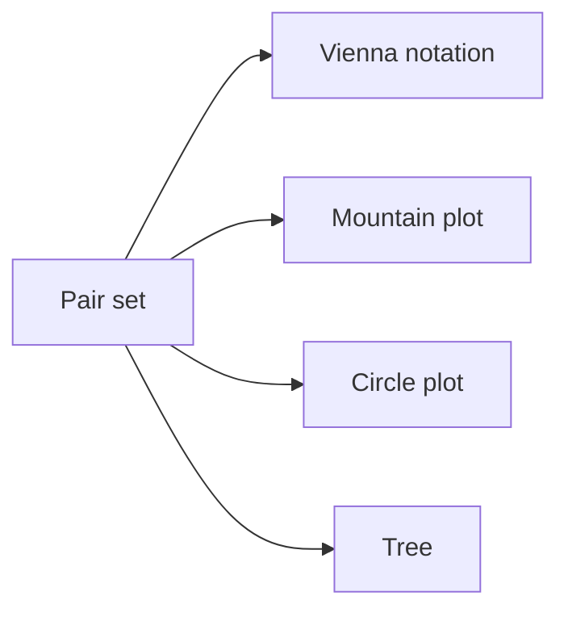

# RNA Secondary Structure Representation

## Definition

The notes represent RNA secondary structures as base-pair graphs, mountain plots, Vienna dot-bracket notation, circle plots, and trees (gik_3_4, p. 2).

## Why it matters

Different representations expose different exam tasks: Vienna notation is easy to parse, circle plots expose crossings, and trees expose loop nesting for [[rna-loop-energy-dp]] (gik_3_4, pp. 2-3).

## Construction / Mechanism



## Pseudocode

```text
ALGORITHM ParseVienna(dotbracket[1..n])
  stack <- empty stack
  pairs <- empty list
  for idx = 1 to n:
    if dotbracket[idx] = '(':
      push idx onto stack
    else if dotbracket[idx] = ')':
      left <- pop stack
      append (left, idx) to pairs
  sort pairs by first coordinate
  return pairs
```

## Complexity

| Operation | Time | Space |
|---|---:|---:|
| Parse Vienna notation | `O(n)` | `O(n)` |
| Convert pair set to plot/tree | `O(n+b)` | `O(n+b)` |

## Worked example

`((..))` pushes positions 1 and 2, then closes `(2,5)` and `(1,6)`. The mountain plot rises twice, stays level over the dots, and descends twice (gik_3_4, pp. 2-3).

## Pitfalls & exam traps

> [!warning]
> - Dots are unpaired bases, not wildcards.
> - The stack stores sequence positions, not stack depths.
> - Standard dot-bracket assumes non-crossing structures.

## Related

- [[rna-secondary-structure]] — object represented.
- [[rna-loop-energy-dp]] — uses loop nesting exposed by tree-like views.
- [[sheet-03]] — parses/counts simplified structures.

## Sources

- gik_3_4, pp. 2-3
