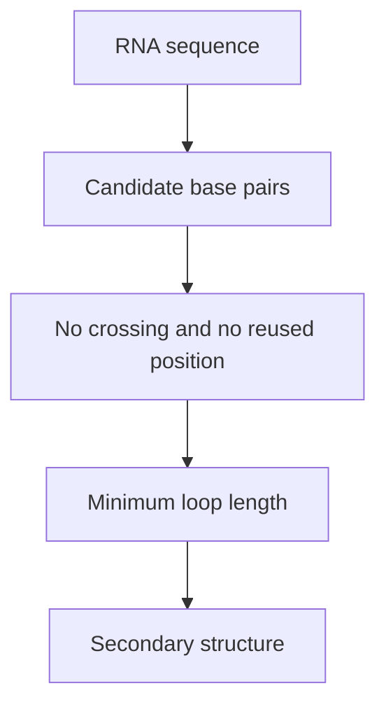

# RNA Secondary Structure

## Definition

For an RNA sequence `w[1..n]` over `{A,C,G,U}`, an RNA secondary structure is a set `S_w` of base pairs `(i,j)` with `1≤i<j≤n`, no position in two pairs, no crossing pairs, only allowed pairs `(A,U),(U,A),(G,C),(C,G),(G,U),(U,G)`, and at least `l_min` enclosed positions (gik_3_4, p. 1).

## Why it matters

The non-crossing restriction excludes pseudoknots and lets [[nussinov-algorithm]] and [[rna-loop-energy-dp]] split a sequence interval into independent subintervals (gik_3_4, pp. 1, 5-9).

## Construction / Mechanism



For `w=A G C U`, pair `(1,4)` is allowed chemically and encloses two positions. Pair `(2,3)` is chemically allowed but violates `j-i-1≥l_min` when `l_min=1` (gik_3_4, p. 1).

## Pseudocode

```text
ALGORITHM IsLegalSecondaryStructure(w[1..n], S, l_min)
  used[1..n] <- false
  for each pair (i,j) in S:
    if not (1 <= i and i < j and j <= n): return false
    if used[i] or used[j]: return false
    if not AllowedPair(w[i], w[j]): return false
    if j - i - 1 < l_min: return false
    used[i] <- true
    used[j] <- true
  for each pair (i,j) in S:
    for each pair (i2,j2) in S:
      if i < i2 and i2 < j and j < j2: return false
  return true
```

## Complexity

| Operation | Time | Space |
|---|---:|---:|
| Validate `b` pairs | `O(b^2)` | `O(n)` |
| Store a structure | `O(b)` | `O(b)` |

## Worked example

`{(1,4)}` is legal for `A G C U` with `l_min=1`; `{(1,4),(2,3)}` is not, because `(2,3)` encloses zero positions. A crossing example is `{(1,3),(2,4)}` (gik_3_4, p. 1).

## Pitfalls & exam traps

> [!warning]
> - Allowed chemistry is necessary but not sufficient: loop length can still reject a pair.
> - Crossing pairs are pseudoknot-like and excluded.
> - A base cannot be paired twice even if no crossing is drawn.

## Related

- [[rna-secondary-structure-representation]] — encodes the same pair set in dot-bracket, plots, and trees.
- [[rna-free-energy-model]] — scores legal structures.
- [[nussinov-algorithm]] — optimises over legal structures under independent pair energies.

## Sources

- gik_3_4, p. 1
