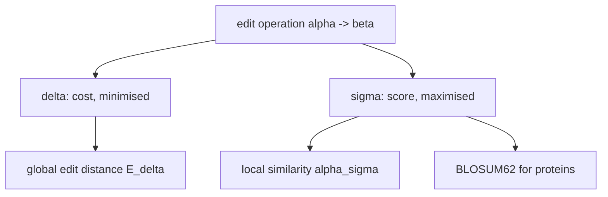

# Score Function

## Definition

A score function (Scorefunktion) `σ` assigns to every [[edit-operation]] `α → β` a score
`σ(α → β) ∈ ℝ` (fsa_part1, p. 13). For an [[alignment]] `A` of length `h`:

```
σ(A) = Σ_{i=1}^{h} σ(α_i -> β_i)
```

The **similarity score** of two strings `u'`, `v'` is the **maximum** over all alignments:

```
score_σ(u', v') = max { σ(A) | A is an alignment of u' and v' }
```

## Why it matters

Costs are minimised and bounded below by 0; scores are **maximised** and may be negative. That
sign freedom is what makes [[local-similarity|local alignment]] possible: a negative-scoring
prefix can be discarded, whereas a non-negative cost can never be "undone" (fsa_part1, pp. 13, 15).

Biologically: amino-acid replacements are not equally plausible. A score matrix such as
**BLOSUM62** for proteins encodes which substitutions are observed in related sequences more often
than by chance, giving them positive scores, and penalises the rest (fsa_part1, p. 13).

## Cost vs. score — the contrast

| | cost `δ` | score `σ` |
|---|---|---|
| objective | minimise | maximise |
| sign | `δ(α→β) >= 0`, `δ(α→ε) > 0` | any real |
| pairwise value | `edist_δ(u,v) = min δ(A)` | `score_σ(u,v) = max σ(A)` |
| metric? | yes, under symmetry + triangle inequality | no notion of metric |
| typical use | global comparison, [[approximate-string-matching]], [[overlap-alignment]] | [[local-similarity]], [[smith-waterman]] |

(fsa_part1, pp. 5–6 vs. 13; summarised on p. 24: "local alignment maximises score while the others
minimise distances".)



## The condition (3.3)

The [[smith-waterman]] recurrence is only correct for score functions satisfying
(fsa_part1, p. 15)

```
(3.3)   loc_σ(s, ε) = loc_σ(ε, s) = 0   for all s ∈ A*
```

i.e. aligning anything against the empty string must not be profitable. In practice this means
indel scores must be `<= 0` and the empty alignment scores 0.

> [!note] Inference
> The "indel scores `<= 0`" reading is the standard consequence of (3.3); the script states the
> condition abstractly (fsa_part1, p. 15) without deriving it.

## Worked example

Toy DNA score function: `σ(a → a) = +2` (match), `σ(a → b) = −1` for `a ≠ b` (mismatch),
`σ(a → ε) = σ(ε → a) = −2` (indel). Check (3.3): any alignment of `s` with `ε` consists only of
indels and scores `−2|s| <= 0`, and the empty alignment scores 0, so `loc_σ(s,ε) = 0` ✓.

`u' = ACGT`, `v' = AGGT`:

```
A C G T
A G G T
```

`σ(A) = 2 + (−1) + 2 + 2 = 5`. No alignment beats it (any indel costs −2 and cannot recover), so
`score_σ(ACGT, AGGT) = 5`.

## Pitfalls & exam traps

> [!warning]
> - `score_σ(u',v')` is a **global** alignment problem on `u'` and `v'` — maximised, but with both
>   endpoints fixed. It is computed in `O(mn)` (fsa_part1, p. 14). The *local* problem is the max
>   over all substring pairs.
> - Do not mix signs: with a score function, a *bigger* number is *better*. Switching from `δ` to
>   `σ` means replacing every `min` with a `max` in the DP.
> - BLOSUM62 is a **replacement** score matrix; it says nothing about gap scores — those are
>   supplied separately, typically by the [[gap-cost-model|affine model]].
> - A score function has no zero property, so there is no triangle inequality and no clustering
>   guarantee — contrast [[cost-function]].

## Related

- [[cost-function]] — the minimisation counterpart; same alignment model, opposite objective.
- [[local-similarity]] — defined entirely in terms of `score_σ`.
- [[smith-waterman]] — the algorithm that maximises `σ` locally.
- [[alignment]] — the object being scored.
- [[gap-cost-model]] — how gaps are charged alongside a replacement matrix.

- [[fsa_part1]] ? source page for this part of the module.

## Sources

- fsa_part1, pp. 13–15, 24 (`raw/foundations_sequence_analysis_part1.pdf`)
