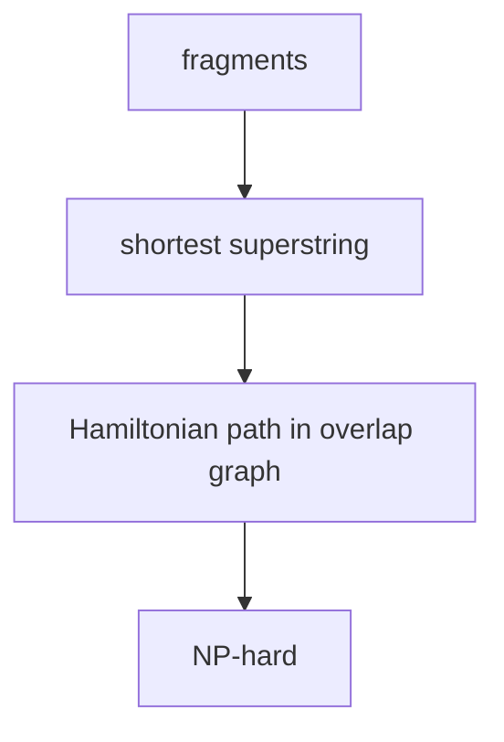

# Shortest Common Superstring

## Definition

Given a set `F` of fragments, an `F`-superstring contains every fragment as a substring. The
shortest common superstring (SCS) problem asks for a minimum-length such string (gik_6, p. 20).

## Why it matters

The notes present fragment assembly as approximately an SCS problem, then immediately highlight
why the assumptions are too strong: errors, reverse complements and repeats break the ideal model
(gik_6, pp. 20-22).

## Construction / Mechanism



A superstring of minimum length corresponds to a Hamiltonian path of maximum total overlap in the
overlap graph when the fragment set is containment-free (gik_6, p. 22).

## Pseudocode

```text
ALGORITHM SuperstringFromPath(P = f1, f2, ..., fk)
  S <- f1
  for i = 1 to k - 1:
    ell <- overlap length on edge fi -> f(i+1)
    append f(i+1)[ell+1 .. end] to S
  return S
```

## Complexity

| Operation | Time | Space |
|---|---:|---:|
| Exact SCS | NP-hard | instance dependent |
| Path-to-superstring conversion | `O(total output length)` | `O(output length)` |
| Greedy heuristic in notes | `O(ell + n^2)` after sorting overlaps | graph size |

## Worked example

For `F={ATG, TGCAT, GGA}`, the path `GGA -> ATG -> TGCAT` has overlaps `1` and `2`, so the
superstring is `GGATGCAT`. A different path can be longer, showing why maximising total overlap
minimises the represented superstring length.

## Pitfalls & exam traps

> [!warning]
> - SCS ignores sequencing errors; it requires exact substrings.
> - The shortest superstring need not be biologically correct in repeat-rich regions.
> - Greedy maximum-overlap assembly is heuristic and can be non-optimal (gik_6, p. 26).

## Related

- [[fragment-assembly]] — biological setting that motivates SCS.
- [[overlap-graph]] — graph formulation.
- [[greedy-fragment-assembly]] — heuristic for the NP-hard exact problem.
- [[all-pairs-suffix-prefix-matching]] — computes graph edges.

## Sources

- gik_6, pp. 20-22, 26
