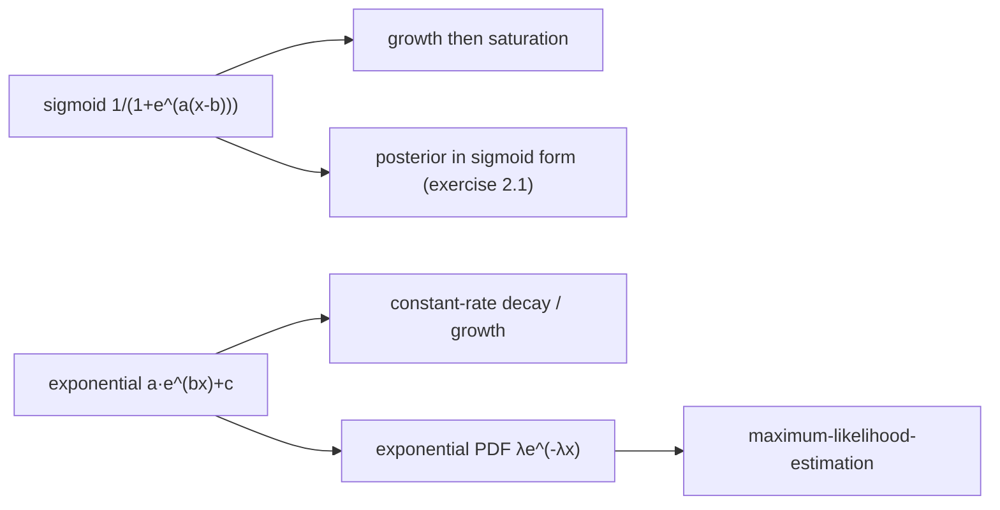

# Sigmoid and Exponential Functions

## Definition

Two function shapes used throughout the module to describe growth and saturation
(gik_1_2, p. 1).

**Sigmoid function:**

```
f(x) = 1 / (1 + e^(a(x − b)))
```

**Exponential function:**

```
f(x) = a · e^(bx) + c
```

## Parameter effects (sigmoid)

| Parameter | Condition | Effect |
|---|---|---|
| `a` | `a > 0` | curve falls (decreasing S-shape) |
| `a` | `a < 0` | curve rises (increasing S-shape) |
| `b` | `b < 0` | shifts the inflection point left |
| `b` | `b > 0` | shifts the inflection point right |

`b` is the location of the inflection point; `a` controls the steepness of the transition.

## Why it matters

The sigmoid describes processes that grow and then saturate. The lecture's example: describing
infection counts in pandemics, which initially grow exponentially and are then brought under
control (*Beschreibung Infektionszahlen von Pandemien, die anfänglich exponentiell wachsen und
dann unter Kontrolle gebracten werden*) — gik_1_2, p. 1.

The exponential shape reappears as a probability density in the
[[maximum-likelihood-estimation|MLE traffic-delay example]], where the number of consecutive
events falls by a constant rate.

> [!note] Inference
> The sigmoid is not just decorative: exercise 2.1 ([[sheet-02]]) shows that a posterior
> probability of the form `P(ext | x)` can be rewritten *exactly* into sigmoid form
> `exp(−log(1 + exp(ŷ − p̂)))`. The S-curve on page 1 and the exercise on page 26 are the same
> object. See [[log-space-computation]].



## Pitfalls & exam traps

> [!warning]
> Sign conventions matter. With `a > 0` in the form above the curve **falls**; many textbooks
> write `1/(1 + e^(−a(x−b)))` so that `a > 0` makes it rise. Check which convention a question
> uses before reading off the parameters.

## Related

- [[maximum-likelihood-estimation]] — the exponential PDF is the worked MLE example.
- [[log-space-computation]] — where the sigmoid form reappears via exercise 2.1.
- [[sheet-02]] — exercise 2.1, the posterior-to-sigmoid derivation.

## Sources

- gik_1_2, p. 1 (unit 1, "Probabilistic Model Analysis").
