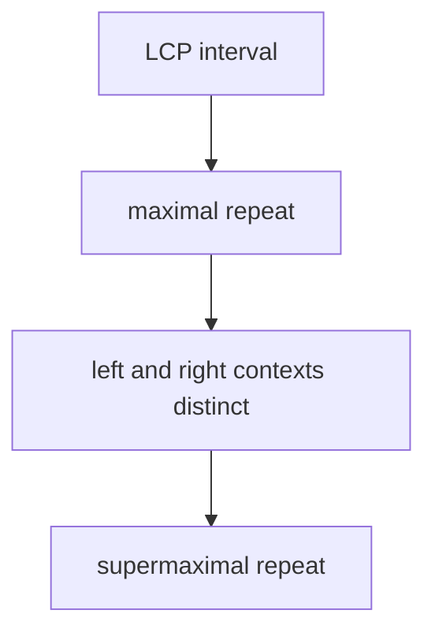

# Supermaximal Repeat

## Definition

A supermaximal repeat is a maximal repeat that is not contained as a substring in any other
maximal repeat (gik_6, p. 1).

## Why it matters

It is the most selective repeat class in the unit-5/6 chain: [[maximal-repeat-enumeration]]
finds all maximal repeats; supermaximal repeats discard those explainable as parts of longer
maximal repeats (gik_6, pp. 1-2).

## Construction / Mechanism

A string `w` is represented by an LCP interval `[l,r]` with value `|w|`. It is supermaximal when
all adjacent suffixes inside the interval have exactly that common prefix and the characters just
outside the interval are pairwise distinct (gik_6, pp. 1-2).



## Pseudocode

```text
ALGORITHM SupermaximalRepeats(S, SUF, LCP)
  for each local maximum interval [l,r] of value h in LCP:
    pairwiseDistinct <- true
    for p = l to r:
      for q = p + 1 to r:
        if S[SUF[p] - 1] = S[SUF[q] - 1]:
          pairwiseDistinct <- false
        if S[SUF[p] + h] = S[SUF[q] + h]:
          pairwiseDistinct <- false
    if pairwiseDistinct:
      output S[SUF[l] .. SUF[l] + h - 1]
```

## Complexity

| Operation | Time | Space |
|---|---:|---:|
| Enumerate local maxima | `O(n)` | `O(1)` extra |
| Pairwise context test | `O(σ)` per interval in notes' alphabet-bound form | `O(σ)` |
| Total in notes | `O(nσ)` | `O(n)` including arrays |

## Worked example

For `S=aaaaa`, `aa` occurs many times but is contained in the longer maximal repeat `aaa`, so it
is not supermaximal. The only length-2 interval shown as supermaximal in the notes' example is the
one whose outside characters are pairwise distinct (gik_6, p. 1).

> [!note] Inference
> The handwritten example is partly compressed; the definition, not the drawing, determines the
> worked-example decision.

## Pitfalls & exam traps

> [!warning]
> - Every supermaximal repeat is maximal, but not every maximal repeat is supermaximal.
> - Testing only length is insufficient; containment in another maximal repeat is the key.
> - LCP local maxima represent repeat candidates, not automatically supermaximal repeats.

## Related

- [[maximal-repeat-enumeration]] — unit 5 enumerates the broader class.
- [[enhanced-suffix-array]] — supplies LCP intervals and local maxima.
- [[minimal-unique-substring]] — the complementary uniqueness question from unit 5.

## Sources

- gik_6, pp. 1-2
