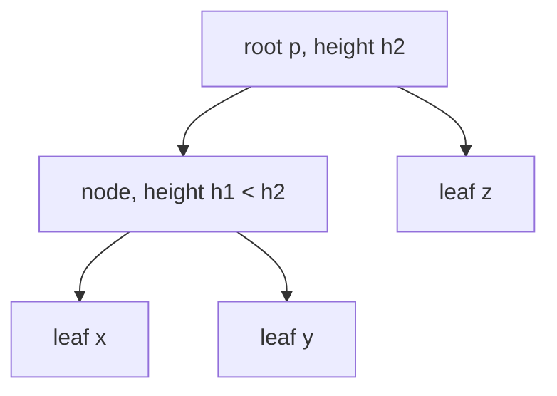

# Ultrametric

## Definition

A distance `d : X × X → ℝ_{≥0}` is **ultrametric** (ultrametrisch) if for every triple
`(x, y, z) ∈ X × X × X` the three distances `d(x,z)`, `d(x,y)`, `d(y,z)` satisfy one of
(fsa_part3, p. 29):

1. **all three distances are the same**, or
2. **two are equal and the remaining one is smaller**.

Equivalently: every triangle is **equilateral or isosceles with the two equal sides being the two
longest**. **The decision is made in `O(n³)`** — one test per triple, `C(n,3) ∈ Θ(n³)` triples
(fsa_part3, p. 29).

Symbols: `X` — set of taxa, `n = |X|`; `T_X` — a phylogenetic tree over `X`; `p` — the root.

## Why it matters — the molecular clock hypothesis

The goal of [[upgma]] is that **all leaves have the same distance to the root `p`**
(fsa_part3, p. 29). This is appropriate for distance functions based on sequence data that has
evolved with a **mutation rate constant over time**. Evolutionary events happening at a constant
rate is the **molecular clock hypothesis** (Molekulare-Uhr-Hypothese), and under it `d` is
additive (fsa_part3, p. 29).

Ultrametry is the *testable* consequence of the clock. If it fails, UPGMA's node heights are
meaningless and [[neighbor-joining]] — which tolerates varying rates — is the right tool.

## Theorem — ultrametric ⟺ equidistant leaves

**Theorem** (fsa_part3, p. 29). Let `d` be additive with respect to a tree `T_X`. Then

```
d is ultrametric   ⟺   every leaf in T_X has the same distance from the root
```

→ if **both** properties hold (additive **and** ultrametric), use **UPGMA** (fsa_part3, p. 29).

> [!note] Inference
> The forward direction is the useful one in practice: for three leaves `x, y, z` of a rooted
> clock-tree, two of them join at a lower node than the third, so their pairwise distance (twice
> the height of their last common ancestor) is the smallest, while the other two distances are both
> twice the height of the *higher* common ancestor — hence equal. That is exactly case 2 of the
> definition. p. 29 states the theorem without proof.



In this tree `d(x,y) = 2·h1` while `d(x,z) = d(y,z) = 2·h2`: two equal and the remaining one
smaller — case 2.

## Relation to the other conditions

| Property | Condition | Test | Tree produced |
|---|---|---:|---|
| metric | triangle inequality etc. | — | — |
| **additive** | four point condition | `O(n⁴)` | unrooted, edge lengths |
| **ultrametric** | three-point condition above | `O(n³)` | rooted, equidistant leaves |

Ultrametric ⇒ additive (for the tree it induces); the converse fails. See
[[phylogenetic-tree]] for additivity and the four point condition.

> [!warning]
> The **ultrametric test is cheaper** (`O(n³)`) than the **additivity test** (`O(n⁴)`) even though
> ultrametry is the **stronger** property. The triple/quartet arity, not the strength, drives the
> exponent.

## Pseudocode

```text
ALGORITHM IsUltrametric(d, X[1..n])                      # O(n^3)
  for i = 1 to n-2:
    for j = i+1 to n-1:
      for h = j+1 to n:
        a <- d(X[i], X[j])
        b <- d(X[i], X[h])
        c <- d(X[j], X[h])
        sort a, b, c so that a <= b <= c
        if b != c:                                       # two largest must be equal
          return false
  return true
```

The sorted test `b = c` covers both cases of the definition at once: `a = b = c` (all equal) and
`a < b = c` (two equal, remaining one smaller).

## Complexity

| Operation | Time | Space |
|---|---:|---:|
| One triple | `O(1)` | `O(1)` |
| Ultrametry decision over `X` | `O(n³)` (fsa_part3, p. 29) | `O(n²)` for `d` |
| Additivity decision, for contrast | `O(n⁴)` (fsa_part3, p. 26) | `O(n²)` |

## Worked example

Five taxa `1..5` with the distance matrix also used on [[upgma]]:

| `d` | 1 | 2 | 3 | 4 | 5 |
|---|---:|---:|---:|---:|---:|
| **1** | 0 | 2 | 11 | 11 | 11 |
| **2** | 2 | 0 | 11 | 11 | 11 |
| **3** | 11 | 11 | 0 | 6 | 6 |
| **4** | 11 | 11 | 6 | 0 | 4 |
| **5** | 11 | 11 | 6 | 4 | 0 |

All `C(5,3) = 10` triples:

| triple | distances (sorted) | case | ok? |
|---|---|---|---|
| `{1,2,3}` | `2, 11, 11` | two equal, third smaller | ✓ |
| `{1,2,4}` | `2, 11, 11` | 2 | ✓ |
| `{1,2,5}` | `2, 11, 11` | 2 | ✓ |
| `{1,3,4}` | `6, 11, 11` | 2 | ✓ |
| `{1,3,5}` | `6, 11, 11` | 2 | ✓ |
| `{1,4,5}` | `4, 11, 11` | 2 | ✓ |
| `{2,3,4}` | `6, 11, 11` | 2 | ✓ |
| `{2,3,5}` | `6, 11, 11` | 2 | ✓ |
| `{2,4,5}` | `4, 11, 11` | 2 | ✓ |
| `{3,4,5}` | `4, 6, 6` | 2 | ✓ |

`d` is ultrametric, so UPGMA is justified. The tree it produces (see [[upgma]]) has every leaf at
distance `5.5` from the root, confirming the theorem: `d(1,2) = 2 = 2·1` with node height 1,
`d(4,5) = 4 = 2·2`, `d(3,4) = 6 = 2·3`, `d(1,3) = 11 = 2·5.5` ✓ — **every** distance is twice the
height of the last common ancestor.

### A violating matrix

Replace `d(4,5) = 4` by `d(4,5) = 5` and `d(3,5)` by `4`:

| triple | distances (sorted) | verdict |
|---|---|---|
| `{3,4,5}` | `4, 5, 6` | all different ✗ |

One violating triple is enough: `d` is **not** ultrametric, the clock hypothesis is rejected, and
UPGMA would place node heights inconsistently. Use [[neighbor-joining]] instead.

## Pitfalls & exam traps

> [!warning]
> - The condition is "two equal and the remaining one **smaller**" — the equal pair must be the
>   **two largest**. A triangle with sides `6, 6, 9` violates it (the odd one is larger).
> - "All three equal" is a separate allowed case; do not force a strict inequality.
> - Ultrametric is **stronger** than additive, yet is tested in `O(n³)` versus `O(n⁴)`.
> - The theorem's equidistance is measured **from the root**, not between leaves.
> - The molecular clock is an *assumption about the data*, not about the algorithm: UPGMA will
>   happily return a tree for non-ultrametric input — a wrong one (fsa_part3, p. 28:
>   "biologically incorrect").
> - `d(x,x) = 0` entries must not be fed into the triple test; triples are over **distinct** taxa.

## Related

- [[upgma]] — the clustering method that is correct exactly when `d` is ultrametric.
- [[phylogenetic-tree]] — additivity and the `O(n⁴)` four point condition.
- [[neighbor-joining]] — the method to use when the clock fails.
- [[hamming-distance]] — one source of the sequence distances `d` summarises.
- [[mash-distance]] — an alignment-free distance that can be fed to these methods.
- [[fsa_part3]] — source page for this unit.

## Sources

- fsa_part3, pp. 26, 28–29 (`raw/foundations_sequence_analysis_part3.pdf`)
