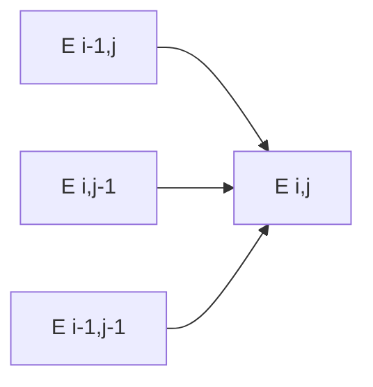

# Unit Edit Distance

## Definition

Unit edit distance `edistδ(w,v)` is the minimum number of insertions, deletions, and substitutions required to transform `w` into `v`, with every non-match operation costing 1 and a match costing 0 (gik_3_4, p. 11).

## Why it matters

It is the distance used by [[lazy-edit-distance]], [[output-sensitive-edit-distance]], and the identity threshold in [[operational-taxonomic-unit]] clustering (gik_3_4, pp. 14-25).

## Construction / Mechanism



## Pseudocode

```text
ALGORITHM UnitEditDistance(w[1..m], v[1..n])
  for i = 0 to m: E[i][0] <- i
  for j = 0 to n: E[0][j] <- j
  for i = 1 to m:
    for j = 1 to n:
      if w[i] = v[j]: cost <- 0 else cost <- 1
      E[i][j] <- min(E[i-1][j] + 1,
                     E[i][j-1] + 1,
                     E[i-1][j-1] + cost)
  return E[m][n]
```

## Complexity

| Operation | Time | Space |
|---|---:|---:|
| Full DP | `O(mn)` | `O(mn)` |
| Distance only with rolling rows | `O(mn)` | `O(min(m,n))` |

## Worked example

For `w=AC` and `v=AGC`, insert `G` after `A`, so the distance is 1. The final `C/C` comparison uses the diagonal at zero additional cost (gik_3_4, p. 11).

## Pitfalls & exam traps

> [!warning]
> - Diagonal movement is free only for equal characters.
> - Unit-cost neighbour properties need unit costs; do not transfer them blindly to weighted alignment.
> - Boundaries encode pure insertions or deletions.

## Related

- [[lazy-edit-distance]] — memoised evaluation of this DP.
- [[output-sensitive-edit-distance]] — computes the same distance via fronts.
- [[operational-taxonomic-unit]] — converts identity to an edit-distance cutoff.
- GSA (module GSA, fsa_part1): [[edit-distance-dp]] derives the same `E_δ` DP from scratch with
  base cases, traceback and space variants, [[edit-graph]] gives the shortest-path view it rests
  on, and [[cost-function]] generalises unit cost to arbitrary `δ` and proves the metric property
  (fsa_part1, pp. 5-12).

## Sources

- gik_3_4, pp. 11-16
- fsa_part1, pp. 5-12 (`raw/foundations_sequence_analysis_part1.pdf`)
