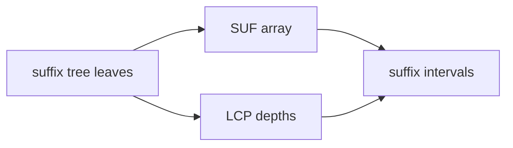

# Enhanced Suffix Array

## Definition

An enhanced suffix array represents suffix-tree information with arrays: `SUF` stores suffix start
positions in lexicographic order, and `LCP[i]` stores the longest common prefix of adjacent
suffixes `S_{SUF[i-1]}` and `S_{SUF[i]}` (gik_5, p. 43).

## Why it matters

It replaces pointer-heavy suffix trees by contiguous arrays while preserving the suffix order and
the LCP interval structure of branching nodes (gik_5, pp. 43-45).
Unit 6 uses the same structure directly for local maxima, [[supermaximal-repeat|supermaximal
repeats]], MUMs and exact matching intervals (gik_6, pp. 1-8).

## Construction / Mechanism



A suffix interval `[l,r]` represents all suffixes with a shared prefix `w`; an `lcp-interval`
corresponds one-to-one to an internal suffix-tree node (gik_5, pp. 43-45).

## Pseudocode

```text
ALGORITHM SuffixTreeToEnhancedSuffixArray(T)
  SUF <- empty array
  LCP <- empty array
  perform left-to-right depth-first traversal of T:
    when a leaf with suffix position j is visited:
      append j to SUF
      if this is not the first leaf:
        append depth of the lowest branching node since the previous leaf to LCP
  return SUF, LCP
```

## Complexity

| Operation | Time | Space |
|---|---:|---:|
| Store `SUF` | `O(n)` entries | `O(n)` |
| Store `LCP` | `O(n)` entries | `O(n)` |
| Generate arrays from suffix tree | `O(n)` | `O(n)` |
| Locate an `lcp` interval from boundaries | interval dependent | `O(1)` extra |
| Store `SUF` values under `n < 2^32` | `4n` bytes | `O(n)` |
| Store selected large `LCP` values | `O(log n / |LCP4tab|)` query overhead | `O(n)` bits plus exceptions |

## Worked example

For `S=aba$` with `$` lexicographically largest as in the notes, the suffixes in increasing order
are `a$`, `aba$`, `ba$`, `$`, so `SUF=[3,1,2,4]` under 1-based indexing. Adjacent LCP values are
`1` for `a$`/`aba$`, then `0`, then `0` (gik_5, pp. 43-45).

Unit 6's storage note: if `n < 2^32`, each `SUF` entry fits in 32 bits, so the full suffix array
needs `4n` bytes. If most `LCP` values are small, values below `255` can be stored in a byte table
and only exceptional values in an auxiliary table (gik_6, p. 8).

## Pitfalls & exam traps

> [!warning]
> - The notes assume `$` is the largest symbol for the array order (gik_5, p. 43); many texts
>   assume it is smallest.
> - `LCP[i]` compares `SUF[i-1]` with `SUF[i]`, so the first meaningful index is `1`.
> - A suffix interval `[l,r]` needs boundary conditions in `LCP`, not only high values inside.

## Related

- [[suffix-tree]] — conceptual tree replaced by the arrays.
- [[suffix-array]] — the base array whose enhancement is described here.
- [[supermaximal-repeat]] — uses LCP local maxima as repeat candidates.
- [[mccreight-suffix-tree-construction]] — can generate the tree that is traversed into arrays.
- [[all-pairs-suffix-prefix-matching]] — suffix intervals encode the same overlap locations.
- [[sheet-05]] — exercises include suffix-tree representation and suffix intervals.
- [[sheet-06]] — applies LCP local maxima to unit-6 suffix-array tasks.

## Sources

- gik_5, pp. 43-45
- gik_6, pp. 1-8
