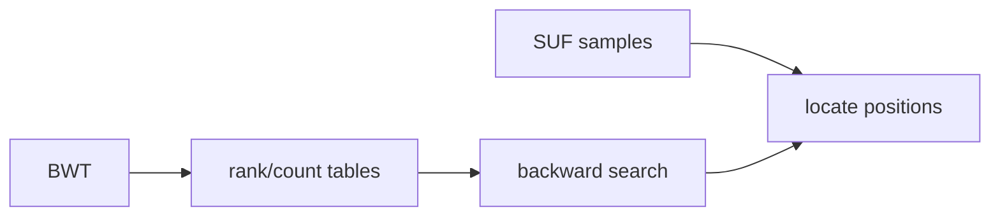

# FM-index

## Definition

An FM-index is a compressed full-text index based on the [[burrows-wheeler-transform]]. It stores
rank support for `bwt` plus sampled suffix-array positions, enabling exact pattern matching with
far less space than storing every `SUF` entry (gik_6, pp. 13-15).

## Why it matters

It turns the suffix-array interval idea into a practical read-mapping index: the pattern is
processed right-to-left, and only sampled `SUF` values are stored for locating positions (gik_6,
pp. 13-15).

## Construction / Mechanism



## Pseudocode

```text
ALGORITHM SampleSuffixArray(SUF[0..n], d)
  for i = 0 to n:
    if SUF[i] is a multiple of d:
      store sample (i, SUF[i])

ALGORITHM Locate(row, LF, samples)
  offset <- 0
  while row is not sampled:
    row <- LF(row)
    offset <- offset + 1
  return samples[row] + offset
```

## Complexity

| Operation | Time | Space |
|---|---:|---:|
| Count/rank support in notes | `O(n + |A|)` preprocessing | table dependent |
| Backward search interval | `O(|P|)` with constant-time rank | `O(1)` extra |
| Locate one occurrence with sampling period `d` | `O(d)` LF steps | `O(n/d)` samples |
| Suffix-array alternative | `O(|P| log n)` search | `O(n log n)` bits |

## Worked example

If only ranks whose `SUF` value is divisible by `d=2` are stored, an unsampled row is located by
following LF until a sampled row is reached. With `bwt=annb$aa`, one LF step moves from a row to
the row representing the suffix shifted one position left, so the number of LF steps is added to
the sampled coordinate (gik_6, p. 14).

## Pitfalls & exam traps

> [!warning]
> - FM-index search finds a suffix-array interval first; locating text positions is a second step.
> - Larger sampling period saves memory but increases locate time.
> - Unit 6 notes that a binary-search suffix-array procedure is often slower in practice despite
>   acceptable asymptotic bounds (gik_6, p. 15).

## Related

- [[burrows-wheeler-transform]] — core transform and LF mapping.
- [[fm-index-backward-search]] — exact pattern search on this structure.
- [[suffix-array-pattern-matching]] — uncompressed baseline.

## Sources

- gik_6, pp. 13-15
