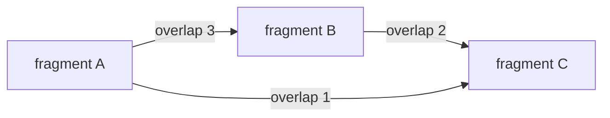

# Overlap Graph

## Definition

For a fragment set `F`, the overlap multigraph `OG(F)` has one node per fragment and a directed
edge `f -> f'` when a suffix of `f` overlaps a prefix of `f'`. Multiple edges may exist between the
same fragments if different overlaps are possible (gik_6, p. 21).

## Why it matters

A layout is a path through this graph. The assembly problem becomes selecting edges that cover all
fragments consistently (gik_6, pp. 21-23).

## Construction / Mechanism



## Pseudocode

```text
ALGORITHM BuildOverlapGraph(F, minOverlap)
  create one node for each fragment f in F
  for each ordered pair (f, g) with f != g:
    for ell = min(length(f), length(g)) downto minOverlap:
      if suffix(f, ell) = prefix(g, ell):
        add edge f -> g with weight ell
        stop scanning this pair
  return graph
```

## Complexity

| Operation | Time | Space |
|---|---:|---:|
| Naive construction | `O(k^2 L^2)` | `O(k^2)` |
| With unit-5 all-pairs suffix-prefix matching | `O(n+z)` minimum overlaps | `O(n+z)` |
| Greedy edge selection in notes | `O(ell + n^2)` after sorting | graph size |

## Worked example

For fragments `ATG`, `TGCAT`, `GGA`, edges include `ATG -> TGCAT` with overlap `2` (`TG`) and
`GGA -> ATG` with overlap `1` (`G`). The path `GGA -> ATG -> TGCAT` spells `GGATGCAT`.

## Pitfalls & exam traps

> [!warning]
> - The graph is directed: `f -> g` and `g -> f` mean different overlaps.
> - The notes allow multiedges; do not collapse edges if their overlap lengths differ.
> - Repeats create multiple plausible paths.

## Related

- [[fragment-assembly]] — uses the graph for layout.
- [[shortest-common-superstring]] — Hamiltonian paths in an overlap graph model SCS.
- [[string-graph]] — simplifies overlap graphs by removing transitive edges.

## Sources

- gik_6, pp. 21-23
