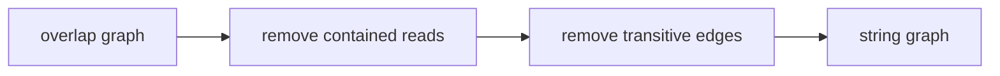

# String Graph

## Definition

A string graph is a reduced overlap graph for assembly: contained reads and transitive overlap
edges are removed so that repeats and alternatives remain visible without redundant edges (gik_6,
pp. 27-28).

## Why it matters

The notes move from raw [[overlap-graph|overlap graphs]] to string graphs because assemblies are
walks in a graph, and repeats/traversals can be represented more cleanly after transitive
reduction (gik_6, pp. 27-28).

## Construction / Mechanism



An edge `r -> t` is transitive if there are edges `r -> s` and `s -> t` whose overlap sequence
implies the direct edge contributes no new information (gik_6, p. 28).

## Pseudocode

```text
ALGORITHM ReduceToStringGraph(OG(F))
  remove every read contained in another read
  for each edge r -> t:
    if there exists a read s with edges r -> s and s -> t and
       the sequence spelled by r -> t is already spelled by r -> s -> t:
      mark r -> t as transitive
  delete all marked transitive edges
  return reduced graph
```

## Complexity

| Operation | Time | Space |
|---|---:|---:|
| Detect containment naively | `O(k^2 L^2)` | `O(k)` |
| Test all edge triples naively | `O(|E|^2)` | `O(|E|)` |
| Unit-6 optimised detail | not fully specified | not fully specified |

## Worked example

If reads give overlaps `r -> s`, `s -> t`, and `r -> t`, and the direct `r -> t` overlap is a
proper substring of the sequence already implied by going through `s`, then `r -> t` is removed.
The assembly walk can still reach `t` through `s` (gik_6, p. 28).

## Pitfalls & exam traps

> [!warning]
> - Removing transitive edges must not delete the only evidence for a unique adjacency.
> - Repeats can remain as branches; string graphs simplify but do not solve ambiguity.
> - Contained reads are removed before transitive-edge reasoning in the notes.

## Related

- [[fragment-assembly]] — string graphs model genome assemblies as walks.
- [[overlap-graph]] — unreduced input.
- [[all-pairs-suffix-prefix-matching]] — computes exact overlaps used as candidate edges.

## Sources

- gik_6, pp. 27-28
