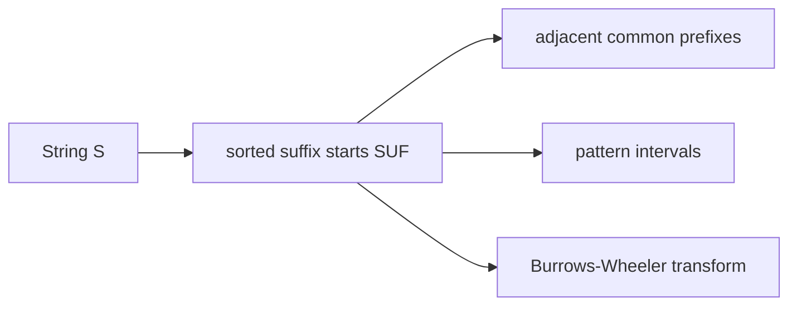

# Suffix Array

## Definition

For a string `S` of length `n`, the suffix array `SUF[0..n]` is a permutation of suffix-start
positions such that `S[SUF[i]..] <= S[SUF[i+1]..]` lexicographically. Unit 6 keeps the sentinel
`$` as the last suffix in some examples, so always state the sentinel order used (gik_6, p. 9).

## Why it matters

The suffix array is the array analogue of the [[suffix-tree]] leaf order. It supports exact
pattern matching, repeat finding, MUMs and [[burrows-wheeler-transform|BWT]] construction with
less pointer overhead than a tree (gik_6, pp. 4, 8-9).

## Construction / Mechanism



An `m`-interval `[l,r]` for pattern `P` contains exactly the suffix-array positions whose suffixes
start with `P`; occurrences are then the text positions `SUF[q]` for `q in [l,r]` (gik_6, p. 4).

## Pseudocode

```text
ALGORITHM NaiveSuffixArray(S[0..n])
  for i = 0 to n:
    suffix[i] <- (S[i..n], i)
  sort suffix lexicographically by first component
  for rank = 0 to n:
    SUF[rank] <- suffix[rank].position
  return SUF
```

## Complexity

| Operation | Time | Space |
|---|---:|---:|
| Store `SUF` | `O(n)` entries | `O(n)` |
| Naive construction by sorting suffix strings | `O(n^2 log n)` worst case | `O(n^2)` if suffixes copied |
| q-gram construction from notes | `O(n + r^q + r^q n)` worst case | `O(n + r^q)` |
| Pattern interval by two binary searches | `O(m log n)` | `O(1)` extra |

## Worked example

For `S=banana$` with `$` smallest, sorted suffixes are `$`, `a$`, `ana$`, `anana$`, `banana$`,
`na$`, `nana$`, so `SUF=[6,5,3,1,0,4,2]`. The pattern `ana` occurs at suffix-array ranks `2..3`,
therefore at text positions `SUF[2]=3` and `SUF[3]=1`.

## Pitfalls & exam traps

> [!warning]
> - Do not confuse `SUF[i]` (text position) with rank `i` (array position).
> - The sentinel order changes worked examples; declare whether `$` is smallest or largest.
> - An interval in `SUF` is sorted lexicographically, not by genomic coordinate.

## Related

- [[enhanced-suffix-array]] — adds the `LCP` table and suffix-tree interval structure.
- [[suffix-array-pattern-matching]] — computes the `m`-interval for a pattern.
- [[burrows-wheeler-transform]] — reads the character preceding each sorted suffix.
- [[q-gram-suffix-array-construction]] — the unit-6 construction method based on first symbols.

## Sources

- gik_6, pp. 4-9
