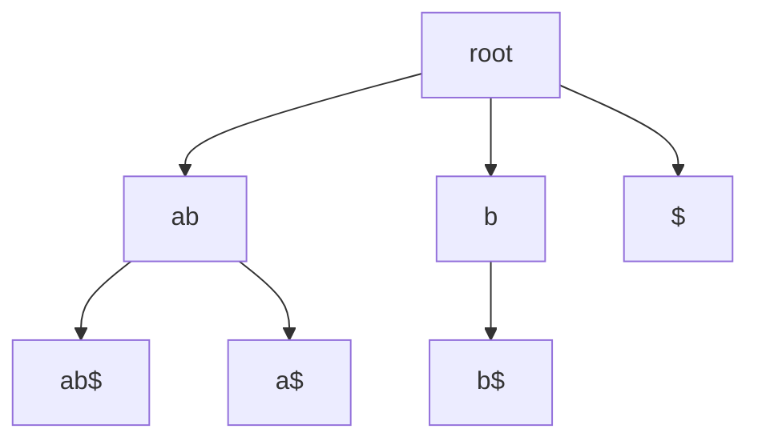

# Suffix Tree

## Definition

A suffix tree is the compact trie of all suffixes of `S$`, where `$` is a unique sentinel
character not in the alphabet. The sentinel makes no suffix a prefix of another suffix, so leaves
correspond one-to-one to suffixes (gik_5, pp. 1, 3).

## Why it matters

It represents the `O(n^2)` substrings of a length-`n` sequence in `O(n)` nodes and supports
exact and approximate pattern tasks used for anchors and repeat discovery (gik_5, pp. 1, 4, 16).
This extends [[anchor-based-sequence-comparison]]: unit 4 assumed anchors; unit 5 shows how to
find them with an index.

## Construction / Mechanism

Start with an `A+`-tree: edge labels are non-empty strings and a node has at most one outgoing
edge beginning with each character. Compact every non-branching node by concatenating the two edge
labels around it (gik_5, pp. 1-3).



For `S=abab`, the suffix tree is built for `abab$`; leaves represent `abab$`, `bab$`, `ab$`,
`b$`, and `$`.

## Pseudocode

```text
ALGORITHM CompactTrie(T)
  for each node beta of T with exactly one outgoing edge beta -> gamma:
    let alpha be the parent of beta
    replace edges alpha -> beta and beta -> gamma by edge alpha -> gamma
    label(alpha -> gamma) <- label(alpha -> beta) concatenated with label(beta -> gamma)
    delete beta
  return T
```

## Complexity

| Operation | Time | Space |
|---|---:|---:|
| Store suffix tree of `S$` | construction-dependent | `O(|S|)` |
| Number of leaves | `O(|S|)` exactly `|S|+1` for `S$` | `O(|S|)` |
| Number of internal nodes | at most leaves minus one | `O(|S|)` |
| Exact pattern traversal | `O(|P|)` plus output | `O(1)` extra |

## Worked example

For `S=aba`, index `aba$`:

| Suffix position | Suffix |
|---:|---|
| 0 | `aba$` |
| 1 | `ba$` |
| 2 | `a$` |
| 3 | `$` |

The substring `a` is right-branching because both `ab` and `a$` occur below it, so it is a
branching node. The suffix `a$` is a leaf because the sentinel prevents it from being a prefix of
`aba$` (gik_5, pp. 3-4).

## Pitfalls & exam traps

> [!warning]
> - Build the tree for `S$`, not just `S`; otherwise nested suffixes break the leaf/suffix
>   bijection.
> - Edge labels are intervals into `S`, not copied strings, if the space proof is required
>   (gik_5, p. 4).
> - A substring can end inside an edge; distinguish node locations from edge locations
>   (gik_5, p. 8).

## Related

- [[mccreight-suffix-tree-construction]] — constructs this tree in linear time.
- [[suffix-tree-exact-matching]] — searches a pattern by top-down traversal.
- [[enhanced-suffix-array]] — array representation carrying the same leaf order and LCP shape.
- [[maximal-unique-match]] — uses suffix-tree branching to find anchors for genome comparison.

## Sources

- gik_5, pp. 1-5, 8, 16
