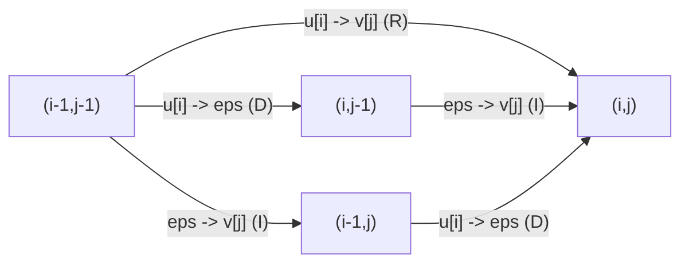

# FSA Fragenkatalog — Part 1 (§1–§2)

Questions Q1.1–Q2.7 of the exam question catalogue, with the answers from the handwritten sheets
(fsa_fragenkatalog, pp. 1–4 for the questions, pp. 10–18 for the answers). Hub and usage
guidance: [[fsa-fragenkatalog]]. Next part: [[fsa-fragenkatalog-2]].

## §1 — The model of edit distance (Das Modell der Edit-Distanz)

Edit operations, alignments, cost functions, the matrix `E_δ`, the edit graph, basic graph theory
and antidiagonal evaluation order.

**Q1.1** Why is the notion of *similarity* (Ähnlichkeit) so important in the analysis of biological
sequences?
**A** Similar sequence ⇒ same or similar meaning / effect, e.g. genes; and similarity is used to
determine phylogenetic descent (fsa_fragenkatalog, p. 10). → [[alignment]], [[phylogenetic-tree]]

**Q1.2** Which distance model is used most frequently in sequence analysis?
**A** The **edit-distance model**: determine the edit distance and all optimal alignments — i.e. the
cost of the optimal alignment of two sequences `u` and `v` (p. 10). → [[edit-distance-dp]]

**Q1.3** Define precisely *edit operation*, *alignment*, and *alignment of two sequences `u` and
`v`*.
**A** (p. 10) An **edit operation** is a pair

`(α, β) ∈ (A ∪ {ε}) × (A ∪ {ε}) \ {(ε,ε)}`

- `α → ε` deletion of `α ∈ A`
- `ε → β` insertion of `β ∈ A`
- `α → β` replacement of `α ∈ A` by `β ∈ A`

An **alignment** is a sequence of edit operations. An **alignment of `u` and `v`** is a sequence
`(α₁→β₁, …, α_h→β_h)` of edit operations with `u = α₁…α_h` and `v = β₁…β_h`.
→ [[edit-operation]], [[alignment]]

**Q1.4** State the recurrence for the *number* of all alignments of two sequences of lengths `m`
and `n`.
**A** (p. 11)

```text
Aligns(m,n) <- 1                                                    if m = 0 or n = 0
Aligns(m,n) <- Aligns(m-1,n) + Aligns(m-1,n-1) + Aligns(m,n-1)      otherwise
```

→ [[counting-alignments]]

**Q1.5** How can the set of *all* alignments of two sequences be represented implicitly in `O(mn)`
space?
**A** By the **edit graph** `G(u,v)` — vertices `(i,j)`, three edge types (p. 11). Every alignment
is a path from `(0,0)` to `(m,n)`, so `O(mn)` vertices and edges encode exponentially many
alignments. The first, struck-through attempt on the page (an `E_δ` matrix plus a bit vector) was
rejected. → [[edit-graph]], [[counting-alignments]]



**Q1.6** With which data structures can a *single* alignment be represented efficiently?
**A** (p. 11) A list `A-list = [x₁y₁ … x_h y_h]` with `x ∈ {D, I, R}` and `y` = number of
consecutive `x`'s, stored together with `u` and `v`. Example: `[R1 I2 D3 R2]`.
The margin reads "Todo: siehe Übung". → [[alignment]]

**Q1.7** What is a cost function (Kostenfunktion) in the edit-distance model?
**A** `edist_δ(u,v)` depends on the cost function `δ`, which assigns a value to every edit
operation and thereby determines how the cost of an alignment is computed (p. 12).
→ [[cost-function]]

**Q1.8** How is the cost `δ(A)` of an alignment `A` computed under the *linear gap model*?
**A** (p. 12) `δ(A) = Σ_{i=1}^{h} δ(α_i → β_i)` — the plain sum over the `h` edit operations of `A`.
→ [[cost-function]], [[gap-cost-model]]

**Q1.9** Define `edist_δ(u,v)`. No recurrence.
**A** `edist_δ(u,v) = min{ δ(A) | A is an alignment of u and v }` (p. 12). → [[edit-distance-dp]]

**Q1.10** Define *optimal alignment of `u` and `v`*.
**A** An alignment `A` is **optimal** iff `δ(A) = edist_δ(u,v)` (p. 12). → [[alignment]]

**Q1.11** Which property does `E_δ(i,j)` have for `0 ≤ i ≤ m`, `0 ≤ j ≤ n`? The *definition*, not
the recurrence.
**A** (p. 12) `E_δ(i,j)` = weight of the shortest path from `(0,0)` to `(i,j)` in `G(u,v)`
= cost of the optimal alignment of `u[1..i]` and `v[1..j]` = `edist_δ(u[1..i], v[1..j])`, with
`E_δ(0,0) = 0`. → [[edit-distance-dp]], [[edit-graph]]

**Q1.12** State the recurrence for `E_δ(i,j)` for `i > 0` and `j > 0`.
**A** (p. 12)

```text
E[i][j] <- min( E[i-1][j]   + delta(u[i] -> eps),
                E[i][j-1]   + delta(eps -> v[j]),
                E[i-1][j-1] + delta(u[i] -> v[j]) )     for i > 0, j > 0
```

→ [[edit-distance-dp]]

**Q1.13** Compute the missing last column of the edit-distance matrix for `u = gcact`,
`v = tgatat` under the unit-cost function, and mark the entry yielding `edist_δ(u,v)`.
**A** (pp. 2, 13) Completed matrix; the last column `j = 6` is the answer:

| | `j=0` | 1 `t` | 2 `g` | 3 `a` | 4 `t` | 5 `a` | **6 `t`** |
|---|---|---|---|---|---|---|---|
| `i=0` | 0 | 1 | 2 | 3 | 4 | 5 | **6** |
| 1 `g` | 1 | 1 | 1 | 2 | 3 | 4 | **5** |
| 2 `c` | 2 | 2 | 2 | 2 | 3 | 4 | **5** |
| 3 `a` | 3 | 3 | 3 | 2 | 3 | 3 | **4** |
| 4 `c` | 4 | 4 | 4 | 3 | 3 | 4 | **4** |
| 5 `t` | 5 | 4 | 5 | 4 | 3 | 4 | **4** |

`edist_δ(gcact, tgatat) = E_δ(5,6) = 4`, the circled bottom-right entry. Traceback priority noted
on both the question page and the answer sheet: `R > D > I` (replacement before deletion before
insertion). → [[unit-edit-distance]], [[edit-distance-dp]]

> [!warning]
> The source writes the priority as `R > D > L` in the printed margin (p. 2) and as `R > D > I` in
> the answer (p. 13). These are the same convention — `L` for the "left" (insertion) predecessor.

**Q1.14** Running time and space of the distance-only method?
**A** Time `O(mn)`, space `O(min{m,n})` (p. 13). → [[edit-distance-dp]]

**Q1.15** Define the *edit graph* `G(u,v)`: vertices, edges, labels.
**A** (p. 13) **Vertices** `(i,j)` with `0 ≤ i ≤ m`, `0 ≤ j ≤ n`. **Edges** are labelled with edit
operations:

| Type | Range | Edge |
|---|---|---|
| D (deletion) | `1 ≤ i ≤ m`, `0 ≤ j ≤ n` | `(i-1,j) --u[i]→ε--> (i,j)` |
| I (insertion) | `0 ≤ i ≤ m`, `1 ≤ j ≤ n` | `(i,j-1) --ε→v[j]--> (i,j)` |
| R (replacement) | `1 ≤ i ≤ m`, `1 ≤ j ≤ n` | `(i-1,j-1) --u[i]→v[j]--> (i,j)` |

Vertices are unlabelled (they are index pairs); edges carry the edit operation as label.
→ [[edit-graph]]

**Q1.16** Which method extracts the optimal global alignments from `E_δ`? At most three sentences.
**A** A **traceback** that follows the minimising paths from `E_δ[m][n]` back to `E_δ[0][0]`,
realised with bit vectors recording, per cell, which predecessors are minimising (p. 14).
→ [[edit-distance-dp]], [[edit-graph]]

**Q1.17** Define *graph* in one sentence.
**A** A graph consists of a set of vertices `V` and a set of edges `E ⊆ V × V` (p. 14).
→ [[edit-graph]]

**Q1.18** Define *path in `G = (V,E)`*.
**A** A sequence of vertices `v₀, v₁, …, v_h`, `h ≥ 0`, such that `(v_i, v_{i+1}) ∈ E` for all
`0 ≤ i ≤ h-1`; it starts at `v₀`, ends at `v_h` and has length `h` (p. 14). → [[edit-graph]]

**Q1.19** Define the *topological order* `≺` of the vertices of a directed graph.
**A** An order `≺` on `V` with `y → x ∈ E ⇒ y ≺ x` (p. 14). → [[edit-graph]]

**Q1.20** `E_δ` may be evaluated antidiagonal-wise (south-west to north-east lines) instead of
row- or column-wise.

**Q1.20.1** How many antidiagonals does `E_δ` have, as a function of `m` and `n`?
**A** `m + n + 1` (pp. 3, 15); for the drawn example with `m+1 = 8`, `n+1 = 10` this gives `17`.
→ [[edit-distance-dp]]

**Q1.20.2** State the property of all pairs `(i,j)` on the same antidiagonal `a`.
**A** `i + j = a`. The antidiagonal runs `(i,j), (i+1,j-1), …`, stopping at `i = m` or `j = 0`
(p. 15). → [[edit-distance-dp]]

**Q1.20.3** On which antidiagonals do the values of antidiagonal `a ≥ 2` depend?
**A** On antidiagonals `a-1` and `a-2` (p. 15): the `D` and `I` predecessors lie on `a-1`, the `R`
predecessor on `a-2`. Illustrated by the index table

| | `j=0` | `j=1` | `j=2` | `j=3` |
|---|---|---|---|---|
| `i=0` | `a₀` | `a₁` | `a₂` | `a₃` |
| `i=1` | `a₁` | `a₂` | `a₃` | `a₄` |
| `i=2` | `a₂` | `a₃` | `a₄` | `a₅` |

→ [[edit-distance-dp]]

## §2 — Variants of the edit-distance model (Varianten des Edit-Distanz Modells)

Local alignment, approximate string matching, and the assembly overlap problem.

**Q2.1** Which property does `L_σ(i,j)` have? The *property*, complete, not the recurrence.
**A** (p. 16) With `score_σ(u',v') = max{ σ(A) | A is an alignment of u' and v' }`,

`L_σ(i,j) = max{ score_σ(x,y) | x is a suffix of u[1..i], y is a suffix of v[1..j] }`

i.e. each entry holds the maximum score over all pairs of suffixes of the prefixes `u[1..i]` and
`v[1..j]`. The maximal entry of `L_σ` is `loc_σ(u,v)`. The first, struck-through attempt
(maximising over *substrings* of `u` and `v` globally) was rejected.
→ [[local-similarity]], [[smith-waterman]], [[score-function]]

**Q2.2** State the recurrence for `L_σ(i,j)`, `i > 0`, `j > 0`.
**A** (p. 16)

```text
L[i][j] <- max( 0,
                L[i-1][j]   + sigma(u[i] -> eps),
                L[i][j-1]   + sigma(eps -> v[j]),
                L[i-1][j-1] + sigma(u[i] -> v[j]) )
```

→ [[smith-waterman]]

**Q2.3** Which method determines an optimal local alignment from `L_σ`? At most three sentences.
**A** (p. 16) (II) Find the maximal entry `L_σ(i,j)`. (III) Traceback from `(i,j)` along the
maximising path until an entry `(i',j')` with `L_σ(i',j') = 0` is reached; that path is the optimal
local alignment. → [[smith-waterman]]

**Q2.4** With error threshold `k ≥ 0`: what is an *approximative hit* of a pattern `p` in a text
`t`?
**A** A substring `w` of `t` with `edist_δ(p,w) ≤ k` (p. 17).
→ [[approximate-string-matching]]

**Q2.5** How are the end positions of all approximative hits computed? Running time? How does
`D_δ` differ from `E_δ` in the first row?
**A** (p. 17)

- Compute the `(m+1) × (n+1)` table
  `D_δ(i,j) = min{ edist_δ(p[1..i], w) | w is a suffix of t[1..j] }`.
- Report all `j` with `D_δ(m,j) ≤ k`.
- Time `O(mn)`; margin note: space `O(m)` without traceback.
- First row: `D_δ(0,j) = 0` for all `j`, whereas
  `E_δ(0,j) = E_δ(0,j-1) + δ(ε → v[j])` depends on the insertion cost.

→ [[approximate-string-matching]], [[naive-exact-matching]]

**Q2.6** With `m ≪ n`, how long can an approximative hit be at most under the unit-cost function?
Justify.
**A** (p. 17) Deletions do not lengthen the hit; there are at most `m` replacements; insertions
each cost at least `min{δ(ε → b) | b ∈ A} > 0`. With `γ` insertions,

`γ · min{δ(ε → b) | b ∈ A} ≤ k  ⟺  γ ≤ ⌊ k / min{δ(ε → b) | b ∈ A} ⌋`

so the maximal hit length is `O(m + k)`.
→ [[approximate-string-matching]], [[unit-edit-distance]]

> [!question]
> **p. 17 — final term.** The last expression is overwritten; the best reading is `O(m + γ)` with
> `γ` bounded as above, which under the unit-cost function (`min δ = 1`) is `O(m + k)`.

**Q2.7** What is the *overlap problem* (Überlappungsproblem) in sequence assembly?
**A** For a pair of reads `f, f'`: decide whether `f` and `f'` overlap, and if so compute the
overlap alignment `A` of `f` and `f'` with `δ(A) ≤ k` (p. 18).
→ [[overlap-alignment]], [[fragment-assembly]]

## Related

- [[fsa-fragenkatalog]] — the hub: usage guidance, section map, complexity summary.
- [[fsa-fragenkatalog-2]] — the next part: gap costs, alignment-free comparison, significance.
- [[fsa_fragenkatalog]] — source page for the catalogue PDF.
- [[edit-distance-dp]] — the full derivation of `E_δ`, its recurrence and traceback.
- [[edit-graph]] — the graph formulation that Q1.5, Q1.11 and Q1.15–Q1.19 circle around.
- [[smith-waterman]] — `L_σ` and the local traceback asked for in Q2.1–Q2.3.
- [[approximate-string-matching]] — the `D_δ` variant of Q2.4–Q2.6.

## Sources

- `raw/foundations_sequence_analysis_fragenkatalog.pdf`, pp. 1–4 (questions), pp. 10–18 (answers)
