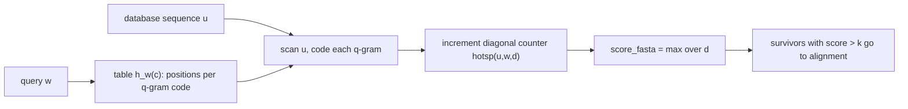

# FSA Fragenkatalog — Part 3 (§6–§9)

Questions Q6.1–Q9.3 of the exam question catalogue with the handwritten answers
(fsa_fragenkatalog, pp. 6–8 for the questions, pp. 26–30 for the answers). Hub:
[[fsa-fragenkatalog]]. Previous part: [[fsa-fragenkatalog-2]]. Next: [[fsa-fragenkatalog-4]].

## §6 — Fasta

The Fasta score as a per-diagonal hot-spot count, the query table `h_w`, and the scan that fills
the diagonal counters.

**Q6.1** Define the Fasta score `score_fasta(u,w)` of a database sequence `u` and a query `w`
w.r.t. `q`.
**A** (p. 26, with `|w| = n`, `|u| = m`)

`score_fasta(u,w) = max{ hotsp(u,w,d) | −m ≤ d ≤ n }`

`hotsp(u,w,d) = |{ (i,j) | 1 ≤ i ≤ m-q+1, 1 ≤ j ≤ n-q+1, j − i = d, u[i..i+q-1] = w[j..j+q-1] }|`

i.e. the maximum, over all diagonals `d`, of the number of exact q-word matches lying on that
diagonal. → [[fasta-database-search]], [[q-gram]]

**Q6.2** State the properties of the preprocessing table `h_w` (not how it is computed).
**A** (p. 26) For all `c` with `0 ≤ c ≤ r^q − 1`, `h_w(c)` is the set of positions in `w` at which a
q-gram with code `c` occurs:

`h_w(c) = { i | 1 ≤ i ≤ |w| − q + 1, c = code(w[i..i+q-1]) }`

→ [[fasta-database-search]]

**Q6.3** Given `h_w`, describe briefly and precisely how `score_fasta` is computed efficiently.
**A** (p. 26)

```text
ALGORITHM FastaScore(u, w, q, h_w)        // |u| = m, |w| = n
  for d = -m to n:  hotsp(u,w,d) <- 0
  for j = 1 to m - q + 1:
    c <- code(u[j..j+q-1])                // constant-time rolling update
    for each i in h_w(c):
      hotsp(u,w,j-i) <- hotsp(u,w,j-i) + 1
  return max{ hotsp(u,w,d) | -m <= d <= n }
```

One left-to-right scan of `u`; each q-gram's code is looked up once in `h_w` and every query
position found increments exactly one diagonal counter.
→ [[fasta-database-search]]

> [!warning]
> The answer sheet runs the loop variable `j` over the **database sequence** `u` and uses `i` for
> positions in the **query** `w`, so the diagonal is `j − i`. The definition in Q6.1 uses `i` in
> `u` and `j` in `w` with diagonal `j − i`. The roles — and hence the sign of `d` — swap between
> the two pages; fix one convention before writing anything in the exam.



## §7 — Blast

Scored seeds, the k-environment, and the two-hit / X-drop extension.

**Q7.1** Define *Blast hit* of `u` and `w`, given `σ`, `k` and `q`.
**A** (p. 27) A pair `(i,j)` such that

`score_σ( u[i..i+q-1], w[j..j+q-1] ) ≥ k`

i.e. a seed defined by **score**, not by exact identity, and without indels. → [[blast]]

> [!question]
> **p. 27 — relation symbol.** The relation is overwritten in the handwriting; the best reading is
> `≥ k` with `k` a score threshold.

**Q7.2** Define the *k-neighbourhood* (k-Umgebung) of `w`.
**A** (p. 27)

`Env_k(w) = { (s, j) | 1 ≤ j ≤ |w| − q + 1, score(s, w[j..j+q-1]) ≥ k }`

— all q-words `s` scoring at least `k` against some q-word of the query, paired with the query
position `j` at which that q-word occurs. → [[blast]]

**Q7.3** Describe the *2-hit strategy* of Blast. What is the *X-drop extension* in the ungapped
case, and what role does the drop-off parameter `X_d` play?
**A** (p. 27) The answer sheet covers the ungapped extension:

- compute the mid point `(i,j)` of the hit;
- extend **left**: compare `u[1..i-1]` against `w[1..j-1]`, scoring pairs
  `(u[i-ℓ], w[j-ℓ])` for `1 ≤ ℓ ≤ min{i-1, j-1}`;
- extend **right**: compare `u[i..m]` against `w[j..n]`, scoring pairs
  `(u[i+r], w[j+r])` for `0 ≤ r ≤ min{m-i, n-j}`;
- track the running maximum `X_max`, and stop extending once the current score has fallen to
  `X_max − X_d`;
- the result is an **MSP** (maximal segment pair).

`X_d` is therefore the tolerated drop below the best score seen so far: it bounds how far a
locally bad region may be traversed before the extension is abandoned.

*The 2-hit strategy itself (pairing two hits on the same diagonal within a maximal distance before
extending at all) is not written out on the answer sheet.* → [[blast]]

## §8 — PSSMs

Definition, derivation, score, hit, search complexity.

**Q8.1** What is a position-specific score matrix (PSSM)? From what is it typically derived?
**A** (p. 28) A PSSM is a function

`M : A × {1, …, m} → R`

(`A` the alphabet, `m` the length of the matrix), i.e. an `|A| × m` matrix in which each row gives
the frequency/score of a character `a ∈ A` for the positions `1 … m`. It is derived from a
**multiple alignment of a family of related sequences**.
→ [[position-specific-scoring-matrix]], [[multiple-sequence-alignment]]

**Q8.2** What are the *PSSM score* and *PSSM hit*? With which running time can all hits of a PSSM
of length `m` be found in a sequence of length `n`?
**A** (p. 28) A **PSSM hit** is a position `j`, `1 ≤ j ≤ |S| − m + 1`, with

`score( S[j..j+m-1], M ) ≥ th`

Running time `O(kn)`, where `k` is the average number of PSSM positions per start position that
are actually evaluated before the lookahead bound aborts the evaluation; worst case `O(mn)`.
*The PSSM score itself is not defined separately on the sheet; it is the matrix score of the
window implied by the hit condition.* → [[pssm-lookahead-search]],
[[position-specific-scoring-matrix]]

## §9 — Alignment in linear space (Alignment in linearem Platz)

Crosspoints, recursion depth, the geometric-series running-time argument, and the worked example.

**Q9.1** Define, via the edit graph `G(u,v)`, the properties of the crosspoints `C(j)` for
`0 ≤ j ≤ n`. State their value range and the relation between two consecutive crosspoints.
**A** (p. 29)

- A crosspoint `(i₀, j₀)` lies on a **minimising path** in the edit graph `G_δ(u,v)` from `(0,0)`
  to `(m,n)`.
- Value range: `0 ≤ i₀ ≤ m`, `0 ≤ j₀ ≤ n`, with `(0,0)` the initial and `(m,n)` the final
  crosspoint.
- Consecutive crosspoints `(i₀, j₀)` and `(i₀', j₀')` satisfy `j₀ < j₀'` and `i₀ ≤ i₀'` — the
  column index strictly increases, the row index is non-decreasing.

→ [[hirschberg-linear-space-alignment]], [[edit-graph]]

**Q9.2** What is the maximum recursion depth, and what is the running time? Justify by counting
the matrix entries computed at depth `k` and summing.
**A** (p. 29)

- Maximum recursion depth `O(log₂ n)`.
- Running time `O(mn)`. At the top level the algorithm evaluates `(m+1)(n+1)` values of `E_δ` plus
  `½(m+1)(n+1)` values of the reverse table `R_{j₀}`, i.e. `3/2·(m+1)(n+1)` values. After the
  crosspoint is found, the recursion processes an `(i₀+1) × (j₀+1)` matrix and an
  `(m−i₀) × (n−j₀)` matrix — together less than half the original area. Hence at depth `i` the
  work is `(1/2^i) · 3/2 · (m+1)(n+1)`, and

`Σ_{i=0}^{∞} (1/2^i) · 3/2 · (m+1)(n+1) ≤ 3(m+1)(n+1) = O(mn)`

→ [[hirschberg-linear-space-alignment]]

**Q9.3** For `u = acactcag` and `v = actacacg`: give the marked optimal path as a vertex sequence,
**all** derivable crosspoint lists, and the two-row alignment.
**A** (pp. 7–8, 30) The printed edit graph carries these `E_δ` values; bold = grey-shaded
vertices of the marked optimal path, `edist = E_δ(8,8) = 3`:

| | `j=0` | 1 `a` | 2 `c` | 3 `t` | 4 `a` | 5 `c` | 6 `a` | 7 `c` | 8 `g` |
|---|---|---|---|---|---|---|---|---|---|
| `i=0` | **0** | 1 | 2 | 3 | 4 | 5 | 6 | 7 | 8 |
| 1 `a` | 1 | **0** | 1 | 2 | 3 | 4 | 5 | 6 | 7 |
| 2 `c` | 2 | 1 | **0** | **1** | 2 | 3 | 4 | 5 | 6 |
| 3 `a` | 3 | 2 | 1 | 1 | **1** | 2 | 3 | 4 | 5 |
| 4 `c` | 4 | 3 | 2 | 2 | 2 | **1** | 2 | 3 | 4 |
| 5 `t` | 5 | 4 | 3 | 2 | 3 | 2 | **2** | 3 | 4 |
| 6 `c` | 6 | 5 | 4 | 3 | 3 | 3 | 3 | **2** | 3 |
| 7 `a` | 7 | 6 | 5 | 4 | 3 | 4 | 3 | **3** | 3 |
| 8 `g` | 8 | 7 | 6 | 5 | 4 | 4 | 4 | 4 | **3** |

**Minimising path:**
`(0,0) → (1,1) → (2,2) → (2,3) → (3,4) → (4,5) → (5,6) → (6,7) → (7,7) → (8,8)`

**Crosspoint row `C(j)`:**

| `j` | 0 | 1 | 2 | 3 | 4 | 5 | 6 | 7 | 8 |
|---|---|---|---|---|---|---|---|---|---|
| `C(j)` | 0 | 1 | 2 | 2 | 3 | 4 | 5 | 7 | 8 |

**All lists of crosspoints derivable from the marked path** — the sheet gives two, differing only
at `j = 7`:

`C = [0, 1, 2, 2, 3, 4, 5, 6, 8]`
`C = [0, 1, 2, 2, 3, 4, 5, 7, 8]`

(The path visits both `(6,7)` and `(7,7)` in column 7, so either row index is a valid crosspoint
for `j = 7`.)

**Alignment:**

```text
a c - a c t c a g
a c t a c a c - g
```

(The handwritten first attempt `ac-atcag` / `actacag` is superseded by the boxed second version
above.) → [[hirschberg-linear-space-alignment]], [[edit-distance-dp]], [[unit-edit-distance]]

> [!warning]
> The alignment has 9 columns: one insertion of `t` (column 3), one deletion of `a` (column 8),
> and one replacement `t → a` at column 6 — three edit operations, matching `edist = 3`.

## Related

- [[fsa-fragenkatalog]] — the hub: usage guidance, section map, complexity summary.
- [[fsa-fragenkatalog-2]] — previous part: gap costs, alignment-free comparison, significance.
- [[fsa-fragenkatalog-4]] — next part: multiple alignment and phylogeny.
- [[fasta-database-search]] — hot spots, `h_w`, diagonal runs: the full §6 machinery.
- [[blast]] — the five stages behind the three §7 questions.
- [[position-specific-scoring-matrix]] — definition and construction asked in Q8.1.
- [[pssm-lookahead-search]] — the `O(kn)` search bound of Q8.2.
- [[hirschberg-linear-space-alignment]] — crosspoints and the divide-and-conquer of §9.

## Sources

- `raw/foundations_sequence_analysis_fragenkatalog.pdf`, pp. 6–8 (questions), pp. 26–30 (answers)
