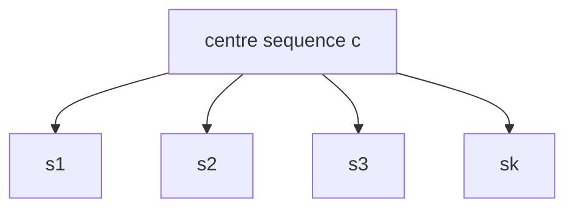
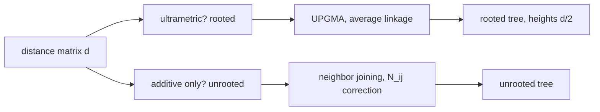

# FSA Fragenkatalog — Part 4 (§10–§11)

Questions Q10.1–Q11.4 of the exam question catalogue with the handwritten answers
(fsa_fragenkatalog, pp. 8–9 for the questions, pp. 31–36 for the answers). Hub:
[[fsa-fragenkatalog]]. Previous part: [[fsa-fragenkatalog-3]].

## §10 — MSAs (multiple sequence alignments)

Definition, the two cost models, the k-dimensional DP matrix, star alignment and its bound, pruning
the exact DP, and iterative methods.

**Q10.1** State the properties a multiple alignment of `k ≥ 2` sequences `s₁, …, s_k` must satisfy.
**A** (p. 31) There must be a row length `ℓ ≥ 1` and rows `s₁', …, s_k'` with:

1. `ℓ ≥ 1` such that `s_i' ∈ (A ∪ {−})^ℓ` for all `i`, `1 ≤ i ≤ k` — all rows equally long;
2. `delgap(s_i') = s_i` for all `i`, `1 ≤ i ≤ k` — deleting the gap symbols recovers the input;
3. for all `j`, `1 ≤ j ≤ ℓ`, there is at least one `i` with `s_i'[j] ≠ −` — no all-gap column.

→ [[multiple-sequence-alignment]]

**Q10.2** Describe the *consensus cost model* (Konsensus Kostenmodell).
**A** (p. 31)

1. Counts: `count(j, a) = |{ i | 1 ≤ i ≤ k, s_i'[j] = a }|`.
2. Consensus: the sequence `cons` with
   `count(j, cons[j]) ≥ count(j, a)` for all `a ∈ A` — at every column, the most frequent
   character.
3. Distance:
   `dist(cons, MSA) = Σ_{j=1}^{ℓ} ( k − count(j, cons[j]) ) = conscost(MSA)`

which is to be **minimised**. → [[multiple-sequence-alignment]]

**Q10.3** Describe the *sum-of-pairs cost model*.
**A** (p. 32) Sum the scores of all pairs of characters/gaps in each column:

`δ_SP(s₁'[j], …, s_k'[j]) = Σ_{l=1}^{k-1} Σ_{r=l+1}^{k} s( s_l'[j] → s_r'[j] )`

and the SP alignment cost is the sum over columns:

`δ_SP(s₁', …, s_k') = Σ_{j=1}^{ℓ} δ_SP(s₁'[j], …, s_k'[j])`

which is to be **minimised**. → [[multiple-sequence-alignment]]

**Q10.4** Which properties does the matrix `M` have when a multiple alignment of `k` sequences of
lengths `n₁, …, n_k` is computed? Not the recurrence.
**A** (p. 32) `M` is an `(n₁+1) × … × (n_k+1)` matrix indexed by
`(q₁, …, q_k) ∈ [0, n₁] × … × [0, n_k]`, and `M(q₁, …, q_k)` is the score of the optimal MSA of the
prefixes `s₁[1..q₁], …, s_k[1..q_k]`. → [[multidimensional-dp-msa]]

**Q10.5** How many entries does `M` have, and in which running time can it be computed?
**A** (p. 32) `z = ∏_{i=1}^{k} (n_i + 1)` entries, computable in

`O( z · f(k) · 2^k )`

where the `2^k` counts the predecessors of a cell (every non-empty subset of the `k` dimensions may
be decremented) and `f` depends on the scoring function.
→ [[multidimensional-dp-msa]]

**Q10.6** Describe the *star alignment* method (Stern-Alignment-Verfahren) for a sequence set `S`.
**A** (p. 33)

1. Identify the **centre sequence** `c`.
2. Construct, from the optimal pairwise alignments of `c` with every other sequence, an MSA that is
   compatible with all of these pairwise alignments ("once a gap, always a gap" propagation).

The alignment tree is a star: centre `c` in the middle, one edge per sequence, each edge being an
optimal pairwise alignment. → [[star-alignment]]



Each edge is an optimal pairwise alignment; the MSA is assembled so as to be compatible with all
of them.

**Q10.7** Give the smallest possible upper bound for the sum-of-pairs score of the star alignment
relative to the optimal MSA.
**A** (p. 33)

`δ_SP(MSA_star) ≤ (2 − 2/k) · δ_opt-sp(s₁, …, s_k)`

i.e. the star alignment is a `(2 − 2/k)`-approximation of the optimal SP MSA.
→ [[star-alignment]]

**Q10.8** How can the exact method for optimal MSAs be combined with a heuristic (e.g. star
alignment) in order to accelerate it?
**A** (p. 33) Use `δ_SP(MSA_star)` as an **upper bound** for `δ_opt-sp`. During the DP, if an entry
`M(…) = d > δ_SP(MSA_star)`, then `d > δ_opt-sp` — stop; such a cell can never lie on an optimal
path. In short: never compute an entry of `M` larger than `δ_SP(MSA_star)`.
→ [[multidimensional-dp-msa]], [[star-alignment]]

**Q10.9** Advantages and disadvantages of *iterative* multiple alignment methods?
**A** (p. 34)

| | |
|---|---|
| **+** | fast algorithms for many and long sequences |
| **+** | conservation in subfamilies that are aligned better ⇒ high-quality MSA |
| **−** | errors in an early step persist: "once a gap, always a gap" |
| **−** | no well-defined objective function to optimise |
| **−** | the guide tree may be biased |

→ [[progressive-alignment]], [[multiple-sequence-alignment]]

## §11 — Phylogeny (Phylogenie)

UPGMA, its distance preconditions, cluster distance, and neighbor joining.

**Q11.1** Describe the UPGMA method for reconstructing *rooted* phylogenetic trees.
**A** (p. 35)

1. Start with one node `x_i` per taxon, representing a cluster `C_i`, placed at height zero.
2. Determine the pair `(C_i, C_j)` with `d(C_i, C_j)` minimal.
   - Create a new cluster `C_k = C_i ∪ C_j`.
   - Compute `d(C_k, C_ℓ)` for all remaining clusters `C_ℓ`.
   - Create a new node `k` with children `i, j` at height `½ · d(C_i, C_j)`.
3. When two clusters remain, place the root at height `½ · d(C_i, C_j)`.

```text
ALGORITHM UPGMA(X, d)
  for each x in X:  create cluster C_x <- {x} at height 0
  while number of clusters > 2:
    (C_i, C_j) <- argmin over pairs of d(C_i, C_j)
    C_k <- C_i union C_j
    height(k) <- d(C_i, C_j) / 2
    make i and j children of k
    for each remaining cluster C_l:  compute d(C_k, C_l)
    remove C_i, C_j;  add C_k
  place root at height d(C_i, C_j) / 2
```

→ [[upgma]], [[phylogenetic-tree]]

**Q11.2** Which preconditions must the distance function `d` satisfy for UPGMA to reconstruct the
correct rooted tree? Define these properties.
**A** (p. 35)

1. `d` is **additive** w.r.t. `T_X` if it is obtained by adding up the edge lengths along the paths
   between the leaves of `T_X`.
2. `d` is **ultrametric** iff every leaf in `T_X` has the same distance to the root — equivalently,
   iff for all triples `(x,y,z) ∈ X × X × X` the three distances `d(x,y), d(x,z), d(y,z)` are such
   that either (i) all three are equal, or (ii) two are equal and the third is smaller.

→ [[ultrametric]], [[upgma]], [[phylogenetic-tree]]

> [!warning]
> The three-point condition is stated here with the odd distance **smaller**; the standard
> ultrametric three-point condition has the two equal values being the **largest**. Both phrasings
> describe the same configuration viewed from different ends — but check which direction the
> lecture's own definition uses before quoting it.

**Q11.3** For disjoint subsets `C_i`, `C_j ⊆ X`, define `d(C_i, C_j)`.
**A** (p. 36) The average linkage distance:

`d(C_i, C_j) = ( 1 / (|C_i|·|C_j|) ) · Σ_{x ∈ C_i} Σ_{y ∈ C_j} d(x,y)`

→ [[upgma]]

**Q11.4** Describe the *neighbor-joining* method for reconstructing *unrooted* phylogenetic trees.
**A** (p. 36) Introduce the corrected distance

`N_ij = d(i,j) − (r_i + r_j)` with `r_i = ( 1/(n−2) ) · Σ_{x ∈ L} d(i,x)`

1. Every leaf becomes a node in `T`; set `L ← T`.
2. Compute `N` and find the pair `i, j` minimising `N_ij`.
   - Add a new node `k` and update the distances `d(k,m)` for all `m ∈ L \ {i,j}`.
   - Add `k` to `T` and construct edges to `i` and `j`.
   - Remove `i` and `j` from `L`, add `k` to `L`.
3. When two nodes remain, add the edge `i, j` with length `d(i,j)`.

→ [[neighbor-joining]], [[phylogenetic-tree]]



## Related

- [[fsa-fragenkatalog]] — the hub: usage guidance, section map, complexity summary.
- [[fsa-fragenkatalog-3]] — previous part: Fasta, Blast, PSSMs, linear-space alignment.
- [[multiple-sequence-alignment]] — the definition and the two cost models of Q10.1–Q10.3.
- [[multidimensional-dp-msa]] — the k-dimensional matrix `M` of Q10.4, Q10.5, Q10.8.
- [[star-alignment]] — the heuristic and the `2 − 2/k` bound of Q10.6–Q10.8.
- [[progressive-alignment]] — the iterative family evaluated in Q10.9.
- [[upgma]] — the rooted-tree algorithm of Q11.1–Q11.3.
- [[ultrametric]] — the precondition that makes UPGMA correct.
- [[neighbor-joining]] — the unrooted alternative of Q11.4.

## Sources

- `raw/foundations_sequence_analysis_fragenkatalog.pdf`, pp. 8–9 (questions), pp. 31–36 (answers)
