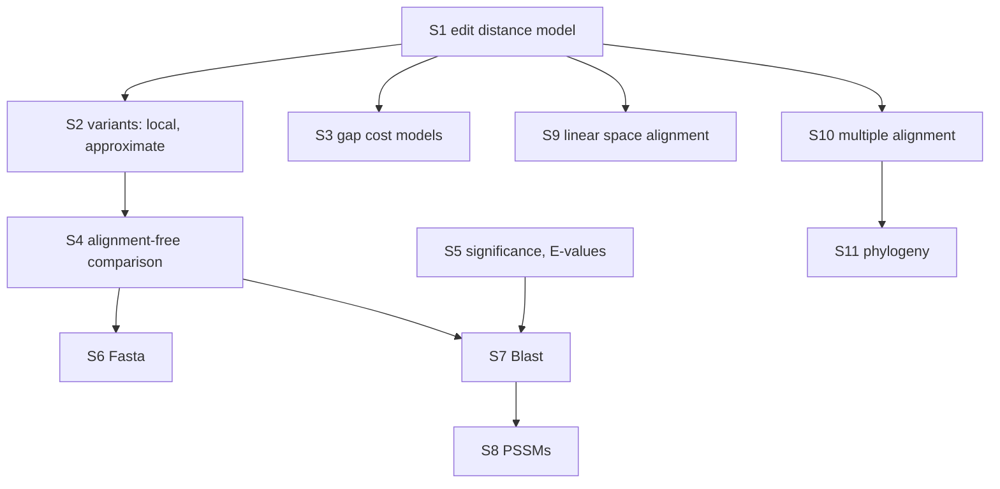

# FSA Fragenkatalog — Exam Question Catalogue (hub)

The official exam-preparation question catalogue (Fragenkatalog) for the module **Grundlagen der
Sequenzanalyse / Foundations of Sequence Analysis**, issued by AG Genominformatik (Stefan Kurtz),
Universität Hamburg, Zentrum für Bioinformatik, dated 30 January 2023
(fsa_fragenkatalog, p. 1). Pages 1–9 are the printed German questions; pages 10–36 are the
handwritten answers. Both halves are reproduced here in English, question by question.

This hub carries the usage guidance, the section map and the links. The questions themselves live
in four part pages:

| Part | Sections | Questions | Page |
|---|---|---|---|
| 1 | §1–§2 | Q1.1–Q2.7 | [[fsa-fragenkatalog-1]] |
| 2 | §3–§5 | Q3.1–Q5.3 | [[fsa-fragenkatalog-2]] |
| 3 | §6–§9 | Q6.1–Q9.3 | [[fsa-fragenkatalog-3]] |
| 4 | §10–§11 | Q10.1–Q11.4 | [[fsa-fragenkatalog-4]] |

## How to use this page

1. **Drill by section, not by page order.** Each `##` section below names the one thing that
   section tests. Read the section description, close the wiki, and try to reproduce the
   *definitions and recurrences* from memory — those are what the catalogue actually asks for.
   Roughly half the questions are "define X precisely", a quarter are "state the recurrence", and
   the rest are complexity or worked-example questions.
2. **Answer first, then open the part page.** Every question in the part pages is followed by the
   answer condensed from the handwritten sheets. Cover the answer, write yours, compare.
3. **Follow the wikilink when you are wrong.** Each answer links to the concept page carrying the
   full derivation, worked example and pitfalls. The catalogue is an *index into the wiki*, not a
   replacement for it.
4. **Memorise the four matrices.** `E_δ` (global, min), `L_σ` (local, max with the extra `0`),
   `D_δ` (approximate matching, first row all `0`), `M` (k-dimensional MSA). Several questions do
   nothing but ask for one of these, its *property* (not the recurrence) or its *recurrence* (not
   the property) — read which one is being asked.
5. **Rehearse the three hand-computations.** Q1.13 (fill the last column of an edit matrix),
   Q9.3 (read a marked path off an edit graph, produce the crosspoint list and the two-row
   alignment) and Q4.10 (`aaca` vs `acacaacc`, result 6) are the only questions with concrete
   numbers; they are the most likely to appear verbatim.
6. **Know the complexity table by heart** — see the summary below.

> [!warning]
> The catalogue repeatedly distinguishes *"the definition is asked for, **not** the recurrence"*
> (Q1.11, Q2.1, Q10.4) from *"state the recurrence"* (Q1.12, Q2.2). Answering the wrong one scores
> zero even if the mathematics is right.

## Complexity summary across the catalogue

| Quantity | Time | Space | Question |
|---|---|---|---|
| `edist_δ`, distance only | `O(mn)` | `O(min{m,n})` | Q1.14 |
| Approximate matching `D_δ` | `O(mn)` | `O(m)` without traceback | Q2.5 |
| `edist_δ`, general gap costs | `O(mn(n+m))` | — | Q3.2 |
| `mmdist(v,u)` | `O(|A|(m+n))` | `O(m)` | Q4.3 |
| `qgdist(u,v)` | `O(m+n+r^q)` | `O(m+n+r^q)` | Q4.9 |
| q-gram hit counting | `O(m+n+r^q)` | `O(r^q)` | Q4.10 |
| Mash sketch, `q ∈ O(log s)` | `O(m(q+log s)) = O(m log s)` | `O(s)` | Q4.13 |
| PSSM search | `O(kn)`, worst case `O(mn)` | — | Q8.2 |
| Linear-space alignment | `O(mn)`, depth `O(log₂ n)` | linear | Q9.2 |
| k-dimensional MSA DP | `O(z·f(k)·2^k)`, `z = ∏(n_i+1)` | `O(z)` | Q10.5 |

## §1 — The model of edit distance

Edit operations, alignments, cost functions, `edist_δ`, the matrix `E_δ` and its recurrence,
traceback, the edit graph, elementary graph theory, and antidiagonal evaluation order.
22 numbered items (Q1.1–Q1.19 plus Q1.20.1–Q1.20.3). → [[fsa-fragenkatalog-1]]

## §2 — Variants of the edit-distance model

Local alignment (`L_σ`, Smith–Waterman), approximate string matching (`D_δ`), the maximum length of
an approximate hit, and the overlap problem in assembly. 7 items. → [[fsa-fragenkatalog-1]]

## §3 — Special gap costs

Generalising linear gap costs to the general gap-cost model, the cost of that generality, and the
definition of affine gap costs. 3 items. → [[fsa-fragenkatalog-2]]

## §4 — Sequence comparison without alignments

Maximal matches (`mmdist`, `mmm`), q-word profiles and `qgdist`, q-word integer coding and its
rolling update, q-word hit counting, the Jaccard index, Mash sketches and the Poisson model.
16 items. → [[fsa-fragenkatalog-2]]

## §5 — Significance computation of alignments

E-values as expected counts under a random model, the bijection argument for maximal exact hits,
and binomial counting. 3 items. → [[fsa-fragenkatalog-2]]

## §6 — Fasta

`score_fasta` via hot spots per diagonal, the properties of the query table `h_w`, and the scan that
turns `h_w` into diagonal counters. 3 items. → [[fsa-fragenkatalog-3]]

## §7 — Blast

The blast hit as a *scored* seed, the k-environment `Env_k(w)`, and the two-hit strategy with
X-drop ungapped extension. 3 items. → [[fsa-fragenkatalog-3]]

## §8 — PSSMs

The PSSM as a function `A × {1..m} → R`, its derivation from a family MSA, and PSSM score / hit /
search complexity. 2 items. → [[fsa-fragenkatalog-3]]

## §9 — Alignment in linear space

Crosspoints `C(j)`, their value range and monotonicity, the recursion depth and the geometric-series
running-time argument, and the worked `acactcag` / `actacacg` example. 3 items.
→ [[fsa-fragenkatalog-3]]

## §10 — Multiple sequence alignments

The three defining properties of an MSA, the consensus and sum-of-pairs cost models, the
k-dimensional matrix `M`, its size and cost, star alignment and its `2 − 2/k` bound, using that
bound to prune the exact DP, and the trade-offs of iterative methods. 9 items.
→ [[fsa-fragenkatalog-4]]

## §11 — Phylogeny

UPGMA, the additive and ultrametric preconditions, cluster distance, and neighbor joining.
4 items. → [[fsa-fragenkatalog-4]]

## Topic map

The arc the catalogue follows: define the edit-distance model exactly (§1), bend it into local,
approximate and gapped variants (§2–§3), abandon alignment entirely when the data is too large
(§4), ask when a result is believable (§5), reintroduce alignment behind cheap filters (§6–§8),
fix alignment's space cost (§9), and finally lift it from two sequences to many and to trees
(§10–§11).

## Which wiki page answers which section

| Section | Primary concept pages |
|---|---|
| §1 | [[alignment]], [[edit-operation]], [[cost-function]], [[edit-distance-dp]], [[edit-graph]], [[counting-alignments]], [[unit-edit-distance]] |
| §2 | [[smith-waterman]], [[local-similarity]], [[score-function]], [[approximate-string-matching]], [[fragment-assembly]], [[overlap-alignment]] |
| §3 | [[gap-cost-model]], [[gotoh-affine-gap-alignment]] |
| §4 | [[maximal-matches-distance]], [[q-gram]], [[q-gram-distance]], [[match-count]], [[jaccard-index]], [[minhash-sketch]], [[mash-distance]], [[suffix-tree]] |
| §5 | [[alignment-significance]], [[karlin-altschul-statistics]] |
| §6 | [[fasta-database-search]] |
| §7 | [[blast]] |
| §8 | [[position-specific-scoring-matrix]], [[pssm-lookahead-search]] |
| §9 | [[hirschberg-linear-space-alignment]] |
| §10 | [[multiple-sequence-alignment]], [[multidimensional-dp-msa]], [[star-alignment]], [[progressive-alignment]] |
| §11 | [[phylogenetic-tree]], [[ultrametric]], [[upgma]], [[neighbor-joining]] |

## Related

- [[fsa-fragenkatalog-1]] — §1–§2: the edit-distance model and its local/approximate variants.
- [[fsa-fragenkatalog-2]] — §3–§5: gap costs, alignment-free comparison, significance.
- [[fsa-fragenkatalog-3]] — §6–§9: Fasta, Blast, PSSMs, linear-space alignment.
- [[fsa-fragenkatalog-4]] — §10–§11: multiple alignment and phylogeny.
- [[fsa_fragenkatalog]] — the source page for the catalogue PDF, with scope and open questions.
- [[edit-distance-dp]] — the single most-tested object in the catalogue.
- [[multiple-sequence-alignment]] — §10 is the longest section after §1 and §4.

## Sources

- `raw/foundations_sequence_analysis_fragenkatalog.pdf`, pp. 1–36
  (cited as `fsa_fragenkatalog, Qn.m` / `fsa_fragenkatalog, p. N`)
