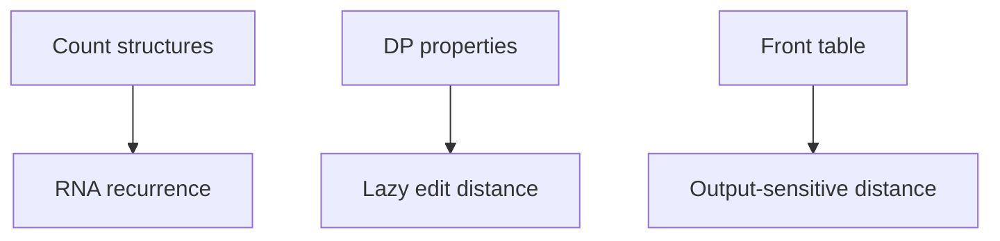

# Sheet 03

## Definition

Sheet Ü3 exercises RNA secondary-structure counting, unit edit-distance DP properties, lazy evaluation, and output-sensitive front tables (gik_3_4, pp. 10, 13, 16, 27).

## Why it matters

It checks mechanics behind [[rna-secondary-structure]], [[unit-edit-distance]], [[lazy-edit-distance]], and [[output-sensitive-edit-distance]].

## Construction / Mechanism



## Exercise procedures

### 3.1 Counting structures

The recurrence assumes `l_min=1` and all bases can pair. Counts shown are `S(1)=1`, `S(2)=1`, `S(3)=2`, `S(4)=4`, `S(5)=8` (gik_3_4, p. 10).

```text
ALGORITHM CountRNA(n)
  if n = 1 or n = 2:
    return 1
  prod_sum <- 0
  for i = 1 to n - 2:
    prod_sum <- prod_sum + CountRNA(i) * CountRNA(n - i - 2)
  return CountRNA(n - 1) + CountRNA(n - 2) + prod_sum
```

### 3.2/3.3 Edit-distance properties

The proof compares neighbouring DP entries and splits into match/mismatch cases. This justifies the reduced lazy recurrence (gik_3_4, pp. 13, 16).

```text
PROCEDURE ProveNeighbourBound(E)
  for each cell (i,j):
    compare E[i][j] with E[i-1][j], E[i][j-1], and E[i-1][j-1]
    use one edit operation to show the value can rise by at most 1
    use the reverse operation to show the value can fall by at most 1
    handle w[i] = v[j] separately on the diagonal
```

### 3.4 Front computation

The notes trace `front(h,d)` for `0≤d≤3`; only diagonals with the parity of `d` are present (gik_3_4, p. 27).

## Complexity

| Task | Time | Space |
|---|---:|---:|
| Naive recursive count | exponential | `O(n)` recursion |
| Memoised count | `O(n^2)` | `O(n)` |
| Check DP properties over a table | `O(mn)` | existing table |
| Fronts through fixed `d=3` | constant | constant |

## Worked example

`CountRNA(4)=CountRNA(3)+CountRNA(2)+CountRNA(1)·CountRNA(1)=2+1+1=4`, matching the note's table (gik_3_4, p. 10).

## Pitfalls & exam traps

> [!warning]
> - The counting task is not the energy minimisation recurrence.
> - Front generation uses diagonals `-d,-d+2,...,d`.
> - The edit-distance proofs depend on unit costs.

## Related

- [[rna-secondary-structure]] — structures being counted.
- [[lazy-edit-distance]] — uses the DP properties.
- [[output-sensitive-edit-distance]] — uses the front table.

## Sources

- gik_3_4, pp. 10, 13, 16, 27
