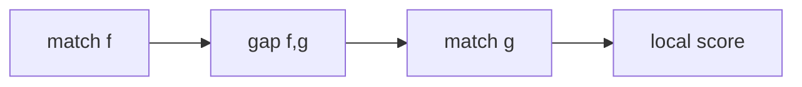

# Sheet 04

## Definition

Sheet Ü4 extends [[match-chaining]] to local chaining by subtracting gap costs between consecutive matches and gives a bounded-predecessor DP (gik_3_4, pp. 35-36).

## Why it matters

Local chaining rewards anchor weight but penalises uncovered sequence between anchors, closer to local alignment quality (gik_3_4, p. 35).

## Construction / Mechanism



For `f<<g`, `gap(f,g)=s(g).x-e(f).x-1 + s(g).y-e(f).y-1` (gik_3_4, p. 35).

## Exercise procedures

```text
ALGORITHM LocalChaining(matchCollection[1..b], p)
  overall <- 0
  best <- nil
  for j = 1 to b:
    maxscore <- weight(matchCollection[j])
    predecessor[j] <- nil
    for i = max(1, j - p) to j - 1:
      if matchCollection[i] << matchCollection[j]:
        candidate <- score[i] + weight(matchCollection[j]) - gap(matchCollection[i], matchCollection[j])
        if candidate > maxscore:
          maxscore <- candidate
          predecessor[j] <- i
    score[j] <- maxscore
    if overall < maxscore:
      overall <- maxscore
      best <- j
  return overall, best, predecessor
```

## Complexity

| Procedure | Time | Space |
|---|---:|---:|
| Inspect at most `p` predecessors | `O(p·b)` | `O(b)` |
| Full predecessor scan | `O(b^2)` | `O(b)` |

## Worked example

If `weight(f)=5`, `weight(g)=6`, and `gap(f,g)=3`, the two-match local score is `5+6-3=8`, better than `g` alone. If the gap were 7, `g` alone would win (gik_3_4, pp. 35-36).

## Pitfalls & exam traps

> [!warning]
> - Initialise each match as a one-match chain.
> - Subtract gaps only between adjacent matches.
> - Bounded `p` is an algorithmic restriction; `p=b` recovers the quadratic scan.

## Related

- [[match-chaining]] — global predecessor relation.
- [[match-chaining-algorithm]] — global and local complexity comparison.
- [[anchor-based-sequence-comparison]] — uses chains as anchors.

## Sources

- gik_3_4, pp. 35-36
