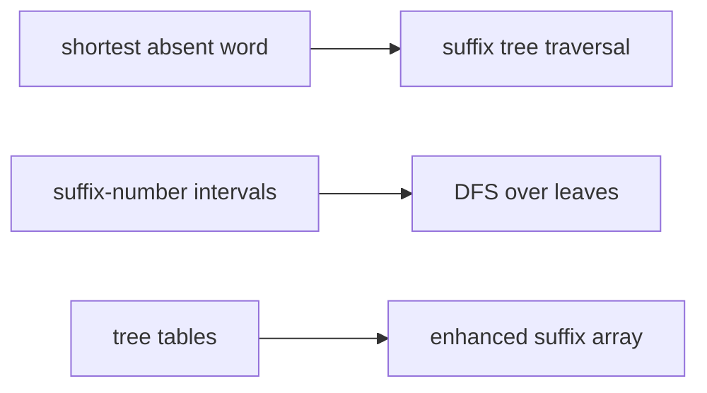

# Sheet 05

## Definition

Sheet 5 practises suffix-tree applications and representations: shortest absent words, suffix
number intervals for nodes, table-based suffix-tree storage, and enhanced suffix arrays
(gik_5, pp. 38-45).

## Why it matters

The lecture pages give suffix-tree applications; the sheet asks how to implement them with compact
annotations rather than storing large sets at every node (gik_5, pp. 38-42).

## Construction / Mechanism



## Pseudocode

Exercise procedures with more than two steps are expanded on [[shortest-absent-word]] and
[[enhanced-suffix-array]]. The interval procedure is:

```text
ALGORITHM SuffixNumberIntervals(T)
  number leaves from left to right in suffix-array order
  for each node v in postorder:
    if v is a leaf:
      interval(v) <- [rank(v), rank(v)]
    else:
      a <- minimum left endpoint over children of v
      b <- maximum right endpoint over children of v
      interval(v) <- [a, b]
  return interval
```

## Complexity

| Exercise task | Time | Space |
|---|---:|---:|
| Shortest absent word, constant alphabet | `O(n)` | `O(n)` |
| Suffix-number intervals | `O(n)` | `O(n)` |
| Table representation | `O(n+q)` worst case noted for branch rows | `O(n+q)` |
| Enhanced suffix array generation | `O(n)` | `O(n)` |

## Worked example

For `S=abab$`, left-to-right suffix order is `ab$`, `abab$`, `b$`, `bab$`, `$` in the sketch on
p. 41. The node for prefix `ab` has an interval covering the two suffixes starting with `ab`; the
stored pair `[a,b]` replaces an explicit set of suffix numbers (gik_5, p. 41).

## Pitfalls & exam traps

> [!warning]
> - An interval works only after leaves are ordered lexicographically as suffix-array leaves.
> - The table representation may need `q` branch rows; worst case `q=n`, so quote the total
>   bound, not only the leaf table (gik_5, p. 42).
> - In enhanced suffix arrays, `lcp` intervals correspond to internal nodes, not leaves
>   (gik_5, p. 45).

## Related

- [[suffix-tree]] — common structure behind all sheet tasks.
- [[shortest-absent-word]] — exercise 5.1 in algorithm-page form.
- [[enhanced-suffix-array]] — final sheet topic and suffix-tree replacement.
- [[gik_5]] — source page for unit 5.

## Sources

- gik_5, pp. 38-45
