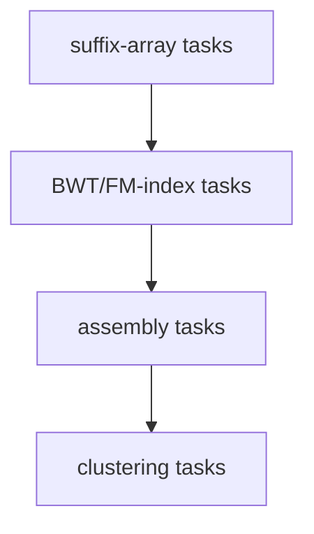

# Sheet 06

## Definition

Unit-6 exercise material consolidates suffix-array/BWT operations, assembly graph procedures and
final clustering computations. The source lacks explicit exercise headings, so this page follows
the worked algorithms and examples in order (gik_6, pp. 1-32).

## Why it matters

These are the likely exam mechanics: compute an interval, follow LF, decide whether greedy
assembly is valid, and compute density-peak quantities.

## Construction / Mechanism



## Pseudocode

```text
ALGORITHM SolveUnit6ProcedureTask(input)
  identify whether the input is a string index, assembly graph, or point set
  if it is a string index:
    compute SUF/LCP/BWT interval operations with explicit ranks
  if it is an assembly graph:
    choose overlaps while enforcing path constraints
  if it is a point set:
    compute distances, rho, delta, centres, and assignments
  return the requested interval, path, superstring, or clustering
```

## Exercises

### 6.1 LCP local maxima and supermaximal repeats

Find local maxima in `LCP`. For each interval, test whether the preceding and following context
characters are pairwise distinct. Only candidates passing the context test are supermaximal
(gik_6, pp. 1-2).

### 6.2 Suffix-array exact matching

Run `FirstRank` and `LastRank` from [[suffix-array-pattern-matching]]. The answer is the interval
`[l,r]` and occurrences `SUF[l],...,SUF[r]`; a single hit is not enough (gik_6, pp. 4-6).

### 6.3 BWT/LF reconstruction and FM-index search

Build `bwt[i]` from the character before `SUF[i]`, compute ranks in the last column, then use
`LF(i)=count[bwt[i]]+R_bwt(bwt[i],i)-1`. Backward search processes the pattern from right to left
(gik_6, pp. 9-15).

### 6.4 Greedy assembly path

Sort overlap edges by decreasing weight. Accept an edge only if it does not give a node two chosen
incoming edges, two chosen outgoing edges, or close a premature cycle. Stop at `|F|-1` edges
(gik_6, pp. 23-26).

### 6.5 Density-peak clustering

Compute pairwise Euclidean distances, local densities, `delta` to the nearest higher-density
point, choose centres and assign every other point to the cluster of its nearest higher-density
neighbour (gik_6, pp. 29-31).

## Complexity

| Procedure | Time | Space |
|---|---:|---:|
| Suffix-array binary interval | `O(m log n)` | `O(1)` |
| FM-index backward interval | `O(m)` with constant rank | `O(1)` extra |
| Greedy edge selection after graph construction | `O(ell+n^2)` in notes | `O(n^2)` |
| Density-peak clustering | `O(n^2 m + n^2)` | `O(n^2)` |

## Worked example

For fragments `ATG`, `TGCAT`, `GGA`, overlaps `GGA -> ATG` of length `1` and `ATG -> TGCAT` of
length `2` form a Hamiltonian path. The superstring is produced by appending only the non-overlap:
`GGA` + `ATG` without first `G` + `TGCAT` without first `TG` = `GGATGCAT`.

## Pitfalls & exam traps

> [!warning]
> - In BWT tasks, rank equal characters by occurrence count, not by row number.
> - Greedy assembly can be valid as a Hamiltonian path but still non-optimal.
> - In density-peak tasks, a high-`delta` low-density point is often an outlier, not a main centre.

## Related

- [[gik_6]] — source summary for the whole unit.
- [[fm-index-backward-search]] — exact BWT-index exercise procedure.
- [[greedy-fragment-assembly]] — graph/path exercise procedure.
- [[density-peak-clustering]] — final clustering exercise procedure.

## Sources

- gik_6, pp. 1-32
