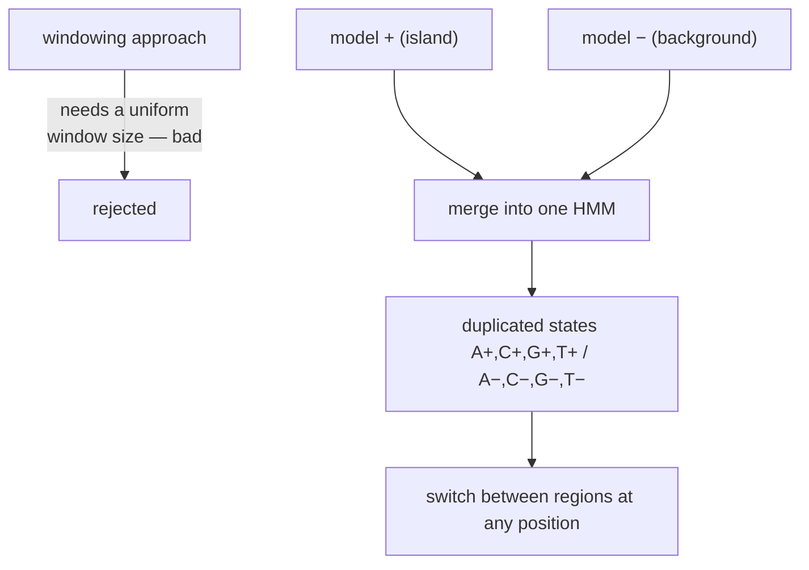
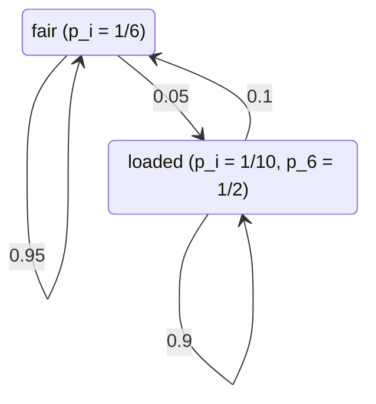

# Hidden Markov Model (HMM)

## Definition

A **Hidden Markov Model** (verborgenes Markov-Modell) couples a hidden state sequence, which
evolves like a [[markov-chain]], with an observable symbol sequence emitted state by state.
The defining property: **the sequence of symbols is known, the sequence of states is hidden**
(gik_1_2, p. 15).

## Formal definition

A **Hidden Markov Model** is a quadruple `M = (Σ, Q, A, e)` (gik_1_2, p. 15):

| Component | Meaning |
|---|---|
| `Σ` | an alphabet |
| `Q` | a set of states |
| `A = (a_{s,t})_{s,t ∈ Q}` | matrix of transition probabilities, for all `s, t ∈ Q` |
| `e_q(b)` | emission probabilities, for all `q ∈ Q`, `b ∈ Σ` |

`e_q(b)` is the probability that symbol `b` is emitted in state `q`.

- The probability of the **state sequence** behaves as in a [[markov-chain]] — it depends only
  on the previous state.
- The probability of the **symbol sequence** depends on the state sequence.

## Why it matters — from two models to one

Question 2 of [[cpg-island]] is: how to detect CpG islands inside a long sequence? Using windows
would be bad, because it forces a uniform window size (gik_1_2, p. 15). Instead, **merge the two
models `+` and `−`** into a single model with duplicated states `A+, C+, G+, T+` and
`A−, C−, G−, T−`. The model can now switch between island and non-island regions at any
position, with no window parameter at all.



## Paths and joint probability

Use an HMM to **generate** data: start in (alias) state `b`, written state `0`. While the state
is not `0` (alias `e`), choose a state using the transition probability, then choose a symbol
using the emission probability (gik_1_2, p. 16).

A **path** `π = (π₁, …, π_ℓ)` is a sequence of states in the HMM `M`.

Given a sequence of symbols `x[1..ℓ]` and a path `π`, the **joint probability** is:

```
P(x, π) = a_{0, π₁} · ∏(i = 1 to ℓ) e_{π_i}(x[i]) · a_{π_i, π_(i+1)}       with π_(ℓ+1) = 0
```

For CpG islands: a path determines which parts of the sequence `x` are classified as CpG
islands, namely the maximal subpaths consisting of `+` states only (gik_1_2, p. 16).

## Worked example — the dishonest casino (gik_1_2, p. 15)



Outcome: `6 5 4 3 6 6`. The symbols are observed; the sequence of states (which die was used at
each roll) is hidden. Recovering it is the decoding problem.

## The three problems

Let `M` be an HMM and `x` a sequence (gik_1_2, p. 16):

| Problem | Task | Algorithm |
|---|---|---|
| **Decoding** | determine the most probable sequence of states in `M` generating `x` | [[viterbi-algorithm\|Viterbi]] |
| **Evaluation** | determine the probability that `M` generates `x`, i.e. `P(x \| M)` | [[forward-algorithm\|Forward]] or [[backward-algorithm\|Backward]] |
| **Learning** | given some set of sequences of symbols, train the parameters of `M` | [[baum-welch-algorithm\|Baum–Welch]] |

See [[hmm-three-problems]] for the comparison in detail.

## Parameters and how they are estimated

See [[hmm-parameter-training]]: with known state sequences the parameters are plain counts; with
hidden state sequences you need [[baum-welch-algorithm|Baum–Welch]], and
[[pseudocounts]] in both cases to avoid zeros.

## Pitfalls & exam traps

> [!warning]
> - In a [[markov-chain]] the symbols **are** the states; in an HMM they are separate. This is
>   the single most important distinction in unit 2.
> - The emission happens in the state you are **in** at position `i`; the transition
>   `a_{π_i, π_(i+1)}` leads to the *next* state. Mixing up the two shifts the whole product by
>   one index.
> - `π_(ℓ+1) = 0` closes the path at the end state — do not drop the final transition factor.
> - Each state emits with probability 1 per position: `Σ_b e_q(b) = 1` for every `q`.

## Related

- [[markov-chain]] — the observable special case.
- [[hmm-three-problems]] — decoding vs evaluation vs learning.
- [[viterbi-algorithm]], [[forward-algorithm]], [[backward-algorithm]], [[baum-welch-algorithm]].
- [[posterior-decoding]] — the alternative to Viterbi for decoding.
- [[cpg-island]] — the application driving the model.

## Sources

- gik_1_2, pp. 15–16 (unit 2).
