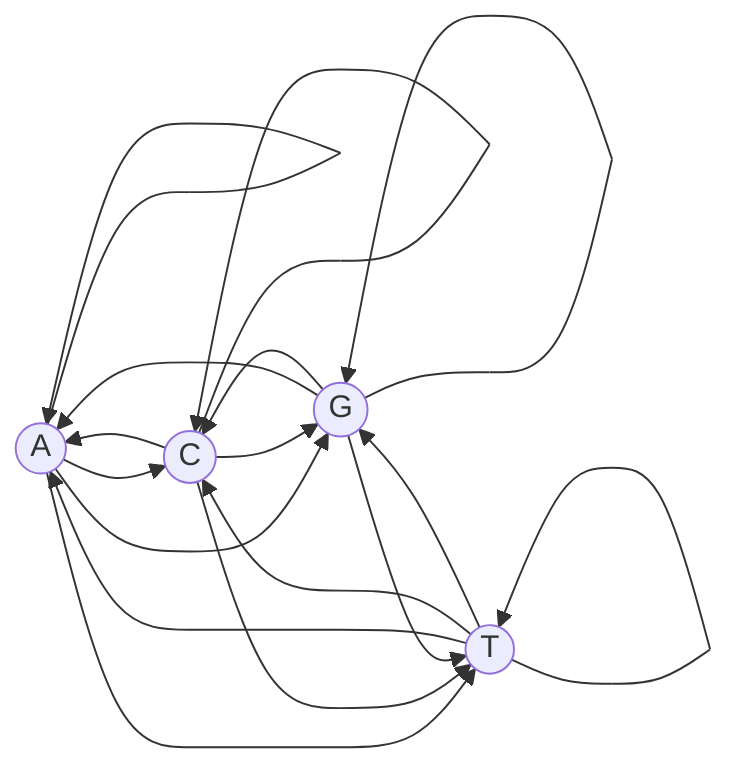
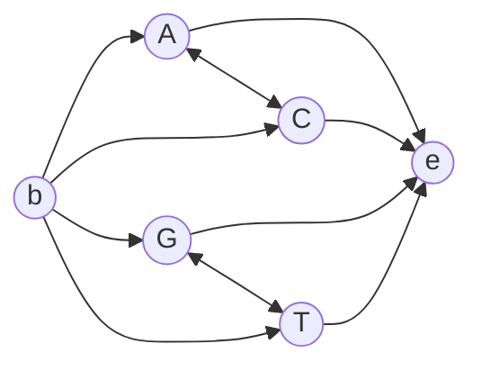

# Markov Chain

## Definition

**The probability of one symbol depends on the probability of its predecessor**
(gik_1_2, p. 12).

## Formal definition

A **time-homogeneous Markov chain of order 1** is a pair `(S, A)` where:

- `S = {s₁, …, s_n}` is a finite **set of states**;
- `A = (a_{s,t})_{s,t ∈ S}` is a **transition matrix** with values in range `[0, 1]`, such that

```
Σ(t ∈ S) a_{s,t} = 1      for all s ∈ S
```

`(S, A)` generates a sequence `x` such that, for all `i`:

```
P(x_i = t | x_(i−1) = s) = a_{s,t}
```

and therefore:

```
P(x) = P(x₁) · ∏(i = 2 to ℓ) a_{x_(i−1), x_i}
```

"Time-homogeneous" means `A` does not change with position `i`.

## Model diagram

For DNA, `S = {A, C, G, T}` and every state can follow every other — 16 transitions, each
labelled `a_{s,t}` for `s → t` (gik_1_2, p. 12):



## Begin and end states

To avoid treating `P(x₁)` specially, add a **begin state** `b` to the Markov model, with
`x₀ = b` (gik_1_2, p. 13):

```
P(x₁ = s) = a_{b,s} = P(s)      where P(s) is the background probability of state s
```

and an **end state** `e`:

```
P(e | x_ℓ = t) = a_{t,e}
```



With begin and end states the sequence probability has no special first factor:

```
P(x) = ∏(i = 1 to ℓ+1) a_{x_(i−1), x_i}      with x₀ = b and x_(ℓ+1) = e
```

## Parameters and how they are estimated

Take a set of DNA sequences divided into two disjoint subsets: one labelled as **CpG**, i.e.
[[cpg-island|CpG islands]], the other labelled **¬CpG** (gik_1_2, p. 13).

**Positive model** — the transition matrix `A⁺` for DNA sequences in CpG islands:

```
             c⁺_{s,t}
a⁺_{s,t} = ──────────────          c⁺_{s,t} = # of positions in the sequences
           Σ(t') c⁺_{s,t'}                    where s is followed by t
```

The **negative model** `A⁻` is estimated analogously from the ¬CpG sequences.

This is [[maximum-likelihood-estimation|MLE]] by counting: the estimate of a transition
probability is its observed relative frequency.

## Worked example

Tiny alphabet `S = {C, G}`, training sequence `CGCGC` (inside an island), with begin/end
ignored. Counts: `C→G` twice, `G→C` twice. So `a_{C,G} = 2/2 = 1` and `a_{G,C} = 2/2 = 1`, while
`a_{C,C} = a_{G,G} = 0`. The probability of `CGC` under this model is `1 · 1 = 1`; the
probability of `CCG` is `0` — a zero that would poison any later product, which is exactly what
[[pseudocounts]] exist to prevent.

## Complexity

| Quantity | Cost |
|---|---|
| Parameter estimation from sequences of total length `n` | `O(n + \|S\|²)` |
| Evaluating `P(x)` for `\|x\| = ℓ` | `O(ℓ)` |
| Size of the transition matrix | `O(\|S\|²)` |

## Pitfalls & exam traps

> [!warning]
> - Rows of `A` sum to 1, **columns do not**. `Σ_t a_{s,t} = 1` is a per-state constraint.
> - Order 1 means dependence on **one** predecessor only. A CpG island is a dinucleotide effect,
>   which is why order 1 suffices here.
> - The state sequence of a Markov chain is **observed** — the symbols *are* the states. That is
>   the one difference from a [[hidden-markov-model]].

## Related

- [[cpg-island]] — the phenomenon being modelled.
- [[log-odds-score]] — compares the `A⁺` and `A⁻` chains to classify a segment.
- [[hidden-markov-model]] — the extension where states are hidden and emit symbols.
- [[probabilistic-model]] — the position-independent model this replaces.

## Sources

- gik_1_2, pp. 12–13 (unit 2).
