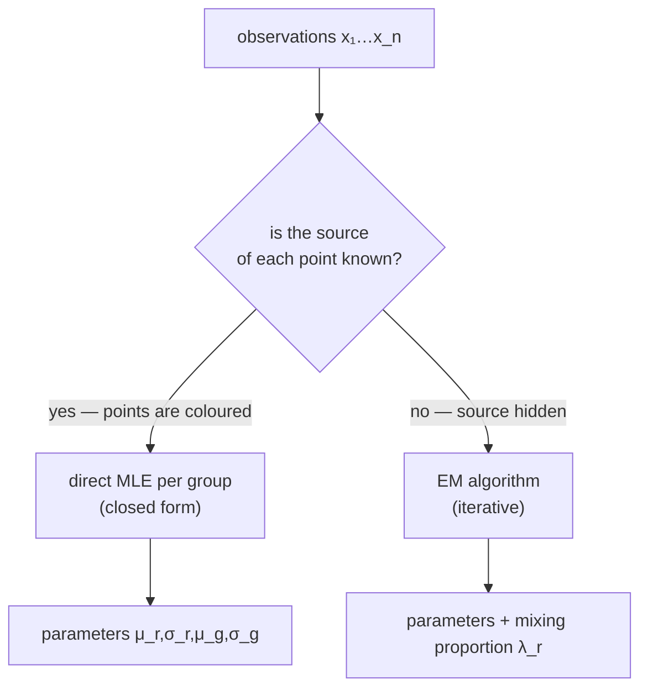

# Mixture Model (1-d)

## Definition

A **mixture model** assumes that observations `x₁, …, x_n` of an experiment come from several
different sources, each with its own distribution. In the 1-d case treated in the lecture, the
observations are generated from **two normal distributions** with unknown parameters
`(μ_r, σ_r)` and `(μ_g, σ_g)` — "red" and "green" (gik_1_2, p. 7).

## Formal definition

| Symbol | Meaning |
|---|---|
| `μ_r, σ_r` | mean and standard deviation of the red normal |
| `μ_g, σ_g` | mean and standard deviation of the green normal |
| `λ_r` | mixing proportion: `P(r) = λ_r`, `P(g) = 1 − λ_r` |
| `Θ` | all of the above together |

Density of a normal (gik_1_2, p. 8):

```
φ(μ, σ, x) = (1 / (σ √(2π))) · e^(−½ ((x − μ)/σ)²)

P(point falls into [a, b]) = ∫(a to b) φ(μ, σ, x) dx
```

Examples from the lecture: genome-wide localisation of transcription factors, clustering of gene
expression points (gik_1_2, p. 7).

## The two cases



### Case 1 — coloured points, source known (gik_1_2, p. 7)

Group similar values into bins and plot the number of values per bin as a bar ⇒ a histogram.
From the points, estimate the parameters of the normals directly by
[[maximum-likelihood-estimation|MLE]], with `R` the set of red indices and `Q` the set of green
indices:

```
μ_r = (1/|R|) Σ(i ∈ R) x_i        σ_r = √( Σ(i ∈ R) (x_i − μ_r)² / |R| )
μ_g = (1/|Q|) Σ(j ∈ Q) x_j        σ_g = √( Σ(j ∈ Q) (x_j − μ_g)² / |Q| )
```

Applying these to the given histogram yields the PDF.

### Case 2 — no colouring, source hidden (gik_1_2, pp. 8–10)

Two kinds of points generated by two normals, **no known source**, and the proportions of the
different points unknown. The [[expectation-maximization|EM algorithm]] is used to estimate the
parameters of the normals *and* the proportion `λ_r` of red points.

`P(x_i | r)` is called the **generative probability**. By Bayes' theorem the **responsibility**
of the red component for point `x_i` is (gik_1_2, p. 9):

```
                 P(x_i | r) P(r)
P(r | x_i) = ─────────────────────────────────
             P(x_i | r) P(r) + P(x_i | g) P(g)

with P(r) = λ_r, P(g) = 1 − λ_r
r_i := P(r | x_i)  for all i ∈ [1, n]
g_i := P(g | x_i) = 1 − P(r | x_i)
```

Parameter update (weighted MLE):

```
μ_r' = Σ r_i x_i / Σ r_i
σ_r' = √( Σ r_i (x_i − μ_r')² / Σ r_i )
λ_r' = (1/n) Σ r_i
```

**A point with large `r_i` has a larger effect on reshaping the normal** (gik_1_2, p. 9) — this
is the intuition for the whole update: responsibilities are soft weights.

## Parameters and how they are estimated

| Parameter | Case 1 (source known) | Case 2 (source hidden) |
|---|---|---|
| `μ_r, μ_g` | plain mean of each colour group | responsibility-weighted mean `Σ r_i x_i / Σ r_i` |
| `σ_r, σ_g` | plain standard deviation per group | responsibility-weighted, using the **new** mean |
| `λ_r` | observed fraction of red points | `(1/n) Σ r_i` |

Case 1 is a single closed-form [[maximum-likelihood-estimation|MLE]] step. Case 2 has no closed
form, so [[expectation-maximization|EM]] alternates responsibility computation (E-step) with the
weighted MLE above (M-step) until the log-likelihood stops increasing (gik_1_2, pp. 8–10).

## Pitfalls & exam traps

> [!warning]
> - The update for `σ_r'` uses the **new** mean `μ_r'`, not the old one (gik_1_2, p. 9).
> - Denominators are `Σ r_i`, **not** `n`. Only `λ_r'` divides by `n`.
> - `r_i` is a *soft* assignment in `[0,1]`, not a hard cluster label. Rounding it to 0/1 turns
>   EM into k-means and changes the answer.
> - In case 1 the standard deviation divides by `|R|`, i.e. the lecture uses the biased
>   (population) estimator, not `|R| − 1`.

## Related

- [[expectation-maximization]] — the algorithm that fits the uncoloured case.
- [[prior-posterior-probability]] — the responsibility is a posterior probability.
- [[maximum-likelihood-estimation]] — the coloured case is plain MLE.
- [[numerical-integration-midpoint]] — how `P(x_i | r)` is computed in practice.

## Sources

- gik_1_2, pp. 7–10 (unit 1).
